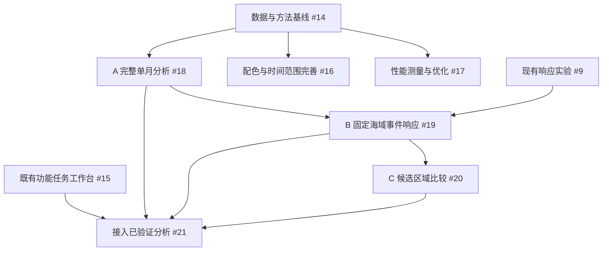

# Ocean 正式任务推进与验收计划

> 2026-10-24总体整理：本文件是当前#13–#21阶段子计划，统一阅读入口、任务顺序和本地状态见[总体规划](ocean-master-plan-2026-10-24.md)。统计细则见[统计协议](../specs/ocean-statistical-analysis-protocol-2026-10-24.md)，预测扩展见[预测协议](../specs/ocean-prediction-experiment-protocol-2026-10-24.md)，可视化实验执行规格见[性能专项](ocean-visualization-performance-plan-2026-10-23.md)。

确认日期：2026-10-22；Q47 整套前端方案于 2026-10-23 在 Q47-36 再确认，恢复按依赖实施。依据本轮逐项讨论及用户最终确认制定。

当前界面规格：[Q47 正式实施基线](../specs/ocean-frontend-redesign-draft-2026-10-23.md)。旧草案、旧截图和模态首版仅为历史证据，不能作为最终验收依据。

2026-10-24 补充：Q48–Q51 均按推荐方案 1 确认。明确 AI 分析指令可直接提交合格任务；服务器重启后安全恢复已提交任务；研究结果分层保留；首版在线模型问答仅本人可用。完整规则已同步总路线，属于已定规格，尚非后端功能完成。

统计/预测和可视化论文优化的具体推进见[方法选型与验证安排](ocean-methods-selection-and-validation-2026-10-24.md)：保留原 #14/#17/#18–#21 依赖，新增方法子项和验收证据，不重复创建总任务。已有统计脚本、候选模型和最终独立验证分别记录，不把规则推演算作完成预测。

权威进度：[执行总纲 #13](https://github.com/NingRuo-code/Ocean/issues/13)。本文是范围、依赖与验收基线；实时状态以关联 Issue、检查证据和 PR 为准。

## 1. 本轮目标与已确认决定

本轮首先服务项目研究、历史分析、结果复核与项目汇报。长期保留实际作业辅助方向，但研究结果不作为已经验证的作业推荐。

1. 主线顺序为 **A 完整单月空间关系 → B 固定海域事件前后响应 → C 候选区域证据比较**。
2. A 先完成一个完整月份并复核，再进入 B；多年同月比较后续扩展。
3. 支持真实数据覆盖范围内任意选点、公里半径和月份，固定示范海域用于回归验收。可选月份由实际联合覆盖决定，不承诺任意历史月份。
4. 研究对象为 **捕捞活动热点 / AIS apparent fishing effort**，不是鱼丰度、渔获量或高产渔场。
5. A 必须有同月对照、有效面积与天数口径、稳定性检查和缺口说明。没有发现稳定关系也属于有效研究结果。
6. B 先固定海域研究锋面接近或经过前后变化；跨日追踪同一条锋面后置。
7. C 首版并列展示证据、优势与不足，由用户判断，不作综合评分或推荐排序。
8. 界面优化并行开展，包含结构调整；配色参考 [NCL 色表](https://www.ncl.ucar.edu/Document/Graphics/color_table_gallery.shtml)，在真实场景上验证可读性。
9. 地图保持首页；工作台通过按钮呼出/收起，首版以任务入口与引导填写整合原有功能。2026-10-23 Q35 补充：必须采用非模态侧边面板，展开时仍可操作地图，居中阻断式弹窗不符合要求。AI 完整后再强化对话；深入结果解释问答单列后续任务。
10. Q47 最终布局：右侧保留“当前 / 历史 / 预测”，AI 移至左侧工作台独立模块。日期、坐标、半径由左侧独立筛选浮层统一设置；图层开关也在左侧，精简图例常驻原地图位置。各模式使用明确时间条件与结果身份；当前指所选观测日，不能暗示历史资料实时。
11. 现有预测保留并标为“实验性趋势推演”，说明基准日期、方法与局限；正式预测独立规划和验证。
12. 无硬性截止，依赖和验收决定进度。助手负责实现、检查、提交推送及 PR；用户审核决定合并；部署单独安排。

旧的 2026-10-21 计划中的双人分工、固定周排期和未确认范围不再作为本轮执行约束。合并清单 A01–A19 是来源索引，不是已完成记录。

## 2. 已有基础与必须补齐的缺口

| 主题 | 可以复用的基础 | 不能据此宣称完成的事情 |
| --- | --- | --- |
| 地图与查询 | 点位、10/20/30 km、日期、锋面/SST、服务器与离线模式 | 任意半径整月联合分析、统一局部覆盖 |
| 数据覆盖 | 本地锋面和 SST 各有 2024 年七、八月逐日导出 | 文件齐全不等于每一天每个海域有效观测齐全；AIS 完整月尚需核实 |
| 数据粒度 | 采集代码支持 0.01°，当前展示路径可见 0.1°约定 | 支持参数不等于细网格已获取；展示网格不是天然合格的研究真源 |
| 历史 | 固定锚点的历史抽样与已导出实况窗口 | 固定锚点/三日样本不能替代任意位置完整月份 |
| 响应 | 既有 Front Response Table 与 #9 实验包 | 旧表不是任意固定海域事件；没有后七天字段不算后七天实验完成 |
| 性能 | RLE、LOD、防抖与缓存实现 | 尚无统一冷热 p50/p95 和完整交互基准，不能宣称加速倍率 |
| 趋势与 AI | 规则推演、本地证据组织和跳转 | 不是独立验证的预测，也不是已完成的自然语言分析助手 |

分析粒度与 ADR-0001 的 0.01°研究目标存在待核对差异。任务 #14 先核查数据；若确需其他粒度，先给出误差与适用尺度依据、评审并更新 ADR/规格，再用于正式研究验收。不能通过界面文案静默改变方法。

## 3. 阶段依赖与验收关口

基础界面与工作台入口可先于研究计算独立交付；月份分析、事件分析与比较入口在对应能力真实完成后开放。使用现有历史功能时必须保留抽样、固定锚点和缺测限制，不能提前改称完整月分析。

| 关口 | 通过条件 | 通过后推进 |
| --- | --- | --- |
| G0 基线可用 | 共同覆盖清单、来源粒度、样本、方法口径和错误状态核实；初始检查记录 | A 正式实现；按实测确定性能目标 |
| GU 首批界面 | 地图仍为首页；工作台可呼出/关闭，已有任务可达；条件不分叉，键盘和窄屏可用 | 界面 PR 可独立审核 |
| GA 单月可信 | 完整月真实样本、异点、边界、缺测、对照和稳定性结果可复核 | B；工作台月度入口 |
| GB 事件可信 | 固定海域事件可复现；时间窗和对照合格；相关样本按组处理 | C；工作台事件入口 |
| GC 比较可用 | 同条件并列证据与不足，不可比原因清楚，无推荐排名 | 本轮分析闭环复核 |

## 4. 工作包与任务清单

### P0 数据、上下文与方法基线 — #14

- P0.1：记录本地提交、线上可核实版本、接口可用性与离线路径；仅有页面截图时不推断部署提交。
- P0.2：逐层逐日核对锋面、SST、AIS 的日期、范围、有效覆盖、粒度、来源与许可。形成可用完整月清单；2024-08 是首选候选，不是已确认联合样本。
- P0.3：明确查询条件：点位、公里半径、日期/月、研究区域、方法/数据版本和请求身份。视野 bbox、搜索圆和锋面缓冲分别表达。
- P0.4：建立状态与分母约定：加载、失败、不可用、覆盖未知、部分覆盖、有效零分别保留；记录有效海域面积、有效天数及共同支持范围。
- P0.5：溯源总量/日均、面积归一、零基线、格点边界和重复归属；列出 ADR 与实际粒度差异以及处理决定。
- 交付：元数据审计脚本、基线报告、覆盖清单、方法规格。只保存允许的聚合与元数据。
- 验收：独立复算能解释数字来源；不能因文件存在、API 返回成功或旧表 status=real 就认定完整分析可用。

### U1 首批地图操作与任务工作台 — #15

- U1.1：地图默认显示；按钮呼出/收起非模态侧边工作台，展开时可拖图、缩放和选点，不加阻断地图的全屏遮罩。支持关闭、Esc、合理焦点管理和可滚动内容；非模态面板不锁住键盘焦点。旧居中模态实现须调整后重新验收。
- U1.2：任务入口复用现有观测、历史、趋势、数据说明，显示实际位置、公里半径与观测日期；不另建一套计算状态。
- U1.3：区分“设置分析点”与“回到分析点”，给出点选、坐标输入和范围的简明说明。
- U1.4：统一“捕捞活动热点”和“实验性趋势推演”等用词；保留原有数值与限制。
- 验收：新用户可从任务进入现有功能；未完成的 A/B/C 不伪装成可执行分析；现有行为、布局、数据契约检查通过。

### U2 配色、时间入口、范围和状态 — #16

2026-10-23 Q47-36 已确认[完整前端实施规格](../specs/ocean-frontend-redesign-draft-2026-10-23.md)：左深右浅、左侧快捷功能与 AI 两模块、独立筛选/图层浮层、右侧当前/历史/预测及底部按需详情。规格已定，正式实现与检查分别留证。

- U2.1：真实海域上比较 SST 连续色带、锋面/侧别与活动符号，确保数值色带与图例同源、单位明确；保留无观测纹理和叠加辨识度。
- U2.1a（2026-10-23 Q41）：实际接入用户提供的 [NCL 色表](https://www.ncl.ucar.edu/Document/Graphics/color_table_gallery.shtml)及其 RGB 数据，不仅作为审美参考。绝对水温已选定 `cmocean_thermal`；零中心温差/异常才评审 `cmocean_balance`。具体色表、数值范围和版本在真实地图样稿中记录；无需迁移到 NCL 运行环境。
- U2.1b：将“色块问题”作为明确修复任务，分别排查温度分档色阶断层、空间粗网格块感、粗细片重叠/拼接和透明度差异。比较现有 0.5℃显示分档与更细颜色映射、当前视野正确 LOD、透明度/覆盖合成及候选栅格绘制，记录色块改善与载荷/绘制代价。Q47 已确认本轮不增加平滑显示模式；近景保留真实网格，不能制造观测精度或改写分析数值。
- U2.1c：地图 SVG、服务端 PNG、图例及后续报告使用同一色表定义与标尺配置；改掉各自硬编码的渐变/端点。Q41 已确认默认固定温标，同温同色；跨日/跨海域比较共用标尺。局部对比增强为手动模式，显示其映射范围，服务端图片缓存身份包含色表/标尺/模式版本。
- U2.1d：用同一真实海域/日期的前后截图、近景/概览、连续切日、冬夏样例及活动/锋线叠加验收。保留缺测与有效零区别；图例可核对单位、端点、超范围值及增强模式，不以截图看起来更顺滑代替数值和边界一致性验证。
- U2.2：保留右侧当前/历史/预测入口，各模式时间身份清楚；切换保留点位和范围，日期/月条件独立且无过时结论。AI 放左侧，图层不迁右侧。
- U2.2a（2026-10-23 Q42）：历史统计默认整月地图总览，突出月度活动分布、以锋面频次等作统计背景；点击日期查看同日真实锋线/海温/活动，提供返回整月。图例、单位、时间标签和摘要随月度/单日视图同步，月度叠加不能当同日共现证据。复用已就绪汇总，尚未计算则提示准备/点击分析，遵循 Q36，不因切模式自动执行耗时月度分析。
- U2.3：评估新增半径档位及默认值，依据网格尺度、研究用途和请求成本记录取舍；公里圆形范围不使用未经解释的角度半径替代。
- U2.4：按摘要、证据、方法组织内容，完善折叠、加载、失败重试与数据可用状态。
- U2.5（2026-10-23 Q36）：改变位置、范围或时间后，地图及轻量摘要自动更新；详细分析点击更新。保留旧结果的原条件并显示“条件已改变，待更新”，避免连续改条件反复自动提交耗时分析；提交时绑定最新条件和请求身份。
- U2.6（2026-10-23 Q37）：按任务搭配重点图层并保留手动开关。附近锋面突出锋线/水温，活动关系突出锋线/活动分布；图例跟随实际可见图层，缺数据明确提示，普通数据刷新不无故重置手动开关。
- U2.7（2026-10-23 Q43）：电脑优先承载完整分析；手机保证基本地图/摘要浏览、基本条件与图层操作、触控缩放及控件收起，复杂分析后续适配。窄窗口与真实手机基本流程分别检查，不将 960px 窗口通过当手机完整适配。
- 验收：截图与实际操作同时验证；任意图层开关组合下图例含义一致，窄屏不裁切主要操作。

### P1 性能基线与优化 — #17

2026-10-23 Q38 补充：用户明确要求优化完整研究数据的可视化加载，并核算服务器配置；采用先概览后细化。工作包、依赖、研究候选和验收见[可视化加载与服务器容量专项计划](ocean-visualization-performance-plan-2026-10-23.md)，不是仅保留原则性建议。

- P1.1：固定环境与样本，记录首屏、改日期/位置/范围、图层开关、连续拖缩、月度分析的冷热耗时及 p50/p95；报告重复次数和测量边界。
- P1.2：分解读取/计算、传输、解析、绘制与面板更新；记录请求量、返回体积和有条件时的内存/服务器资源。
- P1.3：优先改善实测主要瓶颈，采用结果一致的缓存、按需更新或更轻绘制；日期、区域、方法和数据版本进入正确缓存身份。
- P1.4：验证快速切换与乱序返回；旧请求不能覆盖当前结果。优化前后数值、几何、样本及缺测状态一致。
- P1.5：取得现服 CPU/内存/磁盘/带宽/任务负载清单及当前完整资料的实际字节、工作集和缓存增长；区分热数据与完整归档，给出分档配置、容量公式及升级依据。未核实配置不能写成当前事实。
- P1.5a（2026-10-23 Q39）：采用在线研究数据与完整原始归档分层存放；在线保留当前所需数据、索引和有上限的缓存，原档独立保存、按需加工调入。分别记录归档可访问、数据准备中与在线就绪，并分别核算在线盘和独立归档的容量/费用。归档位置与接入方式在实施前核实。
- P1.5b（2026-10-23 Q40）：系统可访问的归档已有数据尚未就绪时，提供“一键准备数据”，复用后台任务中心显示真实进度、失败与就绪提示；期间地图可用，完成后由用户发起详细分析。条件/版本绑定原任务，准备后改条件不串结果。先核实归档接入与质量清单，再分批接入该能力，不阻塞首轮可用数据的地图修复。
- P1.6：落实当前视野的渐进加载与请求调度、浏览器有界缓存、图层增量更新和隐藏面板按需计算；按阶段计时决定先后，不因等待论文原型推迟基础修复。
- P1.7：参考用户指定线程中的 Mosaic Selections 2026、Mosaic 与相邻成果，做同语义小样对照；科学栅格/瓦片 IO 和联动聚合分别选型，条件性评估 COG/Zarr、列式查询与预聚合。不直接把论文性能或技术名称当实施成果。
- P1.8：形成同场景前后性能、完整性与资源对照，说明保留现服/扩盘/增带宽/升 CPU-RAM 的证据；购买与部署另行处理。
- 验收：给出同条件实测对比；交互不阻塞、长任务有进度/失败状态。目标数值在基线后确定，不预填未经验证的倍率或硬件预算。

### A 完整单月空间关系 — #18

- A.1：按真实覆盖筛选月份；任意覆盖内点位与公里圆形范围查询，不复用异地固定锚点结果。
- A.2：逐日关联锋面、侧别、SST 与完整 AIS 输入，计算有效支持内的活动总量、日均/密度、距锋面分组与冷暖侧差异，再汇总月度。
- A.3：距离带按实际源粒度确定；多个锋面、重叠缓冲与边界格点采取明确归属，嵌套范围不相加。
- A.4：同月可比对照报告面积、覆盖和环境差异。离锋面远只是一项筛选条件，不能自动代表可比或因果效应。
- A.5：按日期/区域分组评估差异和不确定性，检查半径、距离带、覆盖门槛等选择对结论的影响；地图限点和百分位筛选不进入分析真源。
- A.6：固定示范案例完整月复算，同时检验换位置、跨边界、缺测、真实零和无稳定关系案例。
- A.7（Q42）：提供月度地图所需的活动汇总、有效覆盖及锋面频次背景，保留逐日支撑以供点击日期查看。频次使用有效观测分母，活动显示其总量/日均/密度口径；统计背景与同日关系分别解释。地图显示筛选与屏幕分桶不改变逐日分析真源。
- 交付：地图与关系图表、逐日聚合与月度摘要、条件/分母/版本、对照与稳定性报告。
- 验收：准确、可复现、可解释；不以显著、正相关或某一旧快照数字为通过条件。必要的 SST 温差只称代理，不声称接入原生 frontal_intensity。

### B 固定海域事件前后响应 — #19，复用 #9

- B.1：从逐日空间资料识别锋面接近/经过固定海域的事件，记录进入/离开、持续、独立性与边界条件；阈值在数据试验后冻结并记录版本。
- B.2：固定研究几何，分别计算事件前 7 天、后 1–3 天和后 1–7 天。使用有效天数与面积统一口径，不直接比较不同天数总量。
- B.3：补齐窗口所需相邻月份；缺窗口就补资料或返回不可分析，不从后 3 天推算后 7 天。
- B.4：构建同日非锋面对照，说明至少 50 km 排除之外的可比条件、对照池不足和匹配失败；不选任意空海域制造差异。
- B.5：相邻日事件、重叠窗口和多半径是相关样本；按事件/时间块重抽样和置换，报告效应、区间、样本与敏感性。旧表 186 行不等于 186 个独立事件。
- 验收：真实完整窗口与可复算事件清单；旧表和合成夹具只能分别用于探索与边界测试，不能代替新实证样本。不作因果承诺。

### C 候选区域证据比较 — #20

- C.1：明确候选区域及同一分析月份/事件窗口，显示单位、范围、来源、粒度和覆盖差异。
- C.2：并列活动强度、距锋面、侧别、历史事件响应、样本与完整度；解释区域各自优势和不足。
- C.3：质量或窗口不一致时标注不可比原因，不用单一数字掩盖差异。
- 验收：同条件可复核，既能展示有差异也能展示证据不足；无综合评分、无捕捞成功率、无推荐排名。

### W 工作台接入新分析 — #21

- W.1：A/B/C 各自通过后，逐项接入任务卡片与引导条件，复用同一确定性计算和状态。
- W.2：展示提交时的分析条件、执行状态、结果图表、来源和局限；改条件后旧结果失效或明确保留为旧任务。
- W.3：未完成能力不显示为已支持，失败可重试且不生成解释性数值。
- 验收：与原界面同条件结果一致，任务可追溯；当前不以自然语言对话、模型调用或深入结果问答为完成前提。

## 5. 必须执行的回归场景

| 场景 | 应有结果 |
| --- | --- |
| 基准点与异点 | 切换位置后地图、统计与工作台使用新条件或明确不可用，不挪用固定锚点 |
| 快速改日/范围 | 乱序返回不覆盖新结果；版本变化使旧缓存失效 |
| 覆盖边界 | 显示实际有效面积与缺口，不把大视野覆盖率当局部圆圈覆盖 |
| 缺测与真实零 | 只有覆盖可确认时才能解释零；基线为零不显示无穷增幅 |
| 整月与抽样 | 逐日数目、共同有效支持与排除日期可检查；抽样不能标整月 |
| 月初/月末事件 | 前后窗口不足时返回原因，不以三日替代七日 |
| 无对照或无关系 | 保留诚实结论，不为演示挑结果或伪造空海区对照 |
| 工作台开关 | 地图首页不变；键盘可关闭、焦点可回到入口，条件不被重置 |
| 离线/服务器 | 原离线能力仍可用；服务器失败不产生伪零或伪完成 |

## 6. 进度与合并约定

本节下表保留首次建单时的初始状态，不代表当前远端实时状态；近期本地进度按总体规划与任务票据更新。规划整理、协议冻结、实现、验证、PR、合并和部署分别登记。

状态顺序：待前置 → 可开始 → 实施中 → 验证中 → PR 待审 → 已合并 → 已部署验证。阻断单独记录原因和解除条件，不用模糊百分比代替完成标准。

每项记录：Issue / 子项、目标与验收、依赖、状态、责任人、分支、提交、PR、实际检查、交付物、残余风险和下一步。

| 工作包 | Issue | 初始状态 | 先做什么 |
| --- | --- | --- | --- |
| 总纲与正式计划 | #13 | 已确认范围；计划 PR 准备中 | 提交本文与基线审计 |
| P0 | #14 | 实施中 | 本地元数据审计，再核实线上 AIS 与版本 |
| U1 | #15 | 可开始 | 地图保留、按钮工作台、操作与趋势说明 |
| U2 | #16 | 部分待 P0 | 配色布局可先做；时间/半径按契约实现 |
| P1 | #17 | 可开始测量 | 先建立重复测量基准 |
| A | #18 | 待 P0 | 联合覆盖及方法确认后开始 |
| B | #19 / #9 | 待 A | 补窗口、重新识别固定海域事件 |
| C | #20 | 待 A/B | 统一证据比较 |
| W | #21 | 待 U1/A，B/C 分别接入 | 不提前开放无计算支持的入口 |

GitHub Issues 为权威进度。本地 `gh` 当前不可用，本轮使用 Wayfinder 允许的 equivalent GitHub Issues tool 同步，保留工具与权限限制记录；不因此重复建单或把本地文件当远端同步完成。

每个可独立验收结果使用 `codex/<topic>` 分支和 PR，目标为 `codex/server-agent-backend`。只提交任务相关路径，保留现有未跟踪资料。检查通过并更新证据后推送、建 PR；用户决定合并。PR 不等于已合并，上线还需另行安排和冒烟验证。

前端运行 data/e2e/layout 检查；后端运行相关 pytest，合并前全量后端检查；文档运行 `git diff --check`。根据修改范围增补必要验证，不把未运行的检查写为通过。

### 6.1 部署访问边界补充（2026-10-23 Q44）

用户确认演示可公开浏览，后台准备数据和重分析仅本人发起。最小维护者身份与服务端权限检查纳入部署/任务中心规格，不扩展完整多人协作系统；界面状态与 API 权限一致，验收匿名直接调用不能执行受限任务、本人可执行并查看进度。个人任务和结果不自动公开，演示材料遵循既有数据公开边界。此条是新确认的规划要求，不表示现服已有身份保护；实现、合并和部署分别留证。

2026-10-23 Q45 补充：公开访客可在公开且就绪的数据范围内自由选点、切日期/图层并查看已有结果；后端检查公开数据范围、轻量读取边界和受限任务权限，超范围说明原因，不自动准备或重分析。验收可用与越界样例、直接 API 调用、范围提示和前后台一致性；将公开轻量读取与本人后台任务组合纳入性能测试。

## 7. 后续独立任务

多年同月与跨海域验证、同一锋面跨日追踪、相似事件检索、经过独立时空留出验证的正式预测、工作台深入结果解释与对话式操作，以及真实渔获/鱼种/作业投入资料接入。

已有 2024 年七、八月探索不能自动成为未见测试集；正式预测需单独定义目标、简单基线、泄漏隔离和评估。外部 SST 预报展示与自行验证的锋面/活动预测分别记录。

## 8. 当前实施批次（2026-10-23 Q47-36）

1. 规格同步：Q47 升为正式界面基线，统一 ux-spec、需求适用说明、执行计划、全路线、录音对照与加载专项；远端同步另记录。
2. U1 先落实非模态可收起工作台和地图共存，再迁移两模块/筛选/结果/详情；逐项检查，不以旧弹窗测试替代。
3. P0 继续覆盖/粒度/有效零核对；U2 按确认色表开展，最终数值域依赖资料，不凭样稿锁死。
4. P1 按全链路基线→请求正确性→渐进加载/缓存/绘制→条件性算法对照→容量结论推进。3/1/2 秒是已准备东海资料的体验目标，需冻结验收环境后测量。
5. A→B→C 按原研究依赖推进，W 按能力验收逐项接入；预测/完整 AI/外部 SST 预报另有门槛。

Q47-34 浅紫活动点；Q47-35 精简图例常驻；Q47-32 恢复已应用条件、不自动重分析；Q47-33 缺日播放暂停。上述均纳入验收。规格完成不代表代码、PR、合并或部署完成。

## 9. 首批执行记录（历史基线）

2026-10-23 Q47-36 后新增：U1.1 在工作台主题目录完成非模态侧边共存的本地实现，已保存为 `codex/task-workbench` 的本地提交 `53762af`。data 923/923、e2e 145/145、layout 30 项无失败；新增真实指针拖动、滚轮、地图点选与焦点检查。完整 U1/Q47 仍在实施中，当前未推送或更新远端 Issue/PR、未合并、未部署。详情见[U1 本地票据](../tickets/research-analysis/15-task-workbench.md)。

- 基线提交：`9ecbf3e`；已同步检查阶段远端，本地与远端一致。
- 修改前：`node tools/data-check.mjs` 923 项通过；`node tools/e2e-check.mjs` 128 项通过；`node tools/layout-check.mjs` 两种宽度检查无失败。
- 本地元数据审计证据见 `docs/reports/research-baseline-2026-10-22.json`。该证据只说明本地文件与字段情况，不代表线上逐日 AIS、有效覆盖或研究方法已验收。
- 下一批：U1 独立主题分支与 PR；P0 继续实际联合覆盖和方法核对。部署不计入当前已完成。
