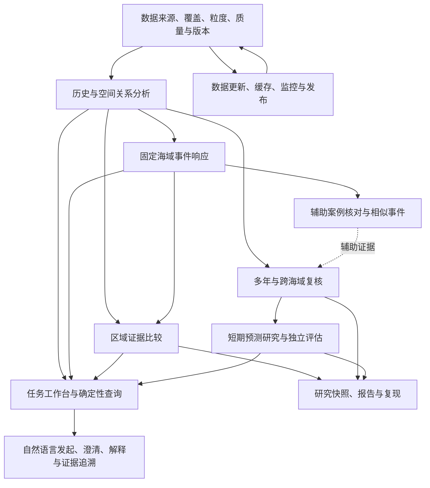

# Ocean 全项目路线规划与模块实施边界

> 2026-10-24总体整理：统一入口、近期批次和跨模块台账见[总体规划](ocean-master-plan-2026-10-24.md)。本文继续保存长期范围与用户决策；旧段落中的讨论状态按当时记录读取，不覆盖当前规格。

创建日期：2026-10-22；最近决策更新：2026-10-24。状态：**已确认全局方向、Q47 整套前端方案及 Q48–Q51 运行策略，按依赖实施；数据事实、数值域、性能参数和具体研究方法仍随审计与实验落实，不等于全部功能完成**。

本文件把项目从当前基础到完整研究版展开，明确每部分用途、已有基础、缺口、依赖和验收。单项选择及 Q47 总体确认已记录；当前阶段计划仍是全项目中的实施子计划，规格、实现、验证、合并和部署分别记录。

## 1. 文档层级与当前阶段的位置

| 层级 | 解决的问题 | 对应载体 |
| --- | --- | --- |
| 全项目总路线 | 最终交付什么、由哪些能力组成、各阶段何时算完成 | 本文为已确认方向基线；未定数值/模块细节按证据展开 |
| 阶段执行计划 | 当前阶段先解决什么、任务依赖、验收与交付方式 | [2026-10-22 推进计划](ocean-execution-plan-2026-10-22.md) |
| 模块功能规格 | 用户怎样操作、输入输出、指标含义、异常、性能与质量要求 | 在对应模块启动前展开，不把实现细节混入产品流程 |
| 开发任务与证据 | 谁做、做到哪、实际检查、分支、PR、合并与部署 | GitHub Issues、任务票据与 PR |

**现有推进文档主要覆盖“可信分析闭环及其配套体验”，不是全项目全部功能。** 其中的数据基线、界面与性能属于公共基础，A/B/C 属于研究分析模块，工作台属于易用入口。现有 #13 是这轮执行总纲，不等同于整个项目终点。

旧路线图仍有“AIS 未集成”“未来再加三维”等历史表述；新的本地代码已经有相关基础。不能直接复制旧阶段状态，也不能把“有接口”当作真实数据和完整使用流程已经验收。

## 2. 版本层级与已选终点

本版选择 L2。下表用于明确它与基础分析平台、后续实际作业应用之间的关系。

| 完整版本候选 | 用户最终能做什么 | 完成边界 |
| --- | --- | --- |
| L1 可信分析平台 | 查历史、看空间关系与事件响应、比较海域、导出可复核报告，以工作台和自然语言降低操作门槛 | 以历史研究为主，不以正式预测为必要交付 |
| L2 分析与预测研究系统 | L1 加上有独立验证的短期预测研究、相似事件与跨时空复核，展示模型适用条件及误差 | 预测有基线和独立评估；没有增益也如实报告，不冒称业务可靠 |
| L3 实际作业辅助系统 | L2 加上稳定更新的资料、预报与必要海况、持续运行、真实用户试用及作业场景验证 | 另需时效、运行可靠性和外部数据条件；不自动等于鱼丰度或渔获量预测 |

已确认：用户选择 L2 作为全项目完整研究版终点，即可信分析平台加上明确目标的短期预测研究、独立评估和结果展示。L3 作为后续应用阶段单独评估。此前“本轮以研究验收”的决定保持不变。

预测目标、使用方式和扩展深度已按下列决定收敛；具体数据年份、空间尺度、数值门槛与评估指标由模块规格落实。研究验收允许无增益结论，不据此自动承诺上线可靠预测。

### 2.1 已确认的研究主线（Q20）

用户确认以锋面与捕捞活动的关系为核心研究问题，目的是为系统用于渔业工作提供证据。短期预测作为进一步验证与扩展，可视化和 AI 支撑分析与理解。

研究表述为：检验在什么海域、时间和环境条件下，捕捞活动与锋面的距离、侧别及经过事件存在稳定关系，并说明关系的效应、不确定性与适用边界。不预设必须发现正向或显著关系。

区分三个证据层次：关系成立的研究证据、对识别活动区域或解释历史变化的参考价值、真实作业结果改善。前两个层次通过关系分析、独立样本和加入/不加入锋面信息的对照验证；提高渔获量或收益需要额外真实资料与作业验证，不由 AIS 相关分析直接推得。

### 2.2 已确认的实用参考价值验证（Q21）

用户选择独立历史验证：比较不使用锋面信息和加入锋面信息时，识别值得关注的活动区域、时段或变化的效果，检验锋面是否提供额外价值。统计关系与案例展示之外，需要独立样本上的对照证据。

具体回测目标、基线、评价指标及样本隔离方案仍待细化；两组应使用可比的其他输入和一致评估条件。该验证不自动等于实时作业试验或渔获收益改善，预测性结论还须遵守输入可知时间和独立留出要求。

### 2.3 已确认的数据扩展顺序（Q22）

用户选择先东海、后跨海域：一个完整月份闭环通过后，先在东海开展跨年份与跨季节复核，再选择其他海域验证地域适用性。

具体年份、季节和外海域样本由真实共同覆盖与质量核实后确定；不以单层资料年限替代联合资料年限。该顺序不改变当前先完整单月 A、再固定海域 B、再区域比较 C 的安排。

### 2.4 已确认的预测扩展目标（Q23）

用户选择预测未来 1–3 天固定区域中的捕捞活动集中情况，并强调贴近实际应用：锋面作为解释和预测活动的输入因子，主要面向用户呈现活动集中区域、时段、强度与证据。

预测扩展首先验证锋面信息是否有助于识别后续捕捞活动。热点的具体门槛、空间尺度、各提前量与评价指标继续细化；输出主次见 Q24。锋面自身出现情况的预测不作为首要产品目标。

### 2.5 已确认的预测输出主次（Q24）

用户确认以未来捕捞活动的集中程度为主，以相对自身历史常态的变化为辅。主要输出识别活动较集中的区域，同时说明这些区域正在增强、减弱或保持相近水平；活动增长明显但总集中程度较低的区域作为补充线索。

比较活动强度时统一时间和有效面积口径；热点门槛、历史常态窗口、空间尺度与最终评估指标仍需根据资料和研究规格确定，不能用独立测试结果反向选择门槛。

### 2.6 已确认的预测使用范围（Q25）

用户确认首版预测围绕选定位置与公里半径展开，显示真实覆盖范围内未来活动分布，允许点选区域查看强度、相对变化及依据；复用已有选点、范围和区域比较的使用方式。

随后扩展整个东海的预测分布浏览与逐级缩小范围。局部预测与全海域浏览分批验收，空间精度和可用范围由资料与验证决定。

### 2.7 已确认的完整 AI 对话能力（Q26）

完整研究版需要连续分析对话，支持继承当前分析条件、修改时间或范围、比较其他区域及追问结果依据。每次执行明确所用条件与本轮修改，结果保留对应条件与证据版本，避免将不同条件的旧结果视为新结果。

首版仍以任务入口和引导填写为主；基础分析可靠后逐步接入自然语言、多轮条件修改与结果解释。后端已有解析、工具与证据结构应复用；具体工具覆盖、澄清流程和失败处理在模块规格中逐项定义。

2026-10-24，Q48 已确认方案 1：本人明确发出分析指令，在必要条件齐全、资料就绪且属于可执行范围时，直接提交对应任务，不重复弹确认卡。缺条件或意图含糊时澄清；仅改变条件、打开页面或进行解释性提问不自动提交耗时分析。新增费用、未准备资料及公开边界仍按各自规则处理；不因本条自动准备归档。

### 2.8 已确认的分析任务中心（Q27）

完整研究版需要后台分析任务与历史记录：用户离开页面后任务仍可运行，返回查看进度和结果，支持取消和失败重试，并保存任务条件用于比较与连续追问。

任务中心作为独立公共模块，供多年统计、事件批量研究和预测回测复用；任务状态、输入条件、结果与失败原因均须可追溯。2026-10-24，Q49 已确认方案 1：服务器重启后自动恢复可安全续跑的已提交任务，展示恢复状态；无法安全恢复的标记中断并保留记录供本人重试。不重复执行已完成步骤或发布半成品，不把重新打开网页当作新建分析。具体恢复检查、保留期和资源上限在运行规格落实；已有加工 job_id 日志不代表已实现。

Q40 补充：复用任务中心支持“一键准备数据”。用户选择系统可访问的归档范围后，若数据尚未上线，可后台准备并查看进度，期间继续浏览地图；准备完成提示就绪，由用户发起详细分析。准备任务绑定提交时的条件与版本，之后更改条件不改变原任务含义。

### 2.9 已确认的成果保存与导出（Q28）

完整研究版需要可复核的研究成果包：PDF 报告、图表、汇总数据表，以及对应分析条件、数据与方法版本、指标和证据记录。

历史结果应能查看并被后续比较或 AI 追问引用；相应资料与版本可用时可复算。任务结果快照、可复算记录和源数据保留分别管理，具体保留期与存储策略在运行规格中落实，不把保存 PDF 等同于保存了全部复算资料。

2026-10-24，Q50 已确认方案 1：分层保存。所有任务保留轻量结果快照、条件、版本和证据记录；普通任务大文件及中间产物可按容量策略清理，清理状态和复算条件可见。主动保存的案例和报告默认保护，不自动按临时产物规则删除；源资料另按资料管理策略。具体天数与容量由实际体量确定，不承诺无限存储或永久保存全部源文件。

### 2.10 已确认的使用与协作范围（Q29）

完整研究版首先服务个人研究：保存自己的任务、案例与研究结果，并通过报告、图表和汇总数据导出分享成果。完整多人账号、权限、协作空间和共同维护案例不作为本研究版必交功能，预留后续扩展。

Q44 补充已确认：允许公开浏览演示内容，数据准备与重分析仅本人可发起。建设最小维护者访问边界与服务端执行权限检查，不因此扩展完整多人账号/协作系统。个人任务、归档与研究结果不因演示页面公开而自动发布；公开演示使用已确认可公开的材料。

Q45 补充已确认：公开访客可在已公开、已就绪的数据范围内自由选点、切日期/图层并查看已有结果，可调用受控轻量读取；不限于固定案例。超出公开/就绪范围时说明原因，不触发归档准备、重分析或公布个人任务。界面提供可用范围，后端校验数据范围和执行权限；查询开销、返回量和缓存增长纳入容量基准。

系统内使用范围与开发协作分开：GitHub Issues、主题分支、PR、用户审核合并的开发流程继续执行。

### 2.11 已确认的 AI 模型使用方式（Q30）

用户允许按需接入在线模型服务，同时保留已有本地能力和规则兜底。模型负责理解请求、组织任务与解释确定性计算结果；模型不可用时仍可使用任务入口和手动分析。

具体模型、调用预算与部署配置在接入前确定。本次仅确认使用方式，不执行模型调用或产生新增服务费用，也不改变数据许可与可发送内容的边界。

2026-10-24，Q51 已确认方案 1：首版调用在线模型的 AI 问答仅本人可用；访客继续使用已确认的地图、筛选、受控轻量查询及公开结果，不自动获得在线模型调用权限。该边界由服务端检查，不能仅隐藏按钮；模型与费用的具体方案仍在接入前落实。

### 2.12 近期预测的数据时效事实与已确认的验收范围（Q31）

- 现用 [Zenodo 锋面记录](https://zenodo.org/records/20356239) V1.0 发布于 2026 年，但观测范围为 1982–2024。未找到能证明它持续公开更新 2026 年逐日锋面的证据；发布日与观测日必须分开。
- [GFW 4Wings 官方文档](https://globalfishingwatch.org/our-apis/documentation/docs/v3/4wings) 当前声明 AIS effort 可覆盖 2012 至约 96 小时前。仓库默认采集起年及已有线上清单仍主要是 2017–2024；官方可请求范围不等于本项目已经获取或核验的范围。
- [NOAA Geo-Polar SST 官方产品](https://coastwatch.noaa.gov/cwn/products/noaa-geo-polar-blended-global-sea-surface-temperature-analysis-level-4.html) 声明近实时低于 24 小时延迟。元数据快照可证明已含 2026 年资料，但未实测本项目实际最近可用日，不能将产品声明当作本项目实时链已验收。
- 现有补齐/采集脚本能读取归档或请求指定日期，尚不能证明已实现“自动发现最新有效资料→增量处理→定期预测”的完整流程。

若完整研究版要求相对今天未来 1–3 天的滚动预测，需要获得持续更新的锋面来源，或另建并验证从近期 SST 生成锋面的处理链，并按活动资料发布时滞重新设计输入与目标。不能以最新活动观测日加 1–3 天冒充相对今天未来 1–3 天。

预测规格须分别记录观测日、资料首次可用/发布日期、获取时间、预测签发时间与目标时间；历史回测也要核对可知输入。历史归档或重处理资料的使用条件须明确，不能自动称为当时实际运行的预报。

Q31 已确认：完整研究版以独立历史回测作为预测必交，检验加入锋面信息是否改善后续活动判断；近期资料接入与相对今天的滚动预测作为后续独立阶段。此决定明确研究版的运行边界，不取消后续实时扩展。

### 2.13 已确认的锋面追踪范围（Q32）

用户当前只考虑分析辅助，不深入研究锋面的发展、移动与生命周期。复用已有短窗口匹配能力，限于必要的案例关联、样本核对及匹配质量说明；无法确认身份时标明不确定或断档。

完整研究版不新增专门的移动规律、长期身份恢复、分裂合并或生命周期研究任务。相似案例检索优先围绕海域、季节和环境/活动证据展开，不依赖完整生命周期追踪；A/B/C 及活动预测不以深入追踪为前置。

## 3. 全项目能力结构

地图、性能、报告与质量检查贯穿各阶段。AI 可以在基础查询和 A 稳定后分批接入历史分析，不必等待预测全部完成。当前活动预测使用经核实的区域特征，深入锋面追踪不在必经路径上。

### 3.1 完整研究版的必交能力与完成条件

| 能力 | 用户能完成的事 | 完成证据 |
| --- | --- | --- |
| 数据与质量 | 选择真实可用海域/月或年份，知道资料与缺口 | 覆盖、粒度、有效日/面积、来源、版本和复算流程 |
| 地图与交互 | 选点、公里范围、历史与当前/未来入口，地图图表联动 | 真实样例可读、条件一致、错误状态及实测性能 |
| A/B/C 分析 | 查完整月关系、固定海域事件响应、同条件比较区域 | 直接复核、对照、稳定性及缺测/无明显关系案例 |
| 扩大研究 | 先东海跨年份/季节，再跨海域验证，检索相似案例 | 共同样本、独立复核、效应与适用边界；追踪只作辅助 |
| 活动预测回测 | 以历史基准预测后 1–3 天集中区域，先附近后全东海浏览 | 简单基线、加入/不加入锋面对照、独立留出及误差；强度为主、变化为辅 |
| 多轮 AI | 发起分析、继承/修改条件、比较区域、解释证据 | 对应真实工具与任务，条件和数字可追溯；模型失败可降级 |
| 任务中心 | 离开后查看进度和结果、取消、重试、引用历史任务 | 后台任务与状态记录、失败原因、保留条件和结果，不依赖页面持续打开 |
| 研究成果包 | 保存案例并导出 PDF、图表、汇总数据 | 条件、数据/方法版本、指标与证据；旧结果可查看、资料可用时复算 |
| 研究服务交付 | 在现有服务器体系运行并保留离线演示，维护样本与任务 | 部署版本、数据/结果状态、备份恢复、检查记录和研究成果包 |

完成标准看计算、证据、复现与使用流程，不预设必须正相关、显著或模型优于基线。任务中心和基础报告从第一批可信分析开始建设，不作为最后才补的附属页面。

以下明确列为后续独立扩展：近期锋面来源/生成链、相对今天的滚动预测、实际作业试验、渔获/鱼种/收益验证、完整多人协作、深入锋面发展移动研究。

## 4. 每部分具体实现什么

### D 数据体系与处理

**使用目的：** 用户知道选定海域、日期和指标到底有没有可用资料，系统能为不同分析提供一致的数据。

已有基础：锋面/SST 下载、裁剪、导出，AIS 采集，数据目录、清单、索引、缓存与来源说明。

需要补齐：

1. 数据源登记：覆盖海域、日期、发布时滞、实际更新方式、粒度、单位、许可和版本。
2. 共同覆盖：分别显示锋面、SST、AIS 的可用性，再计算某项分析真正需要的共同有效日期与区域。
3. 质量标记：陆地、无观测、覆盖未知、有效零、网络失败分开；稀疏记录不能直接代表海上零活动。
4. 分析与展示分开：显示可降采样，计算使用合格的分析输入；明确公里圆、经纬度窗口与锋面缓冲的含义。
5. 可重复加工：同样的数据和参数能够重新产生同样结果；缺口补齐、失败重试、版本更换有记录。
   - Q39 已确认在线研究数据与完整原档分层存放：在线保留当前所需数据、索引及有上限缓存，原档独立保存、按需加工调入；归档可用与在线就绪分别记录，具体归档位置及访问方式在实施规格核实。
6. 扩展数据按问题选择：水深、距岸、季节、渔具/船型等可用于更好对照；不是第一轮全部必采。

当前缺口：线上清单报告 AIS 2017–2024、示范月 31 天，单日接口显示 0.1°；完整逐日可读性、局部有效覆盖与细分析真源尚未全部核实。ADR-0001 的 0.01°目标与实际路径需要明确处理。

交付：覆盖与质量目录、数据加工流程、可用研究样本、版本与来源记录。

验收：查询条件下的数据状态可解释；缺测不变零；方法尺度不超过资料支持精度。

### V 地图可视化、交互与性能

2026-10-23 Q47-36 已确认[前端界面实施规格](../specs/ocean-frontend-redesign-draft-2026-10-23.md)：左深色工作台同时有快捷功能与 AI；日期/坐标/半径为独立筛选浮层，图层开关也在左侧；右侧浅色保留当前/历史/预测，底部按需展开证据。原地图框架保留，两侧可收起；精简图例原位置常驻。旧 Q46 左右职责提案已被本轮替代，规格已定不等于应用已完成。

**使用目的：** 看懂哪里有锋面、海温怎样变化、活动在哪里，能快速改变条件并核对结果。

已有基础：二维/球面、图层、点位、日期、半径、按视野取数、LOD、防抖、缓存与离线回退。

需要补齐：

1. 实际接入 NCL 色表及同源图例；连续变量、侧别分类、活动符号和缺测纹理清晰区分。
   - Q41 已确认固定温标，同温同色，局部对比增强手动开启且明确范围；用户再次要求落实色块修复与所给 NCL 链接的实际应用。阶段 U2.1a–d 明确色表 RGB 接入、温度分档/网格块感/拼接与透明度排查、SVG/PNG/图例/报告色标统一及真实样例验收。
   - 绝对 SST 已选 `cmocean_thermal`，活动点已选反向浅紫 `MPL_Purples` 与统一对数显示；全年数值域仍需核查，零中心差值/异常另按语义选表。换色表不自动消除原始网格和显示量化，显示优化与分析精度分别验收。
2. 分析点、范围圈、最近锋面、选中对象、视野中心的关系明确；拖图不悄悄改分析区域。
3. 右侧保留当前/历史/预测，分别展示实际观测日期、月份/年份与预测基准/目标日期；AI 置于左侧工作台。
4. 地图、曲线、统计表和证据卡联动：点区域能定位，点日期能回到对应结果。
   - Q34 已确认：地图保持主视图；右侧仅留少量摘要，压缩占用并可隐藏；底部分析区默认收起，详细曲线、统计表与区域比较由工作台按需呼出。自然语言询问随 AI 阶段接入，不让完整分析卡片常驻堆积。
   - Q35 已确认：工作台采用可呼出/收起的非模态侧边面板，展开时地图仍可拖动、缩放和选点；当前 #23 居中模态设计不符合要求，需调整并重新验收，不推迟到完整 AI 阶段。
   - Q36 已确认：改变位置、范围或时间后，地图及轻量摘要自动更新；详细分析由用户点击更新。旧结果带原条件及“条件已改变，待更新”提示，不自动冒充当前条件的结果，也不因连续改条件重复提交耗时分析。
   - Q37 已确认：进入不同任务自动搭配重点图层，同时保留手动开关；附近锋面突出锋线与水温，活动关系突出锋线与捕捞活动。缺数据明确提示，图例跟随可见图层，不在日常刷新中反复覆盖手动调整。
5. 加载、重试、部分覆盖与过时结果提示；长分析不冻结普通地图操作。
6. 固定场景实测冷/热耗时、交互、内存与请求体积，再决定绘制复用、栅格、瓦片或更大调整。
   - Q38 已确认先概览后细化，并明确要求服务器容量核算和可视化加速专项。详见[专项计划](ocean-visualization-performance-plan-2026-10-23.md)：现服/资料盘点 → 实际路由与性能基线 → 渐进调度、缓存及绘制优化 → 条件性栅格布局/联动聚合原型 → 资源决策与验收。Mosaic Selections 等研究作为对照候选，不预设采用或性能收益。

7. Q43 已确认电脑优先，完整研究流程在电脑端验收；手机保证基本浏览与操作，复杂分析后续适配。手机触控及小屏基本流程与电脑窄窗口分别验证，布局和性能测试使用对应设备条件。

当前缺口：#23 仅完成按钮工作台与一批说明，未完成 Q47 整体界面、配色/图例统一、半径支持核对和系统性能优化。已有缓存/LOD 不是加速倍率证据。

交付：易用地图、图表联动、性能对比与行为回归证据。

验收：正确性、可读性与实测响应共同通过；不靠删分析数据提高速度。

### S 历史统计与完整单月空间关系

**使用目的：** 回答“这个月哪里活动集中，是否更靠近锋面，冷暖两侧是否不同”。

已有基础：历史同期/月度锋面服务、附近对象与距离、侧别、SST 温差代理。

需要补齐：

1. 任意覆盖内点位、公里半径和月份的逐日关联，替换固定锚点/少数抽样日的限制。
2. 活动小时、有效日均、有效海域面积、空间密度、热点持续性，全部标明单位和分母。
3. 距锋面分组、冷暖侧差异，以及资料支持时的强度代理分层。
4. 同月、可比海域对照，报告样本与覆盖差异。
5. 整月汇总保留逐日支撑，不能把地图限点展示输入当完整分析输入。
6. Q42 已确认历史入口默认整月地图总览：突出月度捕捞活动分布，锋面频次作统计背景；点击日期查看同日真实锋线、海温和活动，支持返回整月。月度/单日的图例、时间及摘要同步；月度叠加不代替逐日关系证据。复用已就绪月度汇总，耗时计算仍按 Q36 点击发起。

当前缺口：已有“月度活动”工具主要是锋面活动、命中比例和 SST，不是完整的 AIS—锋面联合研究工具。

交付与验收：当前 A（#18），先一个真实完整月，包含异点、边界、缺测及无稳定关系案例。随后才扩展完整年份、季节和多年统计。

### E 固定海域事件与响应

**使用目的：** 回答“锋面经过同一片海域后，活动是否变化、何时变化、是否持续”。

已有基础：旧事件响应表、前七/后 1–3 日字段、非锋面对照及实验脚本。

需要补齐：

1. 明确固定海域的进入/接近/离开事件，处理持续经过和重复触发。
2. 前七日基线、后 1–3 日及后 1–7 日分别计算，补齐相邻月份资料。
3. 按有效天数与面积比较；零基线、缺窗口、对照不足明确不可计算。
4. 对照可比性、事件去重、时滞曲线、事件/时间分组不确定性。
5. 将结论定位为观察到的关联与响应，不自动作因果解释。

当前缺口：186 行旧表不是 186 个独立事件，也不是任意固定海域事件研究；后七日有效字段目前为零。

交付与验收：当前 B（#19，复用 #9）。固定研究几何可复算，时间窗完整且对照有效。

### T 辅助案例核对与相似事件

**使用目的：** 帮助核对活动响应样本，并查找过去相似的环境与活动情况。

已有基础：对象与追踪接口，使用距离、长度/像元规模、包围框等启发式匹配；不是完全没有追踪。

需要补齐：

1. 复用短窗口匹配作必要案例关联，核对典型样本并给出匹配质量、不确定性和断档。
2. 固定海域事件按区域与时间定义，不以每日局部 F 编号证明长期身份。
3. 相似案例先按同海域、季节及有依据的局部环境/活动特征筛选。
4. 展示相似案例的结果差异、缺口和失败情形，避免只保留正向样本。

交付：可核对的案例关联、短窗口匹配质量说明、相似案例检索与活动证据。不把锋面发展、移动规律或生命周期作为本研究版研究成果。

依赖：D/S/E；辅助匹配不构成多年统计与活动预测的必需前置。深入身份与分裂合并研究后续另列。

### Q 多年稳健性与研究验证

**使用目的：** 判断一个月发现的现象是否只适用于该月、该海域或某一类样本。

已有基础：长期锋面资料的查询能力、历史样本组织和 bootstrap/置换框架。

需要补齐：

1. 在真实共同覆盖内建立跨年份、季节和海域样本，不能用锋面年限冒充 AIS 联合年限。
2. 把探索数据、方法选择数据和最终复核数据分开。
3. 按事件/时间块/海区处理相关性，重复测半径不能伪装增加独立样本。
4. 检查覆盖、分辨率、距离带、对照与门槛的敏感性；资料允许时控制季节、距岸、水深等差异。
5. 明确适用边界、无明显关联或结果矛盾的情形；多种检验不能只挑显著结果。

交付：可重复实验包、跨时空验证报告、主要结论与失效条件。

验收：结论强度与证据范围一致；脚本通过不等于真实研究结论成立。

### C 区域比较、研究快照与成果交付

**使用目的：** 比较几片海域，把发现保存下来，向同伴或评审解释并复核。

已有基础：报告接口可汇总当前、历史、对象和追踪，提供 Markdown/HTML；脚本和实验包已有部分输入输出记录。

需要补齐：

1. 当前 C（#20）：一致条件下并列活动、锋面关系、事件响应、样本和不足，不先排序。
2. 统一月度、事件和比较报告，包含地图、图表、表格、来源、方法、覆盖与结论边界。
3. 保存查询条件、资料/方法版本、任务结果快照；以后能查看旧结果，能复算时说明复算依据。
4. 数据表、图片与 PDF 导出分级实现；系统内导出能力与本次人工编写的项目 PDF 文档分别验收。
5. 建立示范案例、研究报告与答辩材料；研究贡献需要对照实验支持，不能仅以功能数量说明创新。

交付：比较页面、可保存案例、可追溯报告和研究成果包。

依赖：基础报告在 A 后即可增量交付；跨年结论和预测报告分别等待对应验证，不必全到最后才做报告。

### P 短期预测研究

**使用目的：** 在独立历史样本中检验对基准日后 1–3 天活动的判断，评价锋面信息是否提供额外价值，并说明误差和适用范围。

已有基础：1/3/7 天规则推演和历史查询；尚不能视为已完成正式预测。

需要分开安排：

1. **目标选择（已确认）**：预测历史基准日后 1–3 天固定区域的捕捞活动集中情况，强度为主、相对常态变化为辅；先附近再扩展全东海浏览。锋面作为输入与解释因子，具体标签和空间尺度随资料确定。
2. **可知时间**：区分观测发生时间、资料发布时间和模型发出时间。历史数据能离线回测不代表今天能获得同样输入。
3. **预测基线**：与持续性、季节历史等简单基线比较，而非仅给模型自己一个准确率。
4. **独立验证**：按时间和海域留出；检查未来信息泄漏、误报/漏报、空间偏差和需要时的概率校准。
5. **输出与降级**：基准时间、提前量、预测有效期、误差、模型版本和不可用原因。
6. **后续实时扩展**：SST/海况外部预报、近期锋面与当前滚动预测另列数据阶段；外部产品展示不等于自行训练并验证了预测模型。

交付：目标规格、数据切分、基线对比、独立评估、适用范围和预测页面。

验收：独立历史回测允许无增益结论，显示历史基准与目标日期及输入可知条件；不将其标为当前实时预报。7/10 日外部预报与近期滚动运行属于后续扩展。

### AI 工作台与完整智能分析流程

**使用目的：** 降低使用门槛，让用户用任务入口或自然语言发起真实分析、核对条件并理解结果。

已有基础：#23 的任务导航首版；阶段代码已有规则解析、可选本地模型、能力/健康/知识/分析接口、结构化任务与工具证据链。

逐级实现：

1. **任务导航**：复用原功能与当前条件；#23 为首版交付，尚待合并和部署。
2. **引导执行**：当前 #21 接入已验证的 A/B/C；明确条件、执行状态、结果与失败原因。
3. **自然语言发起**：先接已有稳定工具，再接完整月/事件/比较；缺位置或时间时澄清，不默默猜测。
4. **上下文操作**：用户可继续说“换成八月”“扩大范围”“与另一个区域比较”，明确继承和修改了什么。
5. **结果解释**：回答指标、关系、对照、缺测和不确定性问题，引用具体结果与来源。
6. **可追溯与降级**：保存任务条件、工具调用与结果版本；失败、超时或模型不可用仍可使用手动功能。

当前缺口：已有后端基础尚未形成完整前端流程；月度锋面查询不能充当月度 AIS 联合分析。完整 AI 应以可执行任务与证据正确率验收，不能以聊天框或模型接通作为完成标准。

已确认完整版本需要多轮继承、修改、比较与解释，以及 Q27 的后台任务和离开后查看；Q30 允许按需在线模型并保留本地/规则兜底。具体工具覆盖与澄清流程在规格中细化，模型选型与预算在接入前确定。

### O 持续运行与可交付系统

**使用目的：** 已有功能在服务器长期可靠运行，资料更新、长任务、版本变化和故障都有可见状态。

已有基础：部署手册、systemd/Nginx、数据目录、缓存预热/重建/清理、冒烟、容量盘点、补齐队列与加工 job_id/JSON 日志。

需要补齐：

1. 本版优先历史样本补齐、质量与版本更新；区分资料新鲜度和当前滚动预测，后者另列扩展。
2. 数据任务可恢复调度、失败重试与运行记录；现有后台进程不等于重启后自动恢复的服务。
   - Q40 已确认归档已有但未在线就绪时可一键后台准备，展示真实进度、失败和就绪提示，复用任务中心；前置为归档已登记且系统可访问，校验通过后才发布就绪。
3. 产品分析任务的后台运行、进度、取消、重试、任务历史与结果保存；已有加工日志不等于已具备这一整套能力。
4. 查询缓存和分析结果按版本失效，容量与保留策略实测，必要时限并发和任务规模。
5. 发布版本、验收环境、备份恢复、回滚、接口/数据新鲜度监测；HTTPS 与域名根据交付场景安排。
6. 个人研究为主，保存自己的任务/案例并导出分享；Q44 已确认演示公开浏览，后台准备和重分析仅本人可发起。最小维护者身份与服务端权限检查纳入本版，完整多人账号/协作空间后续扩展；具体认证方式随部署规格落实。

交付：可复现部署、实际运行证据、资料更新/任务状态、恢复与维护说明。

验收：本地通过、PR、合并、部署和线上验证分别记录；数据范围扩展与资源购买由实测决定。

### X 实际作业与资源判断扩展（条件阶段）

只有确定进入 L3 后进一步细化：

- 真实使用者、作业海域、使用频率与决策场景；有效时效内的环境资料和预报。
- 必要海况、天气、法规或作业约束的数据来源与展示边界。
- 真实用户试用、结果反馈与持续评估；不能从历史活动相关直接跳到现实作业收益。
- 若目标进一步变为鱼类资源或高产渔场，需要渔获、鱼种、作业投入等资料及独立验证。此项与目前“捕捞活动热点”不同，另行确认。

## 5. 全局阶段与推进顺序

| 阶段 | 主要交付 | 当前状态 | 下一阶段的条件 |
| --- | --- | --- | --- |
| G0 全局范围与规格 | 终点、能力清单、优先级、数据目标、模块边界与阶段验收 | 范围/交互及Q48–Q51已确认，方法协议已展开，数据参数待冻结 | 数据、统计、预测和性能分别完成所需合同 |
| G1 基础可用与数据可信 | D/V 基线、第一批界面、入口、状态与性能测量 | #14–#17；#22/#23 已建 PR，未合并/部署 | 真实共同样本、正确口径、基本交互可验证 |
| G2 可信分析闭环 | A 单月 → B 固定海域响应 → C 比较；工作台逐项接入，基础报告随结果交付 | 当前执行计划主体，#18–#21 待推进 | 一个完整月和事件链可复核，边界及失败案例通过 |
| G3 扩大研究与复核 | 先东海跨年/季节，再跨海域；相似案例、辅助匹配质量、稳健性与适用边界 | 已有部分工具基础，尚未形成完整验收 | 独立资料与可解释实验结果；不要求深入锋面移动研究 |
| G4a 活动预测独立回测 | 历史基准后 1–3 天，强度主/变化辅；先附近后全东海，加入/不加入锋面对照 | 规则推演基础，正式验证待定 | 留出资料充分，报告误差和适用条件；允许无增益，不要求当前滚动运行 |
| G4b 智能分析体验 | 自然语言发起、多轮改条件、结果解释和追溯 | 有后端基础，前端完整流程待接 | 对应确定性工具稳定，任务与证据正确；可从 G2 后分批启动 |
| G5 系统整合与成果发布 | 保存/复现/导出、长任务、更新与监测、部署验收、研究成果包 | 有报告和运维基础；整体待验收 | 全链路演示、复现与故障恢复可核查 |
| G6a 近期数据与滚动预测 | 近期锋面来源/生成链、发布时滞与相对今天的预测 | 后续独立扩展 | 先解决真实近期输入与时效验证 |
| G6b 实际作业与其他扩展 | 必要约束、真实用户试验、鱼种/渔获验证；多人协作或深入追踪另立项 | 后续条件阶段 | 单独确认场景、资料和验证条件，不列研究版必交 |

不设未经测算的周数。先确定 G0，再把每个阶段细化为可独立评审的工作包；上一阶段验收结果决定下一阶段样本与实现范围。

G3 的辅助案例核对和多年验证可拆开推进；G4a/G4b 是不同方向。任务中心、报告、运行维护和性能按已完成能力提前建设，不等到 G5 才开始。

### 5.1 确认总纲后的具体推进方式

1. **整理任务层级**：将总路线作为上层总纲，关联现有阶段 #13 与 #14–#21；保留 #1/#9/#11/#12 等基础票据，不重复造已有接口。
2. **先补 G1**：#14 核实联合数据和方法口径；#16 完成配色、时间和范围；#17 建性能基准。已有 #22/#23 保留独立审核流程。
3. **按 A→B→C 验收 G2**：每个功能先形成输入/输出/缺测/指标规格，再实现和复核，分别提交 PR。第一批结果即配保存、基础报告和任务记录。
4. **扩展 G3**：在探索与参数选择前规划独立验证样本，先东海跨年/季节，再外海域。相似案例和辅助匹配服务结果核对，不引入深入移动研究。
5. **形成 G4a**：冻结活动标签、时间切分和基线，比较加入锋面信息前后效果，报告成功、失败和无增益结果。已探索的七、八月案例不能自动充当未见测试集。
6. **分批推进 G4b**：可靠分析工具完成后接入任务式执行、自然语言、多轮修改和解释，接到公共任务中心。模型与预算在接入前落实。
7. **G5 联合验收**：完成数据→任务→地图图表→解释→研究成果包全链路，复核版本、恢复、性能和部署；用户审核合并，部署单独安排。

每个阶段都使用“功能已实现/验证通过/PR待审/已合并/已部署验证”的实际状态。阶段越往后，任务粒度在前置证据具备后再细化，不预填未经验证的完成日期。

### 5.2 实施规格中落实的数值与事实

可视化论文优化、统计与预测方法的既有进度、借鉴与定制边界，以及具体方法工作包，见[方法选型与验证安排](ocean-methods-selection-and-validation-2026-10-24.md)。统计研究与预测训练不由渲染加速论文代替；优先复用成熟方法，通过 Ocean 数据和独立实验决定是否采用或改进，不预设必须自创新数学算法。

具体年份与样本量、公里半径档位、网格精度、热点门槛、对照匹配、独立切分、性能目标、结果保留期和模型预算，不能仅靠偏好定数。由数据审计和实验给出依据，记录于对应模块规格与 PR 供评审；需要付费、额外资料授权或改变已确认目标时再单独明确。

默认沿用已确认的点位＋公里圆形范围、月份/年份条件、个人研究与现有服务器体系；不额外承诺任意多边形绘制、全球联合分析、无限任务或永久保留全部源资料。

## 6. 当前执行计划覆盖与未覆盖的部分

| 当前计划 | 在总路线中的位置 | 后续还需补什么 |
| --- | --- | --- |
| P0 / #14 | D 的首批基线 | 全年/多年联合样本、增量更新、完整质量体系 |
| U1 / #15 | V/AI 的任务入口 | 真正引导执行、自然语言、多轮与解释 |
| U2 / #16 | V 的首轮改造 | 更大数据规模的联动、持续体验验证 |
| P1 / #17 | V/O 的第一轮实测优化 | 长任务、跨年规模、缓存增长与运行负载 |
| A / #18 | S 的单月闭环 | 季节/多年/海区扩展与外部复核 |
| B / #19、#9 | E 的固定海域响应 | 辅助案例关联、相似事件与更大样本；不要求深入追踪 |
| C / #20 | C 的证据比较首版 | 研究快照、统一报告和系统内导出 |
| W / #21 | AI 的确定性任务整合 | 完整对话与结果解释、可恢复分析任务 |
| 原阶段文档的后续列表 | 对 G3/G4/G5 的提示 | 本总路线已展开功能范围与验收；模块规格在前置证据具备后细化 |

## 7. 欠缺功能的紧要程度

| 类别 | 问题 | 为什么紧要 / 什么时候处理 |
| --- | --- | --- |
| 当前正确性前置 | 联合覆盖、粒度、有效面积/天数、位置与事件绑定、零/缺测 | 直接影响所有结论；G1/G2 优先 |
| 当前使用障碍 | 操作层次、色带图例、时间范围、加载与实测性能 | 影响能否看懂和完成分析；与正确性并行 |
| 研究可信度 | 对照可比、相关样本、独立复核、年份/海区扩展 | 决定能作多强结论；单月后继续，正式预测前必须有对应验证 |
| 完整交付缺口 | 保存任务/案例、统一报告、导出、版本与复现 | 关系能否共享成果和长期跟进；G2 起增量建设 |
| 能力扩展 | 相似案例、必要辅助匹配、活动预测独立回测、完整 AI | 是独立工作包，需要目标和验收，不与“页面已有入口”混同 |
| 条件性产品化 | 最新资料、运行时效、多用户、实际作业约束、真实渔获 | 由最终版本层级决定，不能静默加入本轮或预先宣布取消 |

## 8. 已确认的决策与规格边界

以下是用户决策；文件/接口/数据可用事实由代理核对，不要求用户自行调查。已确认的 A→B→C、地图首页、工作台按钮、首版不排序、助手建 PR/用户合并、部署另排不再重复询问。

| 顺序 | 决策 | 决定后能细化什么 |
| --- | --- | --- |
| 1（已确认） | L2 为完整研究版终点；L3 后续应用单独评估 | 继续明确研究主问题与各模块实现深度 |
| 2（已确认） | 锋面与捕捞活动关系为主，预测作为扩展，可视化与 AI 支撑；为渔业工作提供参考证据 | 继续明确实用参考价值的验证方式与必需数据 |
| 3（已确认） | 单月后先东海跨年份/季节，再跨海域；本版优先历史样本与研究回测 | D/Q 的样本范围及 O 的更新策略 |
| 4（交互范围已确认） | 点位＋公里圆形范围，月份/年份条件；具体半径档位与门槛据资料和实验确定 | V/S 模块规格与实际界面评审 |
| 5（已确认） | 仅必要短窗口辅助匹配、案例核对与质量说明，不深入锋面发展移动 | T 的轻量范围，不作为 A/B/C 和活动预测的必需前置 |
| 6（首要目标已确认） | 未来 1–3 天固定区域的捕捞活动集中情况；热点定义、空间尺度、各提前量与通过标准待定 | P 的标签、数据切分、基线和评估规格 |
| 7（多轮能力及执行策略已确认） | 继承/修改/比较/解释；Q48明确分析指令可直接提交合格任务，缺条件澄清；Q51在线模型首版本人可用 | 工具覆盖、模型/费用配置与证据正确性落实 |
| 8（任务中心及保留分层已确认） | 后台进度/历史/取消/重试；Q49安全恢复；Q50轻量快照、大产物清理和案例保护；具体容量/天数待测 | 产品任务体系、恢复验证和有界存储 |
| 9（成果包已确认） | PDF、图表、汇总数据表与条件/数据方法版本/证据记录；资料可用时复算 | C 的交付形式、存储与版本及保留策略 |
| 10（已确认） | 个人研究为主，以导出分享成果；完整多人账号、权限和协作空间后续扩展 | O 的产品化范围与访问方式 |
| 11（已确认） | 完整研究版以独立历史回测验收；近期资料接入与当前滚动预测另列后续阶段 | D/P/O 优先历史样本、回测与研究任务运行；实时扩展先解决时效资料 |
| 12（本版边界已确认） | 实际作业、鱼种/渔获、多人与深入追踪后续另行确认 | X/G6 的资料与合作条件，不列本研究版必交 |

全局产品范围已逐项收敛，下一步核对整个总纲。各模块启动前形成“用户任务→输入→输出→数据与方法→异常→验收→进度”规格；数值与方法按第 5.2 节落实。数据和代码事实变化时更新证据，不反复让用户确认可调查的技术事实。

## 9. 当前状态与处理记录

- **当前有效状态，Q47-36：** 用户已确认完整界面与落实方案，恢复按依赖实施。正式规格已建立并同步相关文档，先推进 U1，P0 与 P1 调查按前置开展。下列“暂不恢复”“待界面确认”为此前阶段记录，不再限制已确认范围。
- **完成边界：** Q47 样稿与规格已完成；正式代码、检查、Issue/PR、合并和部署各自记证，不由确认选项推定完成。
- **U1 首个子项：** 非模态侧边面板已在主题目录本地实现并验证，展开期间实际拖动/缩放/点选可用；两模块、筛选迁移、精简结果、U2 与 P1 仍未全部完成。见[本地任务记录](../tickets/research-analysis/15-task-workbench.md)，未由本地检查推断远端或部署状态。

- 2026-10-23，Q46 用户选择继续讨论，要求完整列出前端去臃肿、顶部迁移到两侧、左右协调、工作台集中和美术风格方案。已新增完整设计草案和布局示意，保持规划阶段；等待对新增具体分区和视觉方向的评审，未恢复应用开发。

- 2026-10-23，Q45 确认访客在公开且就绪的数据范围内自由探索，可选择位置、日期和图层、查看已有结果；超范围不触发准备/重分析。已同步范围、权限与性能验收；未改变线上开放范围，待本轮新增规划整体核对后实施。

- 2026-10-23，Q44 确认公开演示浏览、本人发起数据准备和重分析。已补最小访问边界与服务端验收要求，未改变现服访问配置、发布个人结果或实现身份检查；访客可浏览的具体操作范围继续细化。

- 2026-10-23，Q43 确认电脑端完整研究流程优先，手机支持基本浏览与操作，完整小屏分析后续适配。已同步界面与阶段验收范围；没有据此宣称任何设备适配已完成。

- 2026-10-23，Q42 确认历史统计默认整月总览，支持单日查看和返回；已补充阶段 A/U2 与界面审查的同步、统计口径和按需计算要求。本次仍仅更新规划，尚未实现月度地图或单日切换。

- 2026-10-23，Q41 确认默认固定水温标尺、手动局部增强；用户要求明确落实色块问题和 NCL 色表实际应用。已核查官方色表及当前 SVG/PNG 配色差异，补充 U2.1a–d；本轮没有修改应用或宣称色块已修复。

- 2026-10-23，Q40 确认一键后台准备可访问归档中的未就绪数据，期间地图可用，完成提示后由用户发起详细分析。已补充专项 PERF-04a 与公共任务中心范围；仅更新规划，未接入归档或实现任务入口。

- 2026-10-23，Q39 确认在线服务与完整原始归档分层存放，在线容量按实际工作集和缓存预算核算，独立归档另计。已同步专项和阶段计划，尚未选择或购买具体存储，未迁移数据。

- 2026-10-23，Q38 确认先概览后细化；用户要求评估当前完整数据的服务器需求，并参考研究线程 `01a15cf0-34e5-7ab1-b07f-f778b199577f` 加强可视化加载优化。已读取线程、重新核验主源并建立专项计划；本轮仅规划和只读探测，没有采购、部署或生产压测。

- 2026-10-23，Q37 确认按任务搭配图层且保留手动开关；已记录于阶段计划和界面审查，本次仅更新规划，未更改应用或远端任务。

- 2026-10-23，Q36 确认轻量地图自动更新、详细分析点击更新，旧结果保留原条件并明确待更新状态；已同步阶段计划和界面审查，本次没有修改应用或更新远端任务。

- 2026-10-23，Q35 明确否定居中且阻断地图操作的工作台方案，确认可呼出收起的非模态侧边面板。已更新阶段规划与 #15 本地任务记录的变更要求；尚未修改应用、远端 Issue/PR 或重新运行界面检查。

- 2026-10-23，Q34 确认地图＋右侧轻量摘要＋底部可展开分析区；用户进一步要求尽量减少右栏占用或隐藏，详细分析由工作台一键呼出或后续询问。工作台与地图的同时操作方式随后在 Q35 确认；本次仅更新规划。

- 2026-10-23，用户总体认可前述范围，要求继续确认界面设计、可视化加载算法，以及 10.21 录音总结要求是否落实。已新增[专项对照审查](ocean-ui-loading-recording-review-2026-10-23.md)，逐项映射 M01–M08，区分规划、实现、后置调整与未决规格；其中界面布局及算法候选仍为建议，不自动视为已批准实现。
- 本次重新核对 #22/#23 均 open、未合并；没有合并、部署或进行性能测试。旧 `docs/ux-spec.md` 的四页签、单出海日和常驻出海建议与新规划有冲突，具体界面确认后统一修订。

- 计划/本地审计 PR：[#22](https://github.com/NingRuo-code/Ocean/pull/22)，工作台首版 PR：[#23](https://github.com/NingRuo-code/Ocean/pull/23)。上一轮核对均 open、未合并，未部署；本次没有改变其状态。
- 当前主目录在 `codex/research-execution-plan`；工作台首版在独立 `codex/task-workbench`。以分支和 PR 区分功能状态。
- 本次仅完善全局规划与继续确认，不推进功能实现，不将新增长期范围提前发布为已批准任务。
- 本轮 Q19 已确认 L2 完整研究版终点；其余全局设计决策继续按依赖展开。
- 2026-10-23，Q20 确认关系研究为主线，目标包括佐证系统对渔业工作的参考价值；具体实用性验证方式待确认。
- 2026-10-23，Q21 确认采用独立历史样本对照，验证加入锋面信息的额外参考价值；具体目标、基线和指标继续细化。
- 2026-10-23，Q22 确认单月闭环后先东海跨年份、跨季节复核，再做其他海域适用性验证。
- 2026-10-23，Q23 确认预测扩展优先面向未来捕捞活动集中区域，锋面作为输入因子；以实际应用问题组织输出。
- 2026-10-23，Q24 确认预测以活动集中程度为主、相对历史常态变化为辅，两类结果分别展示。
- 2026-10-23，Q25 确认预测首版先支持选点与半径内附近海域，再扩展整个东海的预测分布浏览。
- 2026-10-23，Q26 确认完整 AI 需要连续分析对话，支持条件继承与修改、区域比较和结果解释；首版任务入口优先的顺序保持不变。
- 2026-10-23，Q27 确认完整研究版需要后台分析任务中心、历史记录、取消和失败重试。
- 2026-10-23，Q28 确认成果需包含 PDF、图表、汇总数据表及可追溯条件、版本和证据，支持旧结果查看与资料可用时复算。
- 2026-10-23，Q29 确认个人研究为主，完整多人协作不列本研究版必交；开发阶段的 Issues/PR 流程保持不变。
- 2026-10-23，Q30 允许按需接入在线模型，保留本地/规则兜底；具体模型与预算在接入前确定。
- 2026-10-23，Q32 确认追踪只考虑分析辅助，先不深入研究锋面发展移动；已据此收敛模块、依赖与后续扩展边界。
- 2026-10-23，Q31 确认独立历史回测是研究版预测必交；近期数据接入与相对今天的滚动预测后续独立推进。
- 总体路线确认后：发布全局总纲、关联现有阶段 #13，按阶段补任务，保留历史票据，不重复新建已有实现。

## 10. 本次主要事实依据

- `docs/plans/ocean-execution-plan-2026-10-22.md`：近期确认范围及工作包。
- `docs/server-agent-backend-roadmap.md`：服务器、查询、缓存与响应实验基础，部分里程碑有历史执行记录。
- `backend/app/main.py`、`history.py`、`query_service.py`：对象、历史、月度和查询入口；存在入口不自动代表联合研究已完成。
- `backend/app/front_objects.py`：启发式对象追踪；需要真实匹配质量评估。
- `backend/app/ai_agent.py`：规则/可选模型、工具执行和证据结构；尚需完整用户流程整合。
- `backend/app/reporting.py`、`backend/scripts/export_demo_report.py`：现有报告与导出基础。
- `frontend/prototype/data/front_response/events.js`、`tools/run-front-response-experiment.mjs`：旧事件表、时间窗与当前抽样方法。
- `docs/tickets/server-agent-backend/05-response-analysis-experiment.md`：后七日尚未完整验收。
- `tools/server-pull-job.mjs`、`tools/ops/start-server-pipelines.sh`、`deploy/RUNBOOK.md`：加工日志、后台队列与运维基础。
- `docs/ocean-fishery-operation-roadmap.md`、`docs/requirements-fishing-ground.md`：保留历史方向和数据边界，部分状态、时间入口及样本年限与当前事实不一致，待总体确认后按新范围统一。

本次事实复核为本地文件阅读，未进行新线上部署、科学实验或全量数据验证。上轮线上元数据核对只构成对应接口与清单证据。
