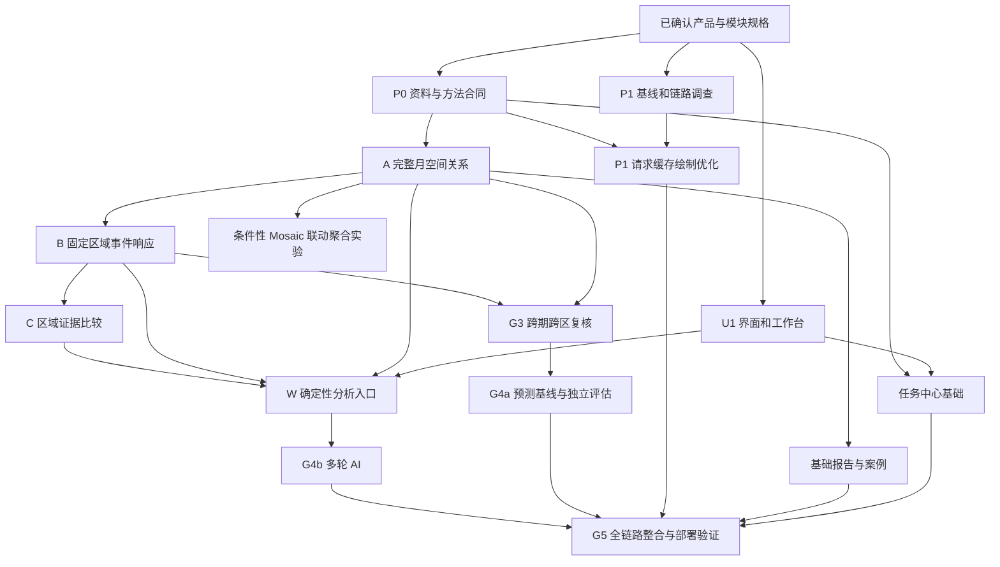

# Ocean 项目总体规划与推进总表

整理日期：2026-10-24。适用范围：完整研究版 L2 及其分阶段实施。本文统一总体目标、优先级、任务依赖、阶段关口和文档导航；具体计算规则以对应实施协议为准。实时开发进度仍以 GitHub Issues、实际检查、PR 和部署证据为准，不能仅凭规划表认定完成。

## 1. 项目最终要完成什么

建设面向渔业活动的海洋锋面分析与预测研究系统：让使用者能选择海域、日期/月份和公里范围，看懂锋面与捕捞活动的位置关系，研究它们何时、何地存在稳定关联，比较区域证据，并检验锋面信息对未来1–3天活动判断是否有额外价值。

完整研究版包含：可信数据、易用地图、A/B/C 分析、跨期/跨区复核、相似案例、独立预测回测、多轮 AI、后台任务、案例/报告导出及可维护部署。它们分阶段交付，当前执行总纲 #13 是其中一轮实施计划，不是项目全部终点。

研究真值为 AIS 表观捕捞活动/小时，非鱼量、渔获、收益或作业成功率。关系不稳定、模型无增益和资料不足同样需要报告；不能预设一定证明正向关系。

### 用户最终的典型操作

1. 选点、设公里范围，选择真实支持的日期或月份。
2. 看同日锋面、海温和活动，右侧读取少量事实与缺口。
3. 从工作台发起完整月关系、固定区域事件或区域比较，后台执行且地图可继续使用。
4. 展开图表、对照、区间和来源，按需让 AI 解释同一份确定性结果。
5. 保存案例、查看历史任务、导出 PDF/图表/汇总表，必要时按原版本复算。
6. 资料与验证支持后查看历史基准后的活动预测及其误差、适用条件；相对今天的滚动运行另行扩展。

## 2. 已确认的范围与决定

| 主题 | 已定原则 | 尚需调查/实验 |
| --- | --- | --- |
| 研究主线 | A 完整月关系 → B 固定海域事件 → C 区域证据比较；先东海，再跨年/季节，后其他海域 | 共同覆盖、实际年份/区域与独立样本 |
| 研究目标 | 检验距离、侧别、事件与活动的关系，以及锋面信息的额外参考价值 | 具体阈值、尺度、检验假设与模型效果 |
| 界面 Q47 | 原地图保留；左深工作台、右浅结果；两侧可收起；统一筛选；左侧图层/AI；右侧当前/历史/预测；底部按需详情 | 正式实现与设备验证 |
| 配色/显示 | thermal 海温、浅紫活动、统一对数活动标尺、原位置精简图例；取消默认热点截断；本轮不加平滑显示模式 | 全时段数值域、LOD、淡化/遮挡的真实样本验证 |
| 加载 | 概览后明细，保留视角、请求身份隔离；目标首开/换日/拖缩后为3/1/2秒 | 冻结设备/网络/冷热条件后测量；实际瓶颈与容量 |
| 预测 | 历史基准后1–3天活动强度为主、相对变化为辅；先局部，再东海；独立回测 | 标签、可知输入、模型、切分、指标与误差 |
| AI Q48 | 本人明确下达分析指令，在条件齐全/资料就绪/可执行范围内直接提交；缺条件澄清；改条件不自动重分析 | 工具覆盖、模型和费用方案；未就绪归档仍需主动准备 |
| 任务 Q49 | 服务器重启后安全恢复已提交任务；不可安全恢复标中断并可重试 | 恢复粒度、幂等、资源预算与实际故障验证 |
| 保存 Q50 | 轻量快照与复算记录保留；普通大产物按容量策略清理；主动保存案例/报告默认保护 | 保留天数、字节预算、备份与可复算支持 |
| 访问 Q51 | 在线模型问答首版仅本人；访客探索公开且就绪的地图、轻量查询及已有结果 | 最小维护者身份与服务端权限验收 |
| 协作/进度 | 无硬性截止；按依赖和验收推进；助手准备实现/检查/提交/PR，用户审核合并，部署单列 | 每项实际进度、远端状态与上线证据 |

不反复询问已定选择。数据、服务器、算法表现由调查和实验给证据；只有发现改变目标、数据授权、费用或重要使用取舍的问题时，再提出具体选项。

## 3. 当前真实基础与不足

下表是截至整理时的本地证据摘要；本轮没有重新核验线上版本、硬件或远端 Issue/PR 状态。

| 能力 | 已有证据 | 当前缺口与状态 |
| --- | --- | --- |
| 地图和数据链 | 原二维/球面、底图、日期/选点/半径、锋面/SST、离线/服务模式、LOD/RLE/缓存 | 有基础；不能据此认定全球联合研究或完整月活动分析已完成 |
| Q47 样稿与规格 | 独立布局、真实单日活动配色评审、正式界面规格 | 规格已定；完整样稿不是正式应用 |
| U1.1 非模态共存 | `codex/task-workbench` 本地提交 `53762af`，本次只读确认仍为主题目录最新提交；此前 data 923、e2e 145、layout 30 项无失败 | 本地实现/验证；未据此认定已推送、合并或部署；完整 U1 未完 |
| 活动资料 | 既有审计取得一个真实日样本及旧事件聚合表 | 单日可读不证明完整月共同支持；0.1°展示与研究粒度差异待解决 |
| 统计 | 描述汇总、旧响应表、逐行 bootstrap/符号翻转实验 | 有第一版代码；缺独立事件、统一分母和相关分组的正式协议验收 |
| 预测 | 当前规则推演与历史查询 | 未形成已验证活动模型、冻结切分和独立评估 |
| AI/任务/报告 | 任务导航、后端工具与证据基础、部分报告和加工日志 | 未形成完整多轮、产品后台任务、恢复/保留策略及系统内成果包 |
| 性能与容量 | 源码审计、论文选型、一次公开接口样本 | 未完成可复现全链路基准；硬件容量未知，单次接口耗时不等于交互性能 |

旧 e2e 中保留的评分/四页签断言只说明未迁移部分的回归，不是 Q47 最终界面验收标准。后续改对应功能时更新断言，不能靠旧测试总数掩盖规格缺口。

## 4. 总体依赖

界面和本地性能调查可以先做，不必等待全部 P0；正式分析和特定性能比较依赖相应资料合同。Mosaic 实验不阻塞近期地图修复，完整 AI 不阻塞确定性按钮入口，报告和任务中心从首批可信分析开始增量建设。

## 5. 各工作包的实现范围

### 5.1 P0：资料、状态与方法基线（#14）

逐层逐日审计日期、覆盖、实际粒度、有效零/缺测、版本与许可，核对完整月候选及前后窗口资料。建立共享的区域、公里圆、锋面缓冲、有效面积/天数和结果身份合同。

交付：脱敏资料清单、覆盖图/表、可支持的月份/区域/半径及不能支持的原因、版本和复算小例。0.01°目标与实际展示/源资料不一致时先做尺度评估和 ADR 决策，不静默更改。

验收：从数字能追到资料和分母；无记录不自动作零，文件齐全不自动作有效覆盖。完整月候选、受支持的研究尺度明确后，A 才进入正式计算。

### 5.2 U1/U2：界面、科学显示与使用流程（#15/#16）

按 Q47 迁移：左侧快捷功能＋AI 两模块；日期/坐标/半径独立筛选浮层；左侧图层入口；右侧当前/历史/预测简短结果；底部按需详情。非模态、共享条件、地图原框架保留，轻量自动更新、详细分析主动发起。

U1.1 仅解决侧边共存，后续完成筛选、模块和结果迁移。U2 实施 thermal/浅紫、同源图例、固定标尺/明确局部增强、活动全量/尺度聚合、最近/选中标签、真实时间身份、已应用条件恢复及缺日播放暂停。

验收：新用户完成选点→看概况→发起支持的任务→看证据，无伪推荐、伪概率、伪 AI。地图点选/拖缩/回中、关闭/Esc/焦点、快切条件、手机基本浏览分别验证。

详见[前端正式规格](../specs/ocean-frontend-redesign-draft-2026-10-23.md)。

### 5.3 P1：可视化算法、论文优化和容量（#17）

先完成现服/资料盘点与全链路基线，再按瓶颈做请求身份、渐进加载、有界缓存、绘制增量、隐藏面板按需计算和活动尺度聚合。保留完整分析真源。

论文路线分清作用：imMens 借鉴分桶/视觉分辨率；Mosaic Selections 对照共享筛选/预聚合；PNG/COG/Zarr 对照展示/窗口/多年读取；Canvas/WebGL 仅在绘制仍是瓶颈时比较。可视化实验必须有普通方案基线、构建/更新成本、数值一致性和采用/放弃结论。

交付：冷/热场景基准、瓶颈证据、优化前后对照、缓存/并发上限及现服保留或升级建议。CPU/RAM、磁盘、IO、带宽与归档分别核算；没有盘点和测量前不把候选配置当购买结论。

详见[加载专项](ocean-visualization-performance-plan-2026-10-23.md)与[方法安排](ocean-methods-selection-and-validation-2026-10-24.md)。

### 5.4 A/B/C：可信分析闭环（#18/#19/#20，复用#9）

A 对完整月逐日关联，比较距离带/侧别和活动分布，使用共同有效面积/日期及同月对照。B 固定区域识别事件，比较前7日、后1–3及1–7日，与同日可比非锋面区域对照；处理窗口不足、重复/相关事件。C 在同条件下并列区域证据和局限。

优先复用成熟统计工具；定制分析支持、几何、事件、对照与分组推断。旧逐行检验须改造，独立样本不足就降低推断强度。没有显著关系不算功能失败。

交付：逐日/月度摘要、事件/对照索引、效应与区间、敏感性/失败案例、地图图表与可复核报告。详见[统计实施协议](../specs/ocean-statistical-analysis-protocol-2026-10-24.md)。

### 5.5 G3：扩大研究和相似案例

单月闭环后先东海跨年份/季节，后其他海域，独立复核冻结的方法；探索和最终复核分开。相似案例先按海域、季节和有依据的环境/活动条件检索，显示差异和失败情形。

只复用必要短窗口匹配作案例核对，说明不确定/断档；深入锋面移动、分裂合并和生命周期不列本版必交。相似检索不是预测独立验证的替代。

### 5.6 G4a：预测研究

先冻结标签、可知时间、空间支持与切分，再跑持续性/近期均值/季节常态基线，然后受控比较可解释模型与一类成熟树模型。相同条件下比较有无锋面特征，分提前量、时间/海区和质量报告误差。

不要求从零自创网络。样本不足先交付基线和可行性结论，不以一个月证明预测泛化。正式评估允许无增益，仍保留误差与失败报告。

交付：协议、标签/特征、切分与环境记录、基线/模型、增量实验、模型卡、可复算结果和限定范围展示。详见[预测实验协议](../specs/ocean-prediction-experiment-protocol-2026-10-24.md)。

### 5.7 W/G4b：确定性工具与多轮 AI（#21 及后续子项）

按 A/B/C 各自验收逐项接入按钮，不等待所有研究完成。工具共享条件、版本、状态和错误合同。随后接自然语言意图、继承/修改条件、比较与解释，引用同一确定性结果；模型不另算数值。

本人明确分析指令可直接提交合格任务；缺条件澄清，未准备资料主动准备，重分析不因改条件偷跑。在线 AI 首版仅本人，服务端校验；访客沿用公开就绪范围。模型不可用仍可手动操作，费用/外发资料边界在接入方案中落实。

交付：工具清单、任务/结果绑定、典型多轮案例、失败/含糊请求处理、证据正确性与手动降级。聊天框或模型接通不算完成。

### 5.8 公共任务、成果与运行维护

任务中心管理后台执行、排队/进度/取消/重试、历史结果和版本；服务器重启安全恢复已提交任务，不能安全恢复则中断。关闭面板或离开网页不取消任务，不因重开网页新建计算。

所有任务保存轻量结果/复算记录；大临时产物按容量策略清理；主动保存案例/报告默认保护，展示资料是否仍可复算。源资料、缓存、结果和备份分别设预算。

成果包包括 PDF、图表、汇总表、条件/数据/方法版本和证据。本人案例不自动公开。部署记录提交/数据版本、服务配置、冒烟、恢复/回滚及线上结果；公开读取、本人执行和在线模型访问分别做后端校验。

## 6. 统一任务台账

下表是本地实施拆分和启动状态，非远端 Issue 最新状态。STAT/PRED/METHOD/PERF 为已有工作包下的子项，不重复建立总任务；后续阶段的 GitHub 子项在进入实施前关联现有总纲。

| 本地工作项 | 关联 | 当前状态 | 前置与交付 |
| --- | --- | --- | --- |
| PLAN 总体/模块规格整理 | #13、全路线 | 本轮文档已整理；数据参数未冻结 | 本文、方法/统计/预测协议与历史索引统一 |
| P0 覆盖/版本/粒度审计 | #14 | 有审计基础，需补核实 | 来源、完整月候选、受支持尺度和零/缺测合同 |
| U1.1 非模态共存 | #15 | 本地实现/验证，提交53762af | 本地票据；远端、合并、部署另核 |
| U1.2 两模块和快捷入口 | #15 | 可开始 | 原条件复用；待接入能力诚实显示 |
| U1.3 独立筛选/图层 | #15/#16 | 可开始，与2协调 | 日期/坐标/半径及原地图交互一致 |
| U1.4 精简结果/底部详情 | #15/#16 | 可开始基础迁移 | 右侧三入口、事实摘要、证据按需展开 |
| U2 科学显示和时间状态 | #16 | 布局可推进，数值域待P0 | 配色/图例同源、活动全量/聚合、时间与缺测 |
| PERF-01/02 盘点与基线 | #17/#14 | 可开始本地准备；现服事实待取得 | 全链路场景与脱敏清单 |
| PERF-03–05 加载/缓存/绘制 | #17 | 正确性修复可先，性能采用待基线 | 乱序安全、渐进、有界内存和前后对照 |
| PERF-06/07 格式/论文原型 | #17 | 条件性待前置 | 对应瓶颈成立；07还需A统一语义 |
| PERF-08 容量决策 | #17 | 待实测 | 分场景现服/升级建议，无盲目采购 |
| STAT-01/02 方法合同/直接参照 | #14/#18 | P0合同可先准备，计算待合格输入 | 精度/分母冻结后形成直接计算基线 |
| STAT-03 完整月A | #18 | 待P0和直接参照 | 月度关系、对照、敏感性及报告 |
| STAT-04/05 固定区B | #19/#9 | 待A及完整窗口 | 事件/对照/分组区间与不足 |
| STAT-06 区域C | #20 | 待A/B相容结果 | 同条件证据并列，无排名 |
| STAT-07/G3 复核与案例 | 全项目后续 | 待冻结方法及独立样本 | 跨期/跨区复核、相似检索、失败条件 |
| PRED-01–06 预测实验 | G4a | 尚未进入正式模型训练 | 可行性→标签/基线→模型→独立评估→展示 |
| W 确定性入口 | #21 | 随U1及A/B/C逐项接入 | 同条件任务/结果/版本一致 |
| TASK 公共任务基础 | 公共模块，关联#21 | 有加工基础，产品流程待实现 | 最小后台任务/记录先服务A，再恢复/清理/预算 |
| REPORT 案例与成果 | 公共模块 | 随A开始，尚未形成完整系统内包 | 保存轻量快照、图表/表/PDF，版本与复算 |
| AI 多轮及在线模型 | G4b | 工具验收后分批启动 | 正确执行/澄清/解释、权限与降级 |
| OPS 整合部署与故障验证 | G5 | 具体实现检查后进入 | 版本、权限、备份恢复、冒烟、成果复算 |

## 7. 近期批次安排

不写未经测算的周数。每批只推进具备前置的任务，并保存“做到哪一步”的证据。

### 批次0：规划整理（本轮）

完成总体导航、方法选型、统计与预测协议、任务依赖与验收整理；标清已确认/待调查/候选/后置范围。更新旧文档适用说明，不修改科学结果或把规划记为实现。

### 批次1：使用障碍与资料事实

- U1.2–4 推进两模块、筛选/图层、三结果入口和底部详情；对应区域完成就运行真实交互/布局回归。
- P0 补共同覆盖与粒度、零/缺测、源版本，给出真实完整月候选。
- PERF-01/02 取得能核实的部署/资源/资料清单，建立本地和测试环境基准；没有现服权限时明确缺项，不阻断其他可做工作。
- 交付：界面可用批次、资料合同初版、基准工具及第一份证据。半径/全年色域随源支持确定，不盲定数值。

### 批次2：首个可信完整月

STAT-01/02 冻结主指标和几何，STAT-03 完成 A；U2 接科学显示与月/日状态；P1 实施与瓶颈对应的请求/缓存/绘制优化。TASK/REPORT 提供第一版结果记录和基础报告，W 接入已验收 A。

交付：一个完整月可复算，至少能通过基准、异点、边界、缺测和无明显关系路径。若联合资料不足，先补缺口或明确缩小支持，不以抽样伪装通过。

### 批次3：事件与区域证据

补齐前后窗口、独立事件和可比对照，依次 B、C；接入相应工具/报告。安全恢复、失败重试和保留策略随后台任务同步完善。Mosaic 原型仅在联动查询与 A 语义稳定且成本成立时进入。

交付：能从事件/区域结论回到几何、逐日支撑、对照与区间；没有排名或因果过度表述。

### 批次4：扩展复核和预测

东海跨年/季节及后续海域复核、相似案例；满足预测样本条件后按 PRED 子项冻结协议、跑基线/候选和锋面增量实验。AI 在对应工具稳定后并行分批接入，不等待所有预测完成。

交付：独立复核、预测误差与增量/无增益结论、多轮真实工具使用。外部实时资料尚未解决时保持历史研究标识。

### 批次5：完整研究版整合

数据→任务→图表→解释→保存/导出全链路验收，补性能、故障恢复、访问边界、复现和部署说明。用户审核合并后再按既定边界安排部署与线上验证。

## 8. 阶段关口

| 关口 | 可以验收什么 | 不能据此宣称 |
| --- | --- | --- |
| G0 规格与支持 | 已定范围明确、初始审计/协议与未决事实登记 | 所有阈值/模型已确定 |
| GU 首批界面 | 非模态、共享条件、正确入口/状态、地图交互与可读性 | 完整统计/AI/预测已实现 |
| GD 资料与方法 | 合格月候选、精度、几何、覆盖/分母、可复算参照 | 任意年份和海域均支持 |
| GP 性能 | 冻结环境中结果一致且全链路指标有对照 | 论文中的倍数适用于Ocean或硬件需求已普适证明 |
| GA 单月 | A 的完整日历支持、对照、敏感性与不足可复核 | 跨季节泛化或因果 |
| GB 事件 | 固定区域、完整窗口、独立组与可比对照 | 旧表每行都是独立事件 |
| GC 比较 | 同条件并列证据和不可比原因 | 渔获/成功率或推荐排名 |
| GV 扩展复核 | 冻结方法在独立时空样本复核 | 所有海域普遍有效 |
| GPR 预测 | 基线/模型/锋面增量、独立误差与边界齐全 | 当前实时作业预报可靠 |
| GAI 智能工具 | 多轮条件/任务/结果正确、证据与权限可靠、失败可降级 | 模型接通就是科研验证 |
| GS 完整交付 | 版本/任务/成果/恢复/性能/部署证据与全链路一致 | L3真实作业收益已经验证 |

## 9. 方法与论文工作的统一要求

每个算法/统计候选都回答：解决哪个实际成本或研究问题，依据哪个原始来源，适用假设是什么，与哪个简单方案比较，需要怎样适配，如何验收，什么情况下放弃。

可视化采用 E0–E6；统计采用 STAT 子项；预测采用 PRED 子项。新数学算法不是本版必需前置。若主张算法创新，需要原始文献定位、可复现基线、消融与独立实验，不能仅凭更换模型/渲染技术命名。

所有实验在合法可复算小样本先建立正确参照，再扩大。数据过滤、缺测处理、距离归属和缓存不得在优化时改变统计语义。模型选择与参数选择不能查看最终测试效果后反复修改仍称独立验证。

## 10. 任务、成果、访问与恢复验收

- 任务绑定提交时条件/版本；连续改条件不生成重复重任务，返回结果不覆盖其他任务或新条件。
- 准备资料与分析分开：后台准备完成只提示就绪，由用户再发起详细分析。
- 重启只恢复已提交且安全可续的任务；重复提交/取消/失败/中断不发布半成品或重复收费调用。
- 历史结果保留原身份；新计算产生可区分结果，不覆盖旧快照。清理大产物后仍说明哪些可看、哪些需复算、复算资料是否可用。
- 公开演示只读确认可公开的资料/结果；本人后台任务、归档、案例与在线模型接口服务端授权，不能靠前端隐藏按钮。
- 本地通过、提交、推送/PR、合并、部署、线上验证分别记证；没有实际执行的检查不写通过。

## 11. 风险、调查与重新决策点

| 风险/缺口 | 先做什么 | 处理与重新决策条件 |
| --- | --- | --- |
| 无合格完整月/窗口 | P0逐日覆盖、相邻月与许可核查 | 补可访问资料；若需新增授权/范围，带证据提出选择 |
| 原粒度不支持小半径 | 源语义与边界偏差试验 | 限定尺度/补合格资料，涉及方法目标变更时评审ADR |
| AIS覆盖/零未知 | 核对来源和加工，不用稀疏记录当完整零图 | 限制分母/结论或暂缓相应分析 |
| 现服资源/接口未知 | 只读盘点、实际路由、基线 | 先修链路和减少重复工作，再给容量/费用建议 |
| 论文方案无净收益 | 数值一致后测冷启动、更新、交互及资源 | 保留简单方案、记录负结果，不强制迁移 |
| 事件独立样本不足 | 去重/分组与窗口支持统计 | 降为描述/案例或扩样，不制造精确区间 |
| 预测泄漏或样本不足 | 可知时间及冻结切分审计 | 重建协议、补独立样本，维持实验状态 |
| 模型无稳定增益 | 同条件基线/消融、分组失败分析 | 如实报告；不以调整测试集或包装评分解决 |
| 缓存/结果增长失控 | 字节、活跃工作集、版本与临时空间盘点 | 限并发/有界缓存/分层保留；不删除受保护案例 |
| 新服务费用/外发/公开风险 | 准备具体调用/资料/权限方案 | 按已定费用与许可边界单独明确，不自动扩大 |

这些调查不是新增一批无依据的偏好题。需要用户判断时，先给具体结果、选项、成本和影响。

## 12. 进度、分支与证据怎么跟进

每个子项记录：ID/Issue、目标、依赖、状态、责任角色、分支/提交、实际检查、交付物、PR/合并/部署状态、残余问题和下一步。

状态采用待前置→可开始→实施中→验证中→PR待审→已合并→已部署验证；仅完成文档的写“规格已整理/待冻结”，不填虚构完成百分比。助手推进调查、实现与检查；用户决定重要范围/费用/许可取舍并审核合并。

每个逻辑切片单独可审查。前端按影响更新 data/e2e/layout；统计/预测验证数值、分组、缺测/边界与泄漏；性能固定资料/设备/网络、记录冷热及原始摘要；文档检查链接与空白。没有代码改动的规划整理不重复运行整套应用测试。

本次是本地规划整理，没有读取/写入最新远端状态。既有 #13–#21 和 #22/#23 仅作关联；当前 GitHub CLI 不可用的限制沿既有本地票据记录，后续同步不能冒充已完成。保留现有其他未跟踪资料，源码、文档、许可允许的成果分别审查提交，不夹带原始 AIS、密钥、服务器地址或个人路径。

## 13. 文档分工与阅读顺序

| 文档 | 当前职责 |
| --- | --- |
| [本总体规划](ocean-master-plan-2026-10-24.md) | 唯一总体导航、优先级、跨模块依赖和统一台账 |
| [全项目路线](ocean-global-roadmap-draft-2026-10-22.md) | 长期范围、用户决定与后续边界，保留讨论历史 |
| [阶段执行计划](ocean-execution-plan-2026-10-22.md) | #13–#21 现阶段具体实施/验收及分支记录 |
| [Q47前端规格](../specs/ocean-frontend-redesign-draft-2026-10-23.md) | 最终界面分工、交互、状态与科学显示要求 |
| [可视化性能专项](ocean-visualization-performance-plan-2026-10-23.md) | PERF工作包、测量与论文/格式选型、容量报告 |
| [方法选型安排](ocean-methods-selection-and-validation-2026-10-24.md) | 三类方法的借鉴/定制边界、候选和METHOD关联 |
| [统计协议](../specs/ocean-statistical-analysis-protocol-2026-10-24.md) | P0/A/B/C与跨期统计的输入、指标、事件、推断及冻结 |
| [预测协议](../specs/ocean-prediction-experiment-protocol-2026-10-24.md) | 标签、可知特征、基线/模型、切分、增量实验和误差 |
| [10.21要求追溯](ocean-ui-loading-recording-review-2026-10-23.md) | 建议书M01–M08与当前任务的映射，不把整理当录音逐字原文 |
| [U1本地票据](../tickets/research-analysis/15-task-workbench.md) | 已实现切片、实际测试、截图、提交及残余项 |
| [原文件任务合并表](ocean-merged-task-summary-2026-10-22.md) | A01–A19来源索引，原建议不覆盖后续已确认决定 |

发生冲突时先查最新用户确认和当前模块规格，更新适用说明；不得让旧草案和新规格同时成为验收标准。具体方法冻结后的版本应登记在对应协议和任务证据中，不能仅改总览表。

## 14. 本轮整理的完成边界

本轮完善可视化实验的执行/采用规则，补统计与预测实施协议，统一总体路线、台账、近期批次、依赖、风险和文档入口。没有运行新科学实验、训练模型、修改应用、购买资源、更新远端 Issue/PR、合并或部署；既有 U1.1 的完成证据仍单独保留。

## 15. 实施接续记录（2026-10-27）

- #6静态视窗适配已由PR #297合并：类型/来源/覆盖校验、缺测与零、旧缓存隔离及同源摘要。原服务核62个展示日期，详见[API交付记录](../reports/ocean-static-viewport-implementation-2026-10-27.md)。
- #8前端视窗消费已实现并按本地验收推进：部分覆盖/失败提示、请求与数据片缓存身份、历史响应/日格网隔离、球面可见性、SST精度和图例来源。详见[前端交付记录](../reports/ocean-viewport-display-implementation-2026-10-27.md)，PR和合并状态以Issue记录为准。
- #10同步准备已实现并按本地验收推进：固定提交/许可资产/目录边界、源码已有服务与O01包区分、范围就绪JSON、严格未通过及安全回退说明。详见[同步准备记录](../reports/ocean-sync-smoke-implementation-2026-10-27.md)；#11真实同步/#12完成复核及实际目标准入仍未由此完成。
- 上述交付是静态展示与软件边界；#46真实B1、论文候选端到端收益、容量、P0原档资格和真实科学结论仍保留各自关口，不能用截图或受控小例代替。
- 根据用户计划更换服务器，暂缓旧服务器深度SSH盘点、调优及部署；#47/#228保持开放及真实阻塞，新目标明确后按实际配置验收。迁移时仍需最小核对旧数据、配置、成果和备份，不因换机取消。
- 原#9实验已有软件和聚合展示，但真实完整后7日资料仍缺，不虚构对称窗口或关闭实证关口。后续继续选择依赖满足的本地软件任务，不等待旧机连接、不绕过研究或生产前置。
