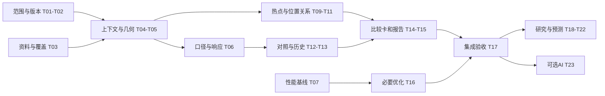

# Ocean 项目任务推进计划

> 历史版本：本文件保留2026-10-21的T01–T23任务及当时估算。当前目标、无硬性截止、A→B→C依赖、界面与方法安排以[2026-10-24总体规划](ocean-master-plan-2026-10-24.md)及对应实施协议为准；旧周排期和未确认提案不再作为执行约束。

> 编制日期：2026-10-21。版本：v1.0，待开工校准。依据：功能现状 PDF、当前仓库与已有实验；本次不重新部署、不运行新实验，也不创建 GitHub Issue。
> 本文 T01-T23 为计划内任务编号，不是 GitHub Issue 编号。事实、工作量估算、建议目标分别表述；勾选框均为后续验收项。

## 01 目标、交付与排期假设

### 本轮首先要交付什么

完成“附近锋面与捕捞活动关系分析闭环”：给定位置、日期和作业范围，查看活动区域与锋面，计算位置关系、前后变化和对照，输出带覆盖、样本与来源的报告。第一轮不承诺鱼群、渔获或收益预测。

### 两段推进

- 第一段：建议 4 个工作周交付核心闭环，包括可信数据、空间关系、有限历史、比较卡、报告与必要加速。
- 第二段：核心闭环通过后，再用约 3 个工作周开展多年复核和一个明确预测目标的首轮验证；资料补齐时间较长时顺延。
- AI 总工作台是可选扩展，排在基础功能稳定之后，不作为第一段完成的前提。

### 估算假设

默认 2 名成员：A 负责产品界面与集成，B 负责数据与分析；双方互审。每人每周投入 4 个项目人日，1 人日按约 6 小时有效工作计算。角色是建议分工，人员姓名待开工填写。

| 项目 | 基准工作量 | 可用容量与缓冲 |
| --- | --- | --- |
| 核心 T01-T17 | 25 人日 | 4 周约 32 人日，预留 7 人日处理返工、数据问题和验收 |
| 研究 T18-T22 | 12 人日 | 后续 3 周约 24 人日；包含跨期数据检查和实验周转余量 |
| 可选 AI T23 | 2 人日 | 从研究阶段余量安排，不挤占正确性与独立测试 |

上述为任务拆解后的基准估算，不是已经测量的工时或截止承诺。数据授权、补齐和服务器限制会影响日历时间。每周按实际剩余工作量重估。

## 02 当前基线：继承什么，不重复做什么

### 已有基础

| 领域 | 当前已有 | 本轮应补的部分 |
| --- | --- | --- |
| 当前页 | 坐标、日期、10/20/30 km、锋面与 SST、距离与属性 | 统一任务上下文，明确覆盖和数据状态 |
| 历史页 | 新界面筛选与固定锚点三日抽样；有错位保护 | 有效区域的完整研究窗口查询，不挪用固定样本 |
| 活动资料 | 2017-2024 日目录；线上默认 0.1°；已有叠加逻辑 | 来源粒度复核、覆盖、局部汇总和热点 |
| 响应表 | 62 个日事件、三档半径、186 行 | 稳定事件绑定、单位归一化、对照与真实后七日 |
| 实验 | 重复抽样、置换检验、summary/manifest/report | 分组评估、完整窗口和独立复验 |
| 服务与缓存 | 查询封装、视野与历史缓存、报告基础 | 线上版本核对、按当前契约集成和必要优化 |

本地票据 04、06、07 分别已有查询服务、部署手册和缓存基础；票据 05 明确为 partial。不要重新安排“从零实现查询/缓存/bootstrap”；应复用并补验收缺口。

### 不应误报的完成项

- 当前历史页的 7% 来自固定点位每年 8 月 5-7 日、2/30 个有效日，不是完整月份。
- 186 行不是 186 个独立事件；真实完整 post7 记录为 0/186。
- 温差代理已有，不等于上游原始强度场；未来页是规则参考，不是已验证预测。
- 本地实现不自动等于线上能力。本计划未重新核验所有线上接口。

当前仓库基线提交为 `9ecbf3e`。GitHub 是权威问题跟踪入口；本机未发现 gh 命令，本次未核实远端 Issue 的最新开闭状态。开工先映射现有 Issue，避免重复开单。

## 03 要解决的问题与范围边界

| 优先级 | 问题 | 直接影响 | 对应任务 |
| --- | --- | --- | --- |
| P0 | 点位、事件、日期、版本未统一 | 可能把异地或异对象响应解释成当前结果 | T01、T02、T04 |
| P0 | 有效覆盖与缺测分母不足 | 未观测可能被当成零 | T03、T05 |
| P0 | 前后时长、面积与单位不一致 | 差异可能只是窗口长短或面积差 | T06、T12 |
| P0 | 缺后七日与边界日期 | 不能完成原七日实验验收 | T03、T06 |
| P1 | 只有叠图，缺热点和位置关系统计 | 用户难以形成可复核结果 | T09-T11 |
| P1 | 历史与候选比较不完整 | 难判断单日线索是否有背景支持 | T12-T15 |
| P1 | 缺当前性能基线与链路测量 | 不知道应优化哪里 | T07、T16、T17 |
| P2 | 泛化、预测与 AI 调用未验证 | 不能升级为可靠预测或总工作台 | T18-T23 |

### 第一段固定范围

- 海域：现有东海有效窗口，优先 120-128°E、27-34°N。
- 事件日期：2024-07-01 至 08-31；完整前后七日需要检查 06-24 至 09-07 的资料。
- 默认解释 20 km，10/30 km 做敏感性；区分用户作业圈与锋面缓冲区。
- 历史功能第一段先覆盖已准备好的完整研究窗口；其他月份或海域返回明确不可用。
- 第一段不新增全球分析、全量原始强度归档、实时海况或产量模型，不强制引入 GPU 或分析数据库。

## 04 七周安排与里程碑

| 周次 | A：产品界面与集成 | B：数据与分析 | 当周交付与检查 |
| --- | --- | --- | --- |
| W1 | 版本/接口盘点，统一条件与状态骨架，性能采样 | 数据清单、粒度/覆盖核对，事件与几何口径 | 有可复查基线；G0 第一次检查，未过项进入 D6-D7 |
| W2 | 地图与列表联动，条件变化失效，热点与关系展示 | 归一化响应、热点、最近关联与距离带 | D7 目标通过 G0；D10 通过空间子闭环 Gs |
| W3 | 历史、候选比较、曲线与报告界面 | 对照、有效历史查询、侧别及事件选择复核 | 同一事件的地图、表、曲线和报告能对应 |
| W4 | 局部更新与缓存边界，回归、已部署环境核验 | 正/无变化/缺测样例、结果复算与文档 | D20 目标通过 G1，交付核心闭环与残余问题 |
| W5 | 多年份筛选与研究结果展示支持 | 联合样本、分组统计、预测协议和标签冻结 | 样本与规则冻结，确认能否进入预测评估 |
| W6 | 实验结果展示、可选 AI 包装的条件评估 | 简单基线与一个可解释模型，验证集选型 | 模型/基线可复算；未动测试集调参 |
| W7 | 比较报告、复核与材料整理；有余量才做 AI | 独立测试、校准/误差与分层分析 | G2：报告预测有无增益；无增益也是有效交付 |

### 三个主要出口

- G0：可信基础。任务条件、来源、有效覆盖、几何与单位通过检查；未知项明确标记。
- G1：核心闭环。至少一个真实、覆盖可解释的事件能从地图走到同一对象的关系、对照与报告，其余状态另测；若全部事件覆盖未知，只能记录工程链路通过，分析验收未过。未满足完整七日的票据仍为 partial。
- G2：独立研究评估。交付冻结协议和测试结果，不以“必须显著”或“必须胜出”作为成功条件。

本表用相对工作周，不预设开工日期。D1 是实际开工首日。若 G0 的数据条件未满足，界面可以继续做空态和条件组织，相关数值能力不得越过门槛。

## 05 前十个工作日怎样落地

| 工作日 | A 的重点 | B 的重点 | 当日应能检查的结果 |
| --- | --- | --- | --- |
| D1 | 复现原型路径，记录界面与环境版本 | 共同固定研究问题、区域、时间和单位 | 任务范围表、负责人、已有 Issue 映射 |
| D2 | 列线上/本地接口与来源差异 | 列逐日联合资料、缺失与输入粒度 | 接口清单和第一版覆盖清单 |
| D3 | 建统一任务标识与旧结果失效规则 | 定义事件身份与 km 几何口径 | 换条件不能混用旧任务；事件可追溯 |
| D4 | 接通加载/不可用/部分可用状态 | 检查掩码、有效面积和前后字段单位 | 缺测与零值样例分开；单位字典 |
| D5 | 记录冷/热操作基线，做 G0 初验 | 核对一个事件前后归一化结果 | 未过项、剩余工量与处理人明确 |
| D6 | 帮助对齐查询响应与任务条件 | 重算事件样例，核查零基线和边界窗口 | legacy/v2 结果可对照，不覆盖旧证据 |
| D7 | 完成条件摘要与失效联动 | 关闭 G0 阻断项；无资料则明确降级 | G0 记录：通过或具体阻断，不模糊结项 |
| D8 | 接活动区列表与地图选中 | 局部活动汇总和透明热点基线 | 单一作业圈的完整汇总可复算 |
| D9 | 接热点到锋面的连线与分项证据 | 最近距离与互斥距离带 | 地图与表中同一对象、同一单位 |
| D10 | 集成空间路径并演示缺测状态 | 复算三档半径、边界与缺测样例 | Gs：点位→活动区→锋面关系能走通 |

这是日目标，不是把串行依赖强行并行。B 的数据工作超出当日容量时，A 优先协助清单、边界检查与复算；不提前接入未经验证的数值。

## 06 依赖关系与并行规则

### 并行能做的事

- W1 可以同时做接口盘点、数据清单和界面状态设计。
- 性能基线及低风险界面调整可并行，但真实数值展示依赖正确上下文。
- 空间模块和历史模块分别产出后，由比较卡和报告集成。
- 多年资料质量不足时，可继续交付样例范围内的描述分析；不据此升级泛化结论。

### 不得跳过的依赖

- 没有覆盖语义，不计算看似完整的活动密度或零活动结论。
- 没有单位确认，不解释增强比例；没有事件绑定，不把响应写进当前对象证据。
- 没有性能基线，不承诺加速倍数；没有冻结协议，不反复查看测试集选方法。
- AI 仅在现有确定性能力稳定后包装，不代替缺失的分析工具。

## 07 开工先定的口径与范围决策

| 决策 | 建议安排 | 没有条件时怎样处理 |
| --- | --- | --- |
| 分析输入粒度 | ADR-0001 优先 0.01°活动真源；线上 0.1°先视为当前服务能力 | 0.1°可做标明粒度的探索演示；正式替代研究真源前更新 ADR/数据说明并做边界敏感性 |
| 覆盖含义 | 区分文件可用、有效观测、有效水域和活动记录 | 无法确认覆盖时标 coverage_unknown，不把活动格点存在当作完整观测掩码 |
| 前后比较 | 先溯源确认总量/均值，再统一日均与有效面积 | 不盲目除以 7 或 3；无法恢复有效日则只展示原字段和限制 |
| 完整后七日 | 真实提供 post7，记录有效日和来源 | 维持 partial；不能由 post1_3 外推，也不能以夹具验收科学结果 |
| 增强阈值 | 保留既有 20%及非锋面对照方向，先明确同单位比较，产物方法版本升级 | 调整阈值或比较单位须同步需求、契约和实验，legacy 结果不覆盖 |
| 历史联合期 | 锋面可更长，AIS 已核对 2017-2024，按实际共同资料取样 | 不把 2015-2016 当作已有 AIS 联合样本 |

### 与旧文档的衔接

旧路线图的“AIS 未集成”与现有日服务、真实来源声明响应表不同，应在 T01 同步事实，但不把叠图写成完整研究闭环。既有 50/50 评分设想在回测稳定后的阶段再评估，本轮不启动权重升级。

AI 总工作台来自当前产品想法；旧文档还保留模块内解释。第一段先保留模块内证据和手动入口，T23 再讨论统一入口，不在基础未稳时扩展聊天功能。

## 08 任务卡：范围、版本与资料

### T01 冻结第一段任务与分析口径

角色：A+B；前置：无；基准：0.5 人日；阶段：W1。

- 问题：范围、指标和“完成”含义不一致，容易重复开发或越界承诺。
- 动作：逐项确认第 07 节；映射已有 Issue 与本地票据；登记负责人、输入、单位和排除项；同步旧路线图中的过时事实。
- 交付：范围与决定记录、Issue 映射、验收样例选择规则。
- 验收：每项未决问题都有负责人和截止检查点；没有把规划写成已上线。决策不能由文档默认替代数据验证。

### T02 对齐部署版本与查询契约

角色：A；前置：T01；基准：0.75 人日；阶段：W1。

- 问题：线上/本地路径与 source 可能不同，优化或集成容易接错数据。
- 动作：盘点页面、接口、来源、覆盖和回退路径；以现有可用链路建立基线，再决定统一方式；记录服务器资源与缓存增长后再扩大数据范围。
- 交付：版本与接口矩阵、兼容/回退清单；部署定位信息保留在受控记录，不写入 Git。
- 验收：示例查询能解释返回的日期、范围、粒度和来源；本地新视野接口不因“存在”就算线上通过。

### T03 建立逐日联合资料与覆盖清单

角色：B，A 协助；前置：T01；基准：1.5 人日；阶段：W1。

- 问题：目录日期不等于联合有效观测，窗口边界和细粒度输入状态未知。
- 动作：先盘点现有授权资料；按 06-24 至 09-07 检查锋面、SST、活动；记录粒度、有效掩码、版本、可用/未知/缺失及补齐成本。
- 交付：coverage-manifest、缺口清单、可分析事件列表与不入选原因；原始与细粒度资料不进入 Git。
- 验收：逐日逐层状态可追溯；活动记录为空不自动为零；补齐无条件时明确限制，不启动全量归档下载。

## 09 任务卡：一致上下文与正确计算

### T04 绑定任务上下文与稳定事件身份

角色：A+B；前置：T02、T03；基准：1.5 人日；阶段：W1-W2。

- 问题：响应按日期/半径查表，局部编号随窗口变化，可能误用异对象证据。
- 动作：统一点位、区域、日期、km 范围、参考期、事件与来源版本；稳定事件号绑定规范几何及提取版本；区分单日事件身份与跨日追踪身份。
- 交付：上下文/事件字段约定、结果失效与缓存身份规则。
- 验收：换地点、日期、对象或版本后正确更新；同日不同窗口通过几何/来源核验关联，不只比较 F 编号字符串。

### T05 统一 km 区域、有效面积与缺测

角色：B，A 协助；前置：T03、T04；基准：1.25 人日；阶段：W1-W2。

- 问题：作业圈、锋面缓冲区和度数窗口混用，局部覆盖和边缘归属不清。
- 动作：定义三类几何；明确格点中心或面积加权算法及研究投影；分别记录总水域、有效观测面积和未知覆盖，做边界敏感性检查。
- 交付：区域计算约定、面积/覆盖字段和手工可复核样例。
- 验收：地图与统计使用相同区域；未知覆盖不能冒充 100%；0.1°边界误差在结果中说明。

### T06 重算前后响应并补完整窗口

角色：B；前置：T03-T05；基准：1.5 人日；阶段：W2。

- 问题：前 7 天与后 3 天总量不可直接解释为同单位变化，完整 post7 尚缺。
- 动作：核实源字段总量/均值；按有效日和可比面积生成 v2；保留前期零值、覆盖不足状态；有真实资料才生成 post7，记录全部窗口有效日。
- 交付：legacy/v2 对照、单位字典、响应表与实验 readiness 更新。
- 验收：可复算单个事件；零基线不输出虚假有限百分比；没有真实 post7 时不关闭原七日验收项。

## 10 任务卡：性能基线、主界面与活动区

### T07 建立正确性与性能基线

角色：A+B；前置：T01、T02；基准：1 人日；阶段：W1-W2。

- 问题：没有统一链路测量，难判断慢在哪里以及优化是否改变结果。
- 动作：固定设备/浏览器/版本/数据/操作；区分读取、计算、传输、解析、绘制和面板；记录冷/热、p50/p95、内存、传输量及数值快照。
- 交付：baseline-v1、场景脚本、正确性参照与原始测量摘要。
- 验收：相同操作可复测；首轮至少每场景 10 次冷/热记录，小样本分位数只作初筛；验收扩充到每组至少 30 次。

### T08 整合全局条件与结果层次

角色：A；前置：T02、T04；基准：1.5 人日；阶段：W1-W2。

- 问题：条件分散、观测日容易被误读，界面指标多而结论不清。
- 动作：整合位置/范围/日期摘要；历史参考期独立标明；按结论、证据、方法组织；区分真实、规则、示例、不可用和加载失败。
- 交付：主流程界面、状态文案、图层与证据展开交互。
- 验收：用户能定位任务条件和限制；改变条件后旧结果收起或更新；示例海况不混为真实证据。

### T09 局部活动汇总与透明热点基线

角色：B 计算、A 展示；前置：T03、T05；基准：1.5 人日；阶段：W2。

- 问题：有活动格点但无当前作业圈完整汇总和持续热点。
- 动作：汇总完整输入而非显示点；先用固定网格/相邻高值区透明方法，记录阈值与有效日；输出总量、密度可用性和近几日持续性。
- 交付：局部摘要、候选区域几何与列表、参数及覆盖说明。
- 验收：小时总量守恒；粒度和热点定义可见；无覆盖时密度不可用，单日高值不被包装成长久渔场。

## 11 任务卡：空间关系与对照

### T10 活动区到锋面的关联与距离带

角色：B 计算、A 展示；前置：T04、T05、T09；基准：2 人日；阶段：W2。

- 问题：现有最近查询主要是用户点到线，活动与锋面关系仍靠目测。
- 动作：统一当日候选几何；计算格点/热点到线的距离；生成互斥 0-10、10-20、20-30 km 带；同一活动不重复计数，显示连线与表。
- 交付：距离关系、分带量/密度/覆盖与边界处理说明。
- 验收：抽查距离与直接计算一致；分带归属可复算；分析不使用显示筛选后的子集。

### T11 冷暖侧关系与采样质量

角色：B 计算、A 展示；前置：T03、T04、T10；基准：1.5 人日；阶段：W3。

- 问题：存在侧别和温差代理，却未形成可比活动统计。
- 动作：在同日、相同距离带内分冷/暖/未知；保留采样数、掩码和来源；检验 SST 分档对代理值影响，结果分项展示。
- 交付：侧别表、覆盖与未知比例、代理属性说明。
- 验收：未知侧不强行归类；不同面积按同单位比较；温差代理不标成原生强度。完整跨日移动分析不列本任务完成项。

### T12 对照区、事件选择与前后曲线

角色：B，A 接图；前置：T03、T05、T06；基准：2 人日；阶段：W3。

- 问题：事件入选与对照可比性不足，难区分局部变化和海域背景。
- 动作：保留事件候选和未入选原因；对照距同日全部锋面至少 50 km；检查同时间段、有效面积与区域条件；输出前后日均及有效日曲线。
- 交付：事件/对照清单、几何排除核验、曲线和差异表。
- 验收：无合适对照时标不可用；50 km 不被当作可比性充分证明；不由差异直接推导因果或渔获。

## 12 任务卡：历史、比较与报告

### T13 接通研究窗口的有效历史统计

角色：B 服务、A 界面；前置：T03、T05、T06；基准：2 人日；阶段：W3。

- 问题：当前界面主要是固定锚点三日样本，服务端度数窗口未统一。
- 动作：复用历史服务，先对已备好的完整研究窗口预计算每日基础量；接 km 区域、共同有效日和月份；保留固定样本的明确标识与防误用。
- 交付：有效日/锋面率/活动量与可用性、年份/月份覆盖表。
- 验收：换位置结果对应新区域；未准备时段不返回锚点值；实际分母和未加载/无效日期可见。不要求第一段补齐全球全年。

### T14 候选比较与证据卡

角色：A，B 复核；前置：T06、T09、T10、T12、T13；基准：1.5 人日；阶段：W3-W4。

- 问题：多个指标尚未形成可解释关注顺序。
- 动作：并列 A/B 的环境、活动、持续性、样本与缺失；区分最近与证据充分；保留当前规则分和 AIS 分项，不新增未经验证的综合权重。
- 交付：候选比较视图、证据卡和可跳转对象。
- 验收：文字每个数字可追到表；支持矛盾证据和不可比较状态；不把 54 等规则分变成捕鱼概率。

### T15 统一分析报告

角色：A 集成、B 核对；前置：T14；基准：1.5 人日；阶段：W4。

- 问题：已有环境报告基础，但联合活动关系、候选比较与质量说明不完整。
- 动作：复用 reporting 能力；汇总地图、曲线、指标、覆盖、方法版本和参数；导出统一阅读材料，保留可复算摘要与生成入口。
- 交付：单任务报告、参数/来源清单和生成说明。
- 验收：全报告同一上下文；缺测断点可见；可重新得到主要数字，不包含禁止公开的底层活动资料。

## 13 任务卡：优化与核心交付

### T16 按实测瓶颈实施有限优化

角色：A 主责、B 协助查询；前置：T02、T04、T07；基准：2 人日；阶段：W2-W4。

- 问题：可能存在整图重建、隐藏页签重复计算、历史扫描和跨日缓存累积。
- 动作：按基线选前两项主要耗时；优先局部更新、延迟计算、索引和有界预取；缓存完整任务身份；有证据才试新渲染技术。
- 交付：前后同条件测量、数值一致性报告、缓存上限和失效策略。
- 验收：优化不改变任务结果；旧请求不覆盖新任务；长播放内存受控；达不到建议性能目标时记录真实数据和后续项。

### T17 集成、部署核验与 G1 验收

角色：A+B；前置：T08、T12、T14、T15、T16；基准：1.5 人日；阶段：W4。

- 问题：各模块独立可用不等于同一次任务能走通，部署版本还可能不同。
- 动作：跑第 19 节验收集和已有相关检查；按现有协作/发布流程同步经过验证的实现；核对已部署站点版本、来源、回退与结果。
- 交付：G1 记录、版本清单、操作演示、复算报告、残余问题与回退说明。
- 验收：正例、无变化例、缺测例通过；没有阻断性错配；离线回退保留；原七日票据只在真实满足时结项。

### 第一段工量与调度

T01-T07 合计 8 人日；T08-T17 合计 17 人日。基准总计 25 人日，留出 7 人日。若超过剩余容量，优先减少区域/历史范围和视觉扩展；事件正确绑定、单位、缺测与报告追溯不能删减。

G0 目标 D7、Gs 目标 D10、G1 目标 D20。任何目标未过，保留未过原因和后续安排；不能只因日期到了就勾选完成。

## 14 任务卡：多年样本与研究协议

### T18 扩展共同有效样本与相似事件基线

角色：B，A 协助；前置：G1；基准：3 人日；阶段：W5。

- 问题：单一 62 日窗口不能说明跨年份、季节和海区适用性。
- 动作：优先 2017-2024 共同资料的相同季节；先按同海区、前后 15 天季节窗筛相似事件，记录覆盖与入选规则；按服务器容量逐批准备。
- 交付：版本化样本清单、事件组、相似事件检索基线和不入选记录。
- 验收：入选条件先于结果分析确定；缺 AIS 的年份不伪造；扩展范围不超过实际有效资料。

### T19 分组统计与稳健性复核

角色：B；前置：T06、T12、T18；基准：2 人日；阶段：W5-W6。

- 问题：逐行重采样忽略事件与时间相关，单一半径结果不够稳健。
- 动作：复用实验 runner，按预定事件组/时间块评估；比较三半径、有效日规则与侧别；报告绝对差、相对差、中位数、区间及未见增强例。
- 交付：新实验版本、样本/方法 manifest 和分层结果。
- 验收：不把 186 行当独立事件；保留失败或无明显关系结论；不为追求显著性反复挑阈值。

### T20 冻结一个预测目标与样本协议

角色：B，A 复核；前置：T18；基准：1.5 人日；阶段：W5。

- 问题：现有规则百分比没有明确预测标签和独立评估协议。
- 动作：在锋面持续性与活动热点持续性中选择一个；固定 1/3 天提前量、输入截止、标签、分组、基线和主指标；设置重叠窗口隔离。已用于原型和规则探索的 2024 年 7-8 月不能自动当作独立测试集。
- 交付：prediction-protocol-v1、固定样本划分与特征可知时间表。
- 验收：不使用事件后响应作事件日输入；先锁定未参与方法选择的留出时空块；找不到合格留出资料则只做探索回测，不宣称独立验证。

## 15 任务卡：预测验证与可选 AI

### T21 简单基线与一个可解释模型

角色：B，A 支持实验组织；前置：T20；基准：3.5 人日；阶段：W6。

- 问题：尚无模型优于简单方法的证据。
- 动作：先跑延续昨天、近七日平均、同季节基线中适用者；只增加一个可解释候选模型；在训练/验证集选参数，记录特征和成本。
- 交付：基线与模型结果、可复算入口、参数和时间信息。
- 验收：同标签同样本比较；未访问测试集调参；模型失败或无增益不阻断核心产品交付。

### T22 独立测试与研究交付

角色：B 测试、A 整理；前置：T19、T21；基准：2 人日；阶段：W7。

- 问题：验证集表现不能代表未知时段效果。
- 动作：冻结方案后在留出期评估；报告基线差、误差/精确率召回率/校准中适用项，给出区间与覆盖；分海区或年份复核。
- 交付：测试报告、预测适用范围与 G2 记录。
- 验收：无增益也完整交付；测试后改方法需新研究版本；不把热点概率写成捕鱼成功率。

### T23 可选：AI 任务与证据组织

角色：A 包装、B 校验；前置：G1 且确定性能力稳定；基准：2 人日；阶段：W6-W7 余量。

- 问题：用户需要跨模块组织任务，但不能靠聊天补足不存在的工具。
- 动作：先接当前状态、历史比较、响应解释、报告四类现有能力；显式显示条件与引用；参数缺失时澄清，数值只能来自工具。
- 交付：有限任务入口和可跳回证据的解释，不要求引入在线 LLM。
- 验收：同条件结果一致；缺测不编造；过期上下文失效；AI 失败不影响手动分析。该项可整体延期。

## 16 统计验收：统一怎样算，哪些不能算

### 必须版本化的计算

- 在确认原字段含义后：前期日均 = 前期小时总量 / 前期有效日数；后期同理。
- 有效面积变化时，按日处理可比区域或使用小时/(有效平方公里×日)，记录采用的方法。仅用总小时除日数不解决空间覆盖差异。
- 前期为零：相对增幅不定义，报告绝对差、新增活动和零基线状态，不输出任意大百分比。
- 覆盖未知：保留原返回活动汇总与限制，密度、无活动判断或推断性结论按条件禁用。
- 旧表与 v2 并存用于核对，不能覆盖历史结果后仍沿用同一方法版本。

### 两个不同的验收出口

| 出口 | 能验收的内容 | 仍不能声称 |
| --- | --- | --- |
| G1 核心展示 | 完整前七日与后一至三日的有效子集、同单位比较、事件对应、缺口可见 | 所有事件完整、对称七日实验完成、关系可推广 |
| G7 原完整七日项 | 授权真实 post7 已提供；逐事件记录有效日；按既有要求通过并重跑报告 | 由夹具或三日外推取得真实七日结论 |

G7 单独记录。未取得完整真实输入时，原实验票据保持 partial。曲线可展示 -7 至 +7，但缺失点断开，不能插补成观察值。

### 研究结果的最小字段

事件身份、几何/来源版本、前后窗口、半径、单位、有效日、有效面积、覆盖状态、对照规则、入选原因、差异、区间、检验方法、随机种子和完整性声明。推断性实验样本充分性由精度和适用范围判断，不以“有三张演示图”代替。

## 17 预测验收：目标、划分与停止条件

### 先选一个问题

建议先做未来 1-3 天局部锋面持续性；若活动覆盖、热点标签和有效负例已可靠，也可优先活动热点持续性。T20 固定选择，不能把两者混在一个分数里。

| 环节 | 必须固定的内容 | 检查方式 |
| --- | --- | --- |
| 输入 | 预测当时及以前可获得的资料和发布时间 | 特征可知时间表；禁止 post1_3 泄漏 |
| 标签 | 未来实际观测、有效区域、提前量 | 缺测标签不作负例 |
| 数据划分 | 可参考 2017-2022/2023/2024 的时间顺序，但不得直接套用 | 2024 年 7-8 月已用于探索；独立测试另锁未参与选择的时空块，并隔离重叠窗口 |
| 对照 | 适用的延续昨天、近七日、同季节基线 | 相同样本、相同评价目标 |
| 指标 | 连续量用误差；分类用精确率/召回率；概率看校准；排序看前 K | T20 先定主指标与必要分层 |

### 提前停止或降级

- 无法确认活动覆盖与有效负例：暂停活动热点预测，可保留描述统计。
- 联合资料不足或标签不稳定：暂停建模，完成数据审计与基线报告。
- 既有样本都参与过界面/方法探索，无法保留独立时空块：只报告探索回测；不把已看过的 2024 年样例再次命名为盲测。
- 模型未超过基线：保留简单方法，报告无增益，不升级业务措辞。
- 如果面向真实当前日期：另设新鲜观测、发布延迟与真实海况任务。本轮历史回测不代表该能力已经具备。

G2 验收的是诚实、可复算的独立评估。任何新增业务概率解释都需要额外校准证据，不能直接沿用规则分。

## 18 性能安排与建议目标

### 测量计划

固定版本、数据、设备、浏览器和网络条件；分别测冷/热。D5 形成每场景至少 10 次初筛；W4 验收每组至少 30 次，保存分布和原始摘要，不能只报最快值。

| 场景 | 基线与优化动作 | 建议验收目标，D5 后校准 |
| --- | --- | --- |
| 热状态切点/半径 | 分离受影响统计、复用不变图层 | 端到端 p95 不超过 1 秒；达不到时列清主耗时 |
| 拖动缩放 | 远景 LOD、松手按需取数、局部更新 | 拖动有连续反馈，松手后结果不混日；分别记录交互与数据完成时间 |
| 研究窗口热历史查询 | 预计算基础量、时间/区域索引 | p95 不超过 2 秒；超出转明确进度或后台任务 |
| 冷查询/报告 | 记录读取与计算，不阻塞所有操作 | 1 秒内出现可理解反馈；不虚构所有冷任务都能立即结束 |
| 连续切日 | 限量预取、完整 key、淘汰 | 200 次操作不串任务；浏览器稳定后内存不持续单调增长 |

这些数字是待验证的产品建议，不是已有性能。T07 依据实际设备和数据量记录是否采纳及调整理由；正确性要求不因目标难达而降低。

### 优化选择

先处理测量中占比最高的两项。优先少算、少传、少重画；只有绘制确为主要成本才评估 Canvas/WebGL。试验没有收益就保留原方案。分析总量、几何距离、样本和缺测状态必须与直接计算参照一致。

## 19 核心验收场景与交付证据

| 场景 | 操作与应有结果 | 必留证据 |
| --- | --- | --- |
| C01 基准位置 | 2024-08-05，124.5°E/30.2°N，20 km；同版本复算最近对象 | 位置、几何与来源；不把 F034 当永久身份 |
| C02 改地点/对象 | 日期半径不变，改到另一位置或选另一线 | 所有响应跟随新对象或明确不可用，不复用异地表 |
| C03 快速切日 | 连续切 5/6/7 日并制造先后返回差异 | 最终页面与参数一致；旧结果只进自身缓存 |
| C04 半径边界 | 10/20/30 km 与恰在边界的格点 | 归属规则明确；嵌套量不相加，互斥带不重复 |
| C05 观测缺失 | 无文件、云/缺测、覆盖未知、网络失败 | 不同原因分别显示，不输出伪零和概率 |
| C06 真实零/零基线 | 在可确认有效覆盖条件下构造零活动或前期零 | 零值与未知不同；相对增幅不可定义时留空 |
| C07 窗口边界 | 7 月初/8 月末事件，缺少前后日期 | 有效日与缺失断点；七日 readiness 不误报完成 |
| C08 无合适对照 | 找不到满足排除与面积条件的对照 | 返回 unavailable，不挑任意空海区替代 |
| C09 历史切换 | 锚点/异点、已备好月份/未备好月份切换 | 样本与分母正确，旧结论收起，不挪用 7% |
| C10 报告与降级 | 导出后比对图、表和数值；服务不可用回退 | 同一上下文、来源及离线/服务器状态一致 |

正例、无明显变化例、缺测例按 T01 的规则确定，不为演示挑最好看的三个结果。合成夹具用于边界正确性；真实研究结论必须引用真实授权资料。

原 PDF 的 15.7 km、30.5°C、2/30 等是旧快照。方法或数据版本变化后先解释差异，不把复现旧数字当作最高目标。

## 20 风险、缓冲与延期时的取舍

| 风险/触发条件 | 处理动作 | 责任与影响 |
| --- | --- | --- |
| D3 仍缺输入粒度/覆盖说明 | 暂停相关密度与推断；保留标注清楚的探索展示，补来源审计 | B；数据条件不满足时相关验收顺延 |
| post7 无授权真实输入 | 继续合规三日解释；原七日票据保留 partial | B；不以外推或夹具结项 |
| 第 2 周依赖仍阻断 | 缩小研究区域/历史范围，先完成一个真实事件链 | A+B；G1 范围重估 |
| 性能优化收益不足 | 记录实测，保留可用方案；不大规模重写渲染 | A；避免技术支线吞掉闭环时间 |
| 服务器资源不足 | 先盘点容量，限制范围和缓存，再决定扩容 | A；不先下载大归档制造容量问题 |
| 统计不稳定或模型无增益 | 报告适用限制/无增益，保留描述与简单基线 | B；不把结果好看作为交付条件 |
| 两人投入下降 | 按实际人日重排；单人每周 4 人日时核心建议约 7-8 周 | 项目负责人；不沿用原 4 周承诺 |

### 延期时优先删减

可以延期：AI 总工作台、复杂聚类、完整跨日分裂/合并追踪、多年全季节扩展、非必要视觉动画、GPU 重写和综合评分升级。

不能删减：事件与条件绑定、单位与覆盖、缺测处理、真实/示例区别、来源追溯，以及基本复算和回归。缩小范围后必须同步验收，不把较小成果冒称全量完成。

## 21 分工、Issue 映射与完成定义

### 协作规则

- A：条件与状态、地图联动、比较/报告呈现、性能测量和集成。
- B：资料与覆盖、事件几何、统计口径、对照与预测评估。
- 每项指定一个最终负责人，另一人按验收样例复核；D1 填姓名，不能只写“大家负责”。
- 每日约 10 分钟同步：昨日完成证据、今日任务、阻断；每周末检查里程碑、剩余人日与下周范围。
- 分支与 PR 遵循现有协作流程，默认 codex/ 前缀；本文件不代表已经创建分支、PR、Issue 或部署。

| 新任务组 | 优先关联的现有票据/资料 | 开单原则 |
| --- | --- | --- |
| T02、T04、T05、T07、T16 | server-agent-backend 02/03/04/06/07 | 复用契约、查询、缓存与部署基础，增补未过验收 |
| T03、T06、T12、T19 | server-agent-backend 05；P1 响应表/对照/验证票据 | 明确 partial 和七日缺口，不重复“新建统计脚本” |
| T08-T15 | P1 UI/AI 证据、文案与报告票据 | 先查询权威 Issue 状态，再关联或拆出新任务 |
| T18-T23 | 路线图研究扩展、相似事件与后续 AI | G1 后按证据启动，不先扩大承诺 |

### 单项完成定义

实现 + 适当检查 + 可复查交付物 + 来源/方法版本 + 残余风险 + 对应 Issue 更新。若声称“已上线”，还必须有部署版本和线上复核；只有本地通过则写“本地完成”。

### 每周执行看板模板

任务 ID / 对应 Issue / 负责人 / 状态 / 前置是否解除 / 剩余人日 / 交付物 / 验收证据 / 阻断原因 / 下次检查日。

状态建议：待认领、待前置、进行中、待复核、本地完成、已部署验证、明确延期。票据状态以 GitHub 为准；本文只记录计划和阶段汇总。

## 22 第一周启动清单与依据

### 开工时先完成这些动作

- [ ] 确认两名成员及可投入时间；将 W1/D1 换成实际日期。
- [ ] 对照 GitHub 现有 Issue，映射 T01-T23，不凭本地票据推断远端状态。
- [ ] 核对部署/本地版本与实际可用接口，登记 source 与覆盖。
- [ ] 固定第一段区域、日期、默认半径和样本选择规则。
- [ ] 查清 0.01°授权研究输入与 0.1°线上输入的关系，记录粒度决策。
- [ ] 建联合资料和前后窗口清单，列出哪些结果只能部分可用。
- [ ] 保存旧表、旧实验和性能基线，给新方法独立版本。
- [ ] 预订 D5 初验、D7 G0、D10 Gs、D20 G1 的复核时段。

### 依据与阅读顺序

| 依据 | 本计划的使用方式 |
| --- | --- |
| output/pdf/Ocean功能现状与最终能力详解.pdf | 已有能力、最终任务、缺口与原始核对快照 |
| CONTEXT.md、docs/adr/0001-use-apparent-fishing-effort-for-front-response.md | 术语、0.01°研究路线、表观活动与产品边界 |
| docs/ocean-fishery-operation-roadmap.md、docs/ocean-gfw-response-issues.md | 原阶段设计、阈值、相似事件与历史计划 |
| docs/data-governance-gfw-ais.md、docs/agents/server-agent-backend.md | 授权、资料/发布边界、基本后端优先于 AI |
| docs/tickets/server-agent-backend/04、05、06、07 对应票据 | 已实现查询、partial 实验、部署与缓存基础 |
| docs/research/ocean-next-stage-plan-2026-10-21.md 与加速专项核对 | 问题证据、分析方法与候选性能瓶颈 |

本次只编制任务安排，没有执行这些实施任务、改变应用行为或更新外部 Issue。计划中的基准工量、性能目标与周安排均需按实际数据和人员校准；验收口径与证据要求保留。
