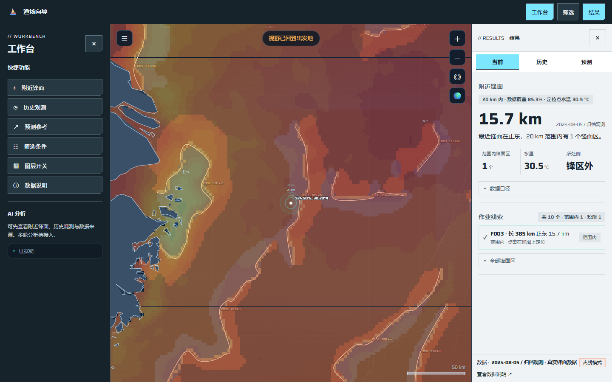
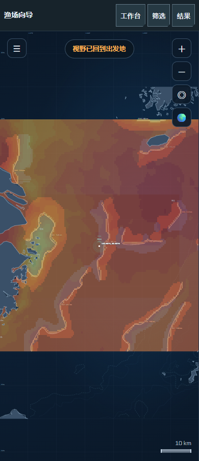

# Ocean 首批实施与验证记录

变体：coldstore / 冰蓝、冷灰纸色、紧切角、低动效。
主视觉：保留原有海洋地图、底图与平面／球面操作。
页面：左侧深色操作区，右侧浅色结果区；本次不改变地图配色算法。

本批依次推进 #36 → #46 → #47 → #25 → #28。当前分支为 `codex/research-execution-plan`，起点 `f036ebd`。推送、PR审查、合并和部署分别记证；本记录不代表生产已更新。

| 任务 | 本批交付 | 尚未完成的证据／后续边界 |
| --- | --- | --- |
| #36 来源审计 | 现有审计CLI增加显式登记、内容身份快照、独立摘要、私有定位和无重扫回放；8个本地来源实审 | 原档位置缺失，许可冲突待核；逐日语义、有效支持与研究资格属于 #37/#38/#41/#44 |
| #46 浏览器基线 | 实际Edge导航、重载、切日、缩放和平移；冷热、请求、成本、GPU、数据文件哈希、失败和小样本限制 | 仅本地B0与合成时序校验；合法完整活动支持的B1尚缺，真实服务和尾部延迟未验，不结项 |
| #47 运行盘点 | 复用只读服务器盘点工具，新增脱敏本地分层字节/缺项快照，核真实公开入口 | 未登录现服；CPU/RAM/磁盘/IO/worker和增长仍未知，不据本机给采购结论 |
| #25 工作台 | 非模态左右独立收起；左快捷功能及未接模型AI，右三入口、事实摘要；独立筛选浮层，保持即时更新 | 后续任务的整月历史、完整预测、详细分析底部联动、色标算法等未在本票据交付 |
| #28 加载隔离 | 日期/点位/半径/视野/模式/已声明版本组成请求身份；废弃迟到响应、取消与模式隔离；一次临时重试和手动重试；分层状态 | 当前服务未声明数据版本时保留null；真实生产权限及新版本服务切换仍须后续联调 |

## 实际发现

[来源快照](ocean-source-audit-2026-10-25.md)中，展示锋面、SST、旧聚合输入/响应表可读；登记的三类原档及逐日活动展示目录缺失。GFW抓取代码的BY-SA/API非商业标记与治理文档的BY-NC标记冲突，均保留为待核声明，不裁定许可、不批准公开、不判研究就绪。

[公开入口检查](ocean-public-route-check-2026-10-25.json)：主页200、健康检查200，小窗口 `/api/viewport` 404；响应未提供可核对提交版本。健康正常不能证明与本地版本一致，也不能证明已部署新视野API。

[本地盘点](ocean-runtime-inventory-2026-10-25.json)测得展示数据约4.26 MB逻辑文件长度；这不是完整原档大小或运行内存。东海多年、全球归档、解压工作集和并发峰值均未知。估算服务器配置前应先在现服私下运行 `deploy/inventory-server.sh`，再结合受控工作集与并发测量；原输出可能含私人定位，不直接提交。

## 浏览器基线

[修改前B0](ocean-map-baseline-before-2026-10-25.json)与[修改后本地记录](ocean-map-baseline-after-2026-10-25.json)分别保留三轮、每轮五类操作的原始摘要。每个阶段15次操作均成功。导航中位数约208/309 ms，仅说明这个本地演示切片；不据此宣称加速。旧记录的重载计时随后增加“必须进入新文档”的校验，因此重载数值不作直接收益比较。25ms轮询、两帧确认、网络和渲染段重叠等口径在JSON中声明。

每类只有3个样本，p95为null。B0保留原活动分位筛选及700格截断，尚不能与完整支持的B1比较。真实线上视野接口仍404，不能用本地快值替代服务端表现或容量验收。

复跑：

```powershell
node tools/audit-research-baseline.mjs --source-registry docs/data/source-registry.json --out data/processed/source-audit.json --report-out data/processed/source-audit.md --private-out data/processed/source-locators.private.json
node tools/benchmark-map.mjs --runs 3 --out data/processed/map-baseline.json
python tools/inventory-runtime.py --snapshot data/processed/source-audit.json --out data/processed/runtime-inventory.json
```

## 界面证据与检查

工作台停靠与焦点处理参考已有非模态修正提交 `53762af575c4eb9c38b3d37b8fda0ee5fb043b46`，按当前规格重接现有地图，没有整体导入未合并的任务执行功能。Saira及OFL许可随前端自托管。

“当前”用最近距离主数值、范围内锋面数、水温及侧别，保留短事实与来源；不再输出把握度、出海推荐和评分分档。归档日期显示年份，不把2024年样例标为今天。旧历史／预测规则只保留为未验证演示，不能当活动预测模型。





检查入口：

- 新增8项Node CLI/真实浏览器检查通过；时序、空态、许可冲突与故障场景为合成测试，不冒充真实资料资格。
- 数据检查922项；完整地图交互回归127项；布局1680/1440/1280/390宽。
- 后端完整pytest 23项；本地盘点pytest正常场景1项通过，目录链接场景因本机创建链接权限不足跳过1项；Python静态检查及所改JavaScript语法检查。
- 新增浏览器加载测试包含网络边界忽略取消后仍返回的迟到日响应；临时网络失败两次请求、403/404/409仅一次，空记录与有效零值记录分开，单层失败保留锋面与服务模式。

规范与规格分别复核后，已修正异常200响应未结束加载、盘点排除链接却误报完整、旧重试策略残留、视野提前计时以及条件变化取消活动请求后未重新调度的问题。新增核查包括异常200后可重试、半径变化后的活动重发、离线移动到零经纬度后不能标记有资料就绪。盘点兼容仓库Python3.11范围；派生待分类、索引和加工暂存分别列项，未知位置不声称已完整盘点。

## 下一批实际前置

先推进 #37/#38 的逐日覆盖、粒度和零值合同，核实可访问原档及GFW具体产品/渠道许可。并核对已部署服务的视野路由、实际提交和版本标记；仅拿到合法完整活动切片后补 #46 的B1与受控服务负载。后续按既有依赖继续，不因界面看起来可用就跳过真实数据关口。推送本分支不自动合并或部署。
