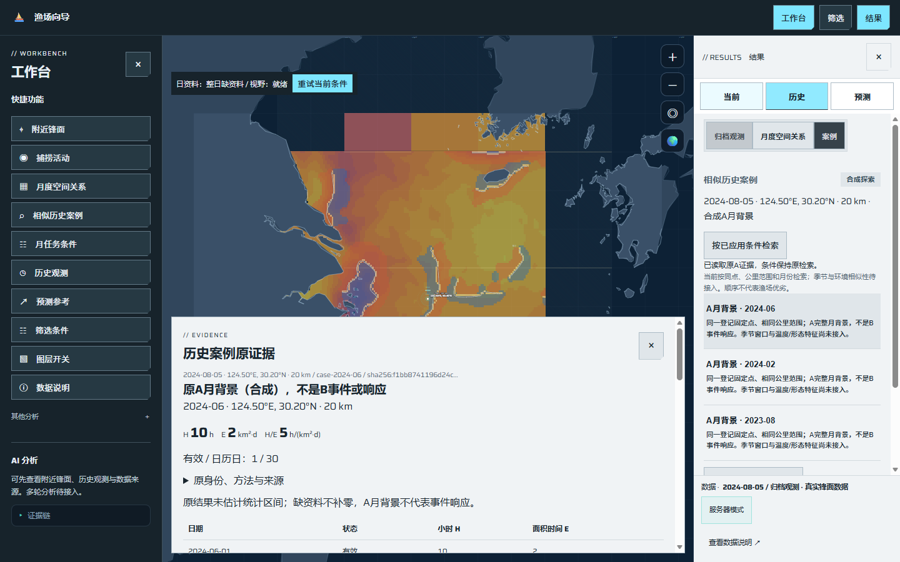
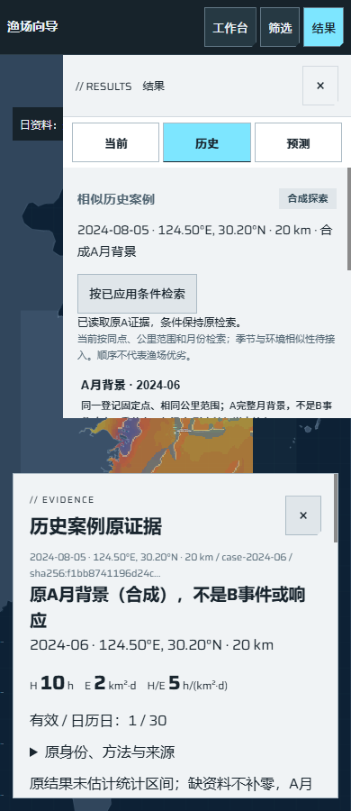

# O01：固定发布包的隔离地图与已知查询

日期：2026-10-27。对应[任务 #227](https://github.com/NingRuo-code/Ocean/issues/227)、[规格 #226](https://github.com/NingRuo-code/Ocean/issues/226)。基线main `bda417c`；实现`58dd5a7`，复核修复`28a3e2d`。本批交付隔离软件切片，合并以GitHub为准，未操作生产。

## 本批可以完成什么

维护者可从明确的完整Git提交构建允许内容发布包，核对包与来源身份后，安装到新建的独立目录及虚拟环境。包内没有Git目录，也可以启动原FastAPI、原地图和既有只读A证据；实际响应提供同一发布身份，地图仍可操作，也可手动切回离线。

这是OPS 25项中的首个软件交付。没有安装新数据库或容器平台，没有重建统计/预测、任务恢复、报告或权限系统；没有调用旧部署脚本的SSH上传、生产目录原位解包或系统服务重启。代码、运行依赖、静态资产和状态均为本次独立副本，已有部署实例未改动。

## 发布与隔离方式

| 环节 | 已实现的行为 |
|---|---|
| 固定来源 | 要求40位提交；从Git对象读取文件，不复制当前工作目录，未提交改动、环境文件和临时报告不随包进入 |
| 允许清单 | 203个明确源/目标条目，含原应用、必要导出依赖、原地图及许可证；新增文件须更新清单并复核 |
| 依赖 | 按原项目声明和平台标记核36个实际发行包版本，复制文件与许可证；禁止可编辑包和可执行路径钩子，不联网升级 |
| 内容身份 | 代码、资产及第三方文件逐项大小/哈希；发布ID绑定提交、清单、实际依赖和Python平台，ZIP另有传输哈希 |
| 独立安装 | 新建专属根、暂存并校验后发布新版本目录；既有版本不覆盖，不自动激活或切换生产 |
| 启动验证 | 先校验登记内容，再核实际代码/配置/依赖树，额外模块或配置也拒绝；核执行脚本自身身份 |
| 运行限制 | 仅动态回环端口、单进程、允许的GET与静态资产；写API、资料准备和模型入口拒绝，后端连接及状态外写入受限 |
| 目录及配置 | 缓存、原档空目录、临时、输出及日志在本版本state内；忽略父进程OCEAN路径/令牌/模型选择，拒绝链接及Windows重解析点 |
| 可核对身份 | `/api/release`与响应头给安全发布/来源身份和未接入范围；原health仍只表示进程可回答 |

启动使用安装后解释器和`-I -S -B`：隔离环境路径及site启动钩子，从解释器启动起禁止字节码写入，避免修改基础环境或登记内容。应用及第三方包独立复制；基础CPython安装仍需匹配，不将该ZIP称为包含解释器/操作系统的通用镜像。

本轮实际包锁定Windows、AMD64、CPython 3.14.0，含6,583个登记文件、合计235,121,387字节，ZIP为101,484,071字节。这只是本机小范围发布内容计量，未包含全量原档、全部暂存峰值或生产混合负载，不能据此给服务器最低配置。Linux与其他解释器必须在对应环境重新构建并实际验收。

## 数据与原功能边界

地图沿用既有锋面/SST许可导出、Natural Earth底图、字体与色表及其归属说明。原GFW响应置为明确缺资料，不把原响应输入、真实小时聚合或未消费fixture带入这个小例；两份JSON不在ZIP中，实际直接访问返回404。缺活动不改为0响应。

A证据只读既有自建CC0合成成果：默认参考2024-08-05、124.5°E/30.2°N、20km，允许历史月4个；2024-06为H=10h、E=2km²·d、H/E=5，有效1/日历30天。2023-08保留有效0；较晚参考日能读到2024-12的未知支持，H及密度仍为null。单位、原结果/投影、方法和来源不因打包而改变。

原统计引擎、地图投影/海岸/网格/按钮和coldstore界面框架未改。工作台→已知候选→底部原A证据，仍是原读数和原条件；关闭证据后可以切离线及缩放地图。公开只读不代表已接入持久任务、私人案例、报告保存或AI，身份接口明确标为未连接/禁用。health正常不代表原档、研究资格或这些功能就绪。

## 实际包与浏览器证据

交付包从两路复核后的完整提交`28a3e2d5657235090a47539af0b3360228724802`构建，安装后在该独立目录启动，非工作区临时挂载的业务替身。源码改动忽略、原查询、数值、单位、原身份、响应头、独立依赖导入及未接入状态均逐项核对。

执行收据：[脱敏发布与原服务证据](ocean-isolated-release-execution-2026-10-27.json)。记录实际发布/包哈希、来源提交、运行时与依赖版本、原A数值/身份、零与未知、缺活动视窗、拒绝的维护探测、遗漏资产404及原地图条件。包含本机启动计时，不将其当作P1加载或生产容量验收。

本次实际包冷启动测得102.669秒，包含逐文件完整性校验和导入；尚需另测和优化启动成本。它与地图交互加载是两个阶段，当前通过不代表生产启动或P1性能目标已达标。运行后生成4个本例缓存目录/文件条目，父环境指定的原档与缓存路径均未使用。

截图来自实际独立包，地图日期、点位、范围、地理中心与缩放在案例阅读前后保持；另行显式手动切换和滚轮核地图可操作。浏览器流程没有POST，维护反例的两次POST单列记录且均403，不冒充正常分析请求。

## 检查与失败证据

| 检查 | 实际结果 |
|---|---|
| 新发布检查 | 11项，包括真实包/独立安装/原服务、静态边界、错版本保护、真实浏览器，以及坏包、危险路径、缺依赖、既有目标、凭据形状、未登记导入、旧API能力下的联接反例 |
| 最终完整工具 | 113项通过；包含原界面、地图交互、既有研究阅读和本批发布流程 |
| 完整后端 | 197项通过，原数值计算没有修改 |
| 数据与静态 | 922项数据检查、ruff、JS语法和diff检查通过 |
| 独立运行 | 实际原接口与桌面/手机读取；不含Git及原GFW响应输入，依赖从独立venv导入，父环境路径未使用 |

初次工具回归108项中1项失败：新增viewport断言误用了Python内部`fishing_effort`，原公开合同是`fishingEffort`；已按既有API更正，产品接口没有修改。最终完整回归重跑通过。

首次端到端在逐文件校验阶段等候不足；诊断后采用有界启动等待，按实际响应与已知数值验成功，不以进程存在或阶段日志作成功。Windows测试清理处理响应文件短锁，只结束本轮记录的进程树，不按名称终止其他服务。早期暂存日志仅本地保留，未写入公开记录。

坏包原先抛出内部堆栈；设备名及大小写别名原先可被接受；登记外静态文件原先可返回200；源码中自建的凭据形状也曾被打包。各反例均先失败再修复。发布扫描仅补充明确模式拦截，不能替代允许清单、源许可和审核。

## Standards

独立初审提出2项P2：只核已登记文件而未拒绝新增模块，可能改变导入身份；允许表仍含未消费的真实GFW输入，与小例范围不符。已新增实际输入树检查、剔除两份输入，并核启动前拒绝、ZIP无成员及HTTP 404。`28a3e2d`定点复核通过，最终0项未解决；未另列需扩大本批范围的Fowler设计问题。

## Spec

独立初审提出3项P2：上述两项，以及文档允许Python 3.11却依赖3.12新增联接方法、缺能力时直接判无链接。已改`lstat`链接/重解析属性检查，真实Windows联接与移除新stdlib能力的模拟先红后绿；`28a3e2d`定点复核通过，最终0项未解决，无新增范围扩张。

旧能力模拟不等于实际Python 3.11解释器或Linux已验收。未登记模块反例是仅会抛错的自建故障文件，不是新的业务服务；主通路使用实际原应用和独立依赖。两轴分别记证，审查者未另启测试或浏览器。

## 后续与当前不足

- O02/#228仍需P1/#47实际目标盘点，核目标准入、权限、磁盘/资源和环境；本地包成功不能代替现服准入。现服已存在，本轮未读取或改变其实际配置。
- 兼容切换/回退、轻量监测、持久任务/保护引用整合、一致备份及独立恢复依后续OPS票，不把新目录安装当生产激活或备份完成。
- 本包没有真实源档、GFW活动响应、真实统计/预测结果或在线模型；P0/A/B/C/G3/PRED资料及科研关口继续保留。固定合成A读数不证明锋面与实际捕捞活动的关系。
- 应用审计和只读入口不是运行不可信代码的操作系统沙箱；使用已审核提交和受控包哈希，未登记文件/损坏时拒绝，不放宽到任意资料或命令。
- 无生产同步、采购扩容、原档下载、模型费用或外部告警；父规格#226及总体规划#13保持开放。提交、合并、本地验证和生产部署分别记录。

操作说明：[固定发布包的隔离只读操作](../data/isolated-release.md)。
