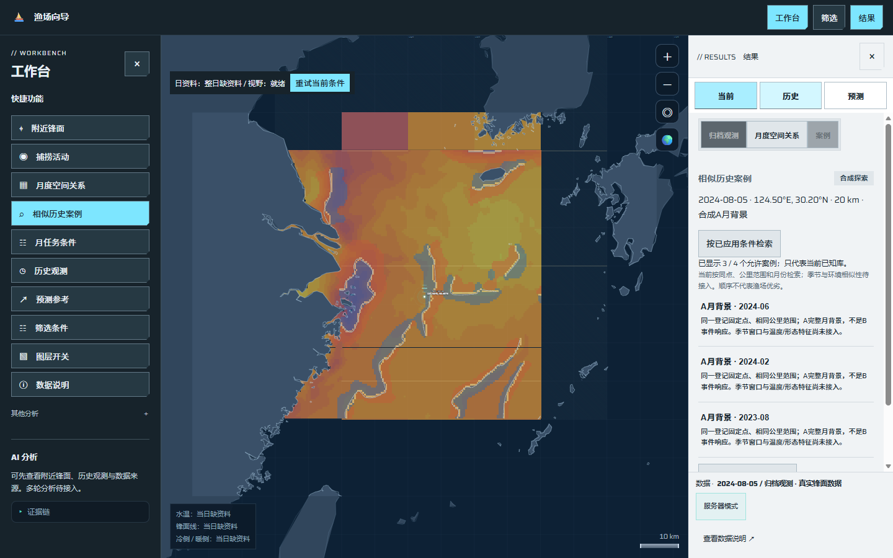
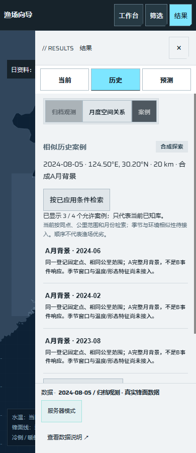
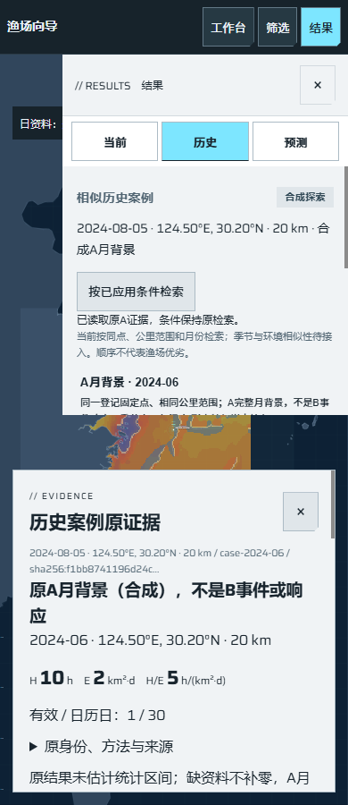

# S01：工作台已知历史案例检索交付

日期：2026-10-26。对应[任务 #160](https://github.com/NingRuo-code/Ocean/issues/160)、[规格 #159](https://github.com/NingRuo-code/Ocean/issues/159)，复用已合并的W02/#97。基线主分支`1198932`；读取功能`b30fd39`，取消及跨视图修复`76ad6c7`、`e315153`。合并状态以GitHub为准，未部署生产。

## 使用者现在可以做什么

在左侧工作台点击“相似历史案例”，使用已经应用的点位、公里半径和参考日，经实际只读服务查看少量已知候选；点击某月，底部打开这份原A月度背景。关闭证据可以继续选择，不改变地图日期、分析点、中心或缩放。默认先显示3个，明确点击“更多”才读取同条件、同库版本下一页。

这是相似案例功能的首个软件切片，当前实际能力是**同一登记点、同半径、早于参考日的完整月背景检索**。当前按月份和稳定ID排序，不以活动小时、响应好坏或人工评分筛选。季节±15日、真实海域目录、环境相似性与原B响应留在原后续任务，不以入口名称代替它们已经实现。

候选说明同点/同半径、A背景与B事件的区别、尚缺环境特征；不新增常驻评分、权重或推荐排名。修改已应用筛选或月任务草稿时，保留旧查询及原条件，显示待更新，只有明确重新检索才替换。月草稿并非此入口的参考日来源，地图视野也不代替公里圆。

## 原数据、指标与访问边界

本批复用既有`g3-known-snapshots.json`内自建CC0合成A成果；新目录仅登记这些既有身份与内容指纹。只读服务先核目录公开/探索用途、合成身份、来源公开许可，再通过既有A公开投影验证原单位、逐日支持和内容。调用者不能传本地文件、真实目标或其他库；服务没有分析、准备归档或AI入口。

搜索、数量和详情共享相同允许集合。未登记、私人、用途未知或标为验证保留的条目不可枚举、不可直接读取；详情还须属于原查询的点、半径与日期。分页带原库版本；库内容改变返回409，需明确重新查询，不能串页。所有读取禁止缓存；无服务的离线页面明确提示需要只读服务，不造候选或静默回退。

这里的“验证保留”是**自建目录内的合成访问反例**。既有G3源中相应合成月在其他公开通路仍可读；本批不是正式研究保留集，也没有完成G3分区、真实资料接触登记或独立验证。正式隔离仍须S08及其真实前置，当前不接收任意真实资料。

原A指标保持：H为表观捕捞活动小时，E为有效面积时间km²·d，H/E为h/(km²·d)，D为有效日、日历日另列。未知小时或未知支持继续显示“未知”，有效零仍是0；月背景不改称B事件、活动响应、鱼群密度或渔获量。逐日表、方法、原结果/投影身份和来源可按需核对，统计区间未估计如实标注。

## 实际执行证据

默认参考日2024-08-05、124.5°E/30.2°N、20km，完整允许历史集合为2024-06、2024-02、2023-08、2023-02；首屏前三个，翻页后4个。合成私人2024-07和合成保留2024-08不进入数量或详情。参考日改为2025-01-01时，可读的2024-12背景仍为未知支持，不被当零活动。

| 核对项 | 独立期望与实际结果 |
|---|---|
| 2024-06原A | H=10h、E=2km²·d，H/E=5；有效1/日历30天，逐日30行 |
| 2023-08原A | 有效零为0h，不改称0响应 |
| 2024-12原A | 无共同已知支持，H/E等保持null/未知 |
| 修改条件/草稿 | 旧查询身份保留并标待更新；明确新检索后才替换 |
| 无权/版本变化 | 403清除旧案例值；409停止原版本翻页/详情并提示重新检索 |
| 迟到/取消 | 新查询或新案例不被旧响应覆盖；离开子视图、主标签和工作台快捷入口均取消旧读取 |
| 地图与执行 | 实际桌面/手机核原日期、点位、范围、地理中心和缩放保持；没有POST或隐式任务 |

[脱敏实际浏览器/API执行记录](ocean-known-case-search-execution-2026-10-26.json)包含代码版本、源文件指纹、原请求、查询/库/原成果身份和实际显示值。运行实际应用与Edge，隔离原数据和缓存；并非业务替身或真实渔业实证。

延续coldstore深色工作台、浅色阅读和冰色操作；地图投影、海岸、网格与控制未改。案例作为原“历史”的子视图，仍是3个主标签和2个左侧工作台模块。证据非模态，小屏阅读时收起右侧重复导航/页脚；关闭后恢复候选，Esc返回可见原按钮，地图仍可缩放。

## 验证

| 检查 | 实际结果 |
|---|---|
| 新API针对性 | 16项通过：真实路由、候选/页身份、零与未知、内容换版、目录/源权限门、空态/不支持/故障、非法条件 |
| 新浏览器 | 10项：实际搜索/原证据、草稿/应用条件、离线/403、两种乱序、手机地图/Esc、取消文案、旧月跨案例、两种快捷拒绝竞态 |
| 完整后端 | 197项通过；接口后未改后端 |
| 完整工具 | 初次98项通过；复核后新增4项交错回归，最终102项全部通过 |
| 原界面、布局、数据 | 初次及修复后129项、四宽1680/1440/1280/390均通过；922项数据检查通过 |
| 静态与包 | ruff、JS语法、diff检查；离线wheel含新接口、新目录及既有源，4个文件逐字节一致，无新依赖 |

截图核验曾将面板伸缩前后的SVG画框尺寸作完全相等断言；既有布局会按绘图区宽高更新画框高度，断言不适合表示地理视野保持。改核真正的地理中心与缩放、应用日期/点位/半径，实际桌面和手机均一致；没有改动地图逻辑或放松交互回归。

## Standards

独立静态审查无硬性风格或数据边界违规，初审提出2项P2：取消后残留加载文案；工作台快捷切换不取消旧读取，迟到403可能关闭新预测证据。均由真实浏览器先复现失败，再修复代次/中止及明确停止状态；追加月度读取同类反例。`e315153`定点复核通过，0项未解决。

非阻塞设计判断：新案例原A校验与原月度阅读器有部分重复；留待正式真实成果合同扩展时合并，当前没有为此扩大重构范围。

小屏压缩规则`07e6e91`只在实际案例证据展开时隐藏重复导航/页脚，追加静态复核通过，未新增问题。

## Spec

独立静态初审提出1项P2：离开月度子视图后，旧月请求仍能关闭新案例证据。真实浏览器交错路径先红后绿；离开子视图、主标签和工作台快捷入口时取消旧读取，保留旧成果与明确停止状态。`e315153`定点复核通过，未发现必需能力缺漏或范围扩张，0项未解决。

两轴分别记证，不以某轴通过覆盖另一轴。审查者未另启浏览器/测试，执行证据来自本批串行实际验收。

## 后续与当前不足

- S02/#161仍需W受控构建/#99，交付真实支持/许可目录；S03/#162才扩展精确海域和季节筛选，不将当前同点/月序称作完整相似搜索。
- S04/S05环境、事前活动和可知截点、S06真实B、S07兼容阅读仍依原票；本批无事件后响应筛选或概率排名。
- S08正式分区/资料接触、S09明确定位、S10起短窗断档核查未完成；当前只读，明确说明定位和短窗不可用。
- S13正式持久查询/版本保存及S14/S15真实历史/短窗核查未完成；本批仅有最低必要页身份，不新增任务/保存平台。
- P0真实源审计、A/B真实研究、统计区间、预测及加载容量/算法仍按独立关口；当前合成软件结果不能证明锋面与实际渔业活动存在关系。
- 无生产部署、扩容采购、原档下载、付费模型调用或公开权限扩大。父级#159/#13保持开放，S01仅完成相似案例16项中的首个软件切片。

使用说明：[已知案例只读通路](../data/known-case-search.md)。
