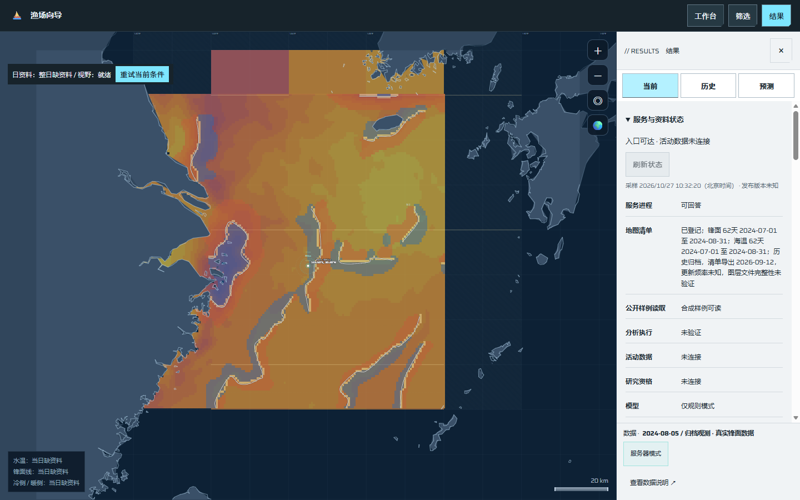
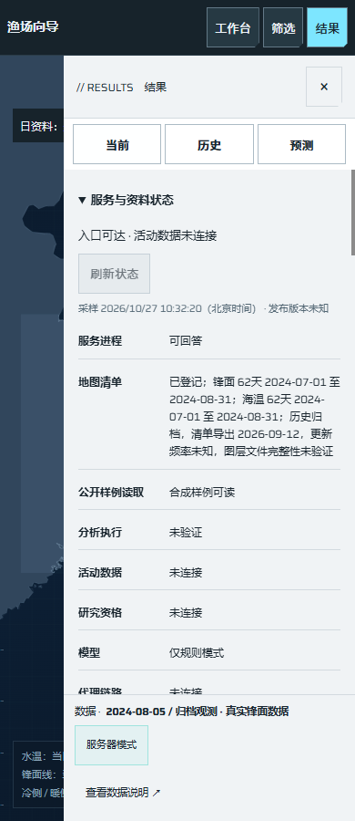

# O07：分层服务与资料状态

日期：2026-10-27。对应[任务 #233](https://github.com/NingRuo-code/Ocean/issues/233)、[规格 #226](https://github.com/NingRuo-code/Ocean/issues/226)。基线main `70072bb`，应用实现复核至`617c8e7`，固定发布浏览器证据补充至`a128f49`。本批软件切片已验收，合并/关闭以GitHub为准；未登录或部署生产。

## 可以使用的功能

“查看数据说明 → 服务与资料状态 → 读取状态”从原FastAPI读取分层结果，不自动轮询。服务可回答、地图日期清单、公开合成样例读取、分析执行、活动数据、P0研究资格、模型、代理、任务与备份分别显示。采样时间和短发布版本用于日常阅读，完整身份与各层最近成功放在折叠记录中。

已有地图清单显示锋面和海温各62个登记日，2024-07-01至2024-08-31，清单导出日2026-09-12；它属于现有历史归档，更新频率未知，不因没有今天资料判故障。只证明日期登记，不能据此证明每个日文件完整。活动清单存在时仅说明已登记、日期范围与资格未核，不投影小时、船舶、网格或私人元数据。没有清单不推断零活动。

公开A只读工具真实读取并验证既有合成冻结成果；能读样例不等于真实研究或分析执行可用。普通开发服务的执行能力未探测、模型仅按原规则配置说明；独立发布明确禁用执行/模型。未接权威记录的P0资格、任务、备份、代理继续显示未连接，不给整站“全部正常”。

地图投影、海岸、网格、按钮、原筛选和三主标签保持，状态区默认折叠。读取状态不改变日期、位置、作业范围、地图中心/缩放，不触发POST、清单重建、归档准备、分析或模型。离线文件可继续操作地图，但不从本地日期推断服务可达。

## 有界读取和实际入口

原应用新增必要的`GET /api/status`投影，复用现有日期索引、活动manifest和原公开A投影。每进程一份内存快照、每层一个最近成功时刻，无磁盘历史；最短采样30秒，90秒后页面本地标陈旧。最多读64 KiB日期索引、1 MiB冻结样例、256 KiB活动清单，各清单日历最多3660项。缺失、损坏、非普通文件、权限失败分别保持未知或失败，公开字段没有路径、主机或原始错误。

服务端等待最多2秒，文件读取不持状态锁、同一进程最多一个守护采样工作；超时层显示`sampling_deadline`，已完成层及最近成功保留，迟到结果不覆盖或继续下一层。底层挂起IO本身可能等候至文件系统恢复，但不会累计新的采样工作；这是明确保留的限制，不声称能强制终止底层IO。服务重启后最近成功从未知开始，完整持久监测/告警在后续任务。

维护者的一次性探针分别读取显式回环和入口的health/status，浏览器路径另行实际验证。最多两条顺序路径，每路径独立子进程6秒截止、响应64 KiB、输出一份16 KiB以内摘要；无默认目标、凭据、跳转、环境代理或历史文件。实际原服务正常而受控代理状态接口503时，报告保留回环正常/入口health可达/入口status失败，未谎称代理配置已验证。用法及限制见[操作说明](../data/operational-status.md)。

## 证据和检查

| 检查 | 实际结果 |
|---|---|
| 原状态API定向 | 9项：历史日历/闰日、失败保留最近成功、空/大/无效清单、冻结样例完整性、发布身份、权限/非普通文件、活动登记投影、采样截止/迟到隔离 |
| 新浏览器与探针 | 6项：实际原服务、桌面/手机、HTTP失败/旧接口/无时区、陈旧/时间不明、离线/模式切换乱序、自动失效不轮询、挂起请求和独立入口定位；子场景在各测试内分别断言 |
| 固定发布 | 真构建、独立安装、原应用运行及实际页面读取同一发布身份；发布status与响应头一致，模型/执行禁用、P0未连接，旧A阅读/零/缺测继续通过 |
| 完整工具 | 119项通过，失败0 |
| 完整后端 | 206项通过 |
| 原页面回归 | e2e 129项；布局1680/1440/1280/390四档通过 |
| 数据与静态 | 数据922项，ruff、JS语法、diff检查通过 |

[脱敏执行记录](ocean-operational-status-execution-2026-10-27.json)区分普通回环原服务、测试内固定Git发布环境和合成故障。固定发布的来源提交是测试内创建的独立快照Git提交，不伪装成仓库main或生产提交；实际新状态的原页面已通过同身份核对。公开截图来自普通回环原应用，因此发布版本显示未知，与该环境一致。

初次原接口缺模块、空清单误报登记、活动清单未消费及服务端8秒阻塞反例均先失败再修复。浏览器初次基址重复后按原`/api`基址修正；无时区时间戳反例先失败，再与维护探针统一拒绝。陈旧/失败及挂起IO为受控故障，不记作真实生产事故。

## Standards

初审无硬性违规或需单列的Fowler问题；提出前端无时区时间戳与探针不一致的健壮性建议。已补反例并统一拒绝，`617c8e7`定点复核0项遗留。审查者只读，未另启测试/浏览器。

## Spec

初审1项P2：客户端超时不能限制原服务持锁读文件。已补原接口挂起IO反例，新增2秒截止、最多一个工作、无持锁读取及迟到隔离；原版8秒反例失败，修复后通过。`617c8e7`定点复核0项遗留，无新增范围扩张。

## 当前不足与下一步

- OPS 25项中完成O01/#227、O07/#233两个软件切片，非整套OPS、完整研究或生产就绪。
- #47仍需现服可信连接及实际盘点，#228准入继续受其阻塞；本机硬件、隔离包或状态接口不能代替服务器CPU/内存/磁盘和全量容量证据。
- #234仍需真实权限#229及任务阶段#113，不能因状态页完成而提前做生产告警。真实数据、统计/预测、持久任务、报告与备份恢复按原依赖推进。
- 本轮没有生产部署、重置登录、开放端口、原档采集、付费模型或对外通知。服务器用户名和身份未核实前，保留该关口；用户可先从已有云控制台核实例和原连接方式。
