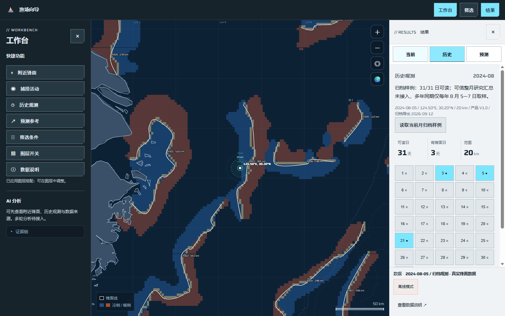
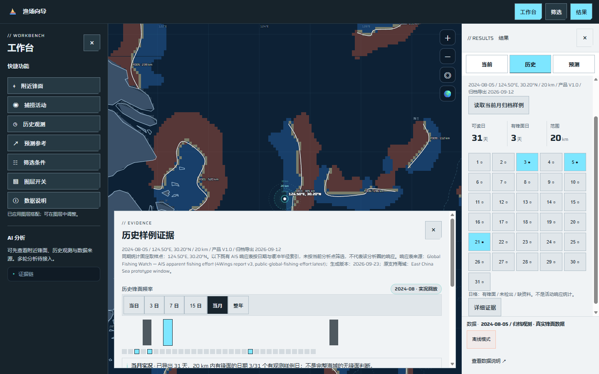
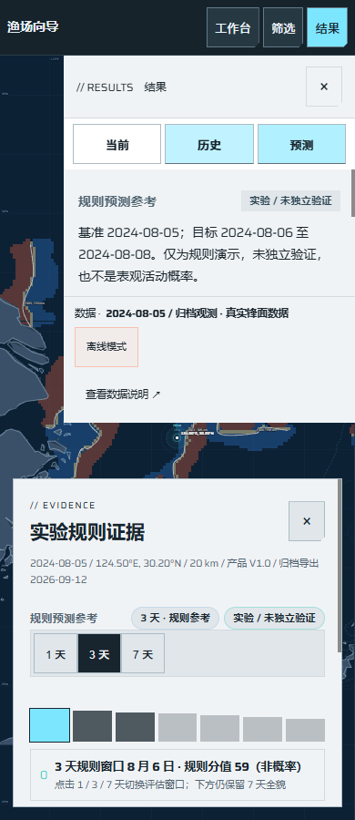

# 捕捞活动概况与历史、预测证据阅读实施记录

日期：2026-10-25。规格：[UI #24](https://github.com/NingRuo-code/Ocean/issues/24)。实施票据：[活动概况 #29](https://github.com/NingRuo-code/Ocean/issues/29)、[历史/预测证据 #30](https://github.com/NingRuo-code/Ocean/issues/30)。

设计变体：沿用 coldstore / ice，冷灰纸面、冰蓝操作色、紧凑切角和低动效。
主视觉：保留原地图、投影、底图、拖动与缩放；本批不迁移科学配色。
本批重点：右侧短结果、活动来源与覆盖限制、默认收起的底部证据。

## 合并与实施状态

已按用户要求合并 [PR #282](https://github.com/NingRuo-code/Ocean/pull/282)，主分支合并提交为 `476b7e5d4fbb57d93c6ed76341b73ed00565bc20`。#26/#27/#31/#32 已实际关闭。

本批 #29/#30 基于该主分支，在 `codex/ui-evidence-reading` 顺序实现并完成本地验收，另提 PR；合并前保持票据开放。本批没有合并独立数据工作 PR #281，也未同步生产服务器。

| 首批界面任务 | 当前状态 |
|---|---|
| #25/#26/#27/#28/#31/#32 | 已合并，共 6 项 |
| #29/#30 | 本批实现与本地验收完成，待 PR 合并，共 2 项 |
| #33/#34 | 科学色标、配色及相关显示优化尚待实施，共 2 项 |

不据此关闭 #15/#16 父工作包，也不提升 P0/P1、统计、预测或 AI 的研究与生产验收进度。

## #29：捕捞活动概况

工作台新增“捕捞活动”快捷入口，复用已应用日期、分析点与公里范围，并打开原活动图层。右侧以一个小时数、简短说明和三个辅助指标展示结果；返回“附近锋面”可继续阅读原锋面事实。

小时数来自完整返回数组中的有效、唯一格点，按格心至分析点的大圆距离筛入当前半径；不按地图圆点、分位筛选结果或 700 点上限反算。独立小例中，701 个 1 h 格点、3 h 与 30 h 格点合计 734 h，范围外 999 h 不进入结果。多船累计超过 24 h 不会被截断。

现有活动接口没有足以证明分析圈完整覆盖的合同，因此当前只显示“已返回格点的部分累计”，不能称全圈总量。空记录、全非法或圈内无有效记录显示未知；有效返回记录为零可显示 0 h，但明确不代表全圈零活动。显式 `minutes` 等单位冲突会阻断小时摘要、活动绘制、有效色块和播放；未声明单位沿用现有 `hours` 字段合同并说明限制。

来源声明、许可、条款、署名、资料版本、实际展示粒度、重复/非法记录和返回格数不一致在“数据口径”中说明。服务元信息是来源声明，不等于已经完成 P0 许可与资料资格审计。

地图仍有原有分位筛选和最多 700 点的显示限制，本批如实提示，不宣称完成全量近景、远景聚合或守恒验收。展示格网不替代领域 ADR 要求的细粒度锋面缓冲研究真源；活动是 AIS 表观捕捞活动，不是渔获、鱼群密度或成功概率。

## #30：历史与预测按需阅读

历史默认月份入口，明确可信整月研究汇总尚未接入。用户主动读取已有归档样例后，可看可读日、检出锋面区日与逐日历日格，并从有支持的日格进入实况，再返回原月份。缺日、全天缺测、分析点无有效主片支持的日期不会计入观测分母或伪装为“未检出”；新到资料不能自动提升旧结果资格。

历史月/周/年图表只展示检出和可读样例事实，移除把握度、评分和最佳日期。近 7/15 日按日历界定窗口；日格的“未检出”仅指已有观测部分，不表示全圈无锋面。固定取样点的多年同期频率不会套用到其他分析点。既有 AIS 响应表单独标明其原海域、日期/半径索引及生成信息，说明未按当前分析点筛选，不冒充该分析圈的响应。

预测保留已有确定性规则演示，明确基准日、目标日和“实验 / 未独立验证”。规则分值放在底部并说明非概率；主摘要不把它当作作业成功率。无有效基准观测时不生成规则图；未观测的目标日不能切成未来实况。

曲线、逐日表、来源、方法和既有响应证据迁入底部独立滚动区，默认关闭，不锁定地图。进入页签或展开证据不会重新计算。日期、点、半径、模式、已知版本或实际参与日资料改变时，保留原证据并标“待更新”；资料版本未声明时，也绑定实际读取的日载荷与缺日状态，收到新载荷不会误判为当前结果。只有用户明确读取或调整证据中的原有窗口，才更新本地参考；不启动月研究、准备资料、训练或模型调用。

桌面详情避让工作台与右侧结果；小屏结果区和详情分上下独立滚动区。实际触摸可操作，地图剩余区域可拖动；Escape 关闭当前证据并返回入口。另修复了原地图指针捕获吞掉“重试当前条件”真实点击的问题。

## 验证结果

| 检查 | 实际结果 |
|---|---|
| 完整工具测试 | `node --test --test-concurrency=1 tools/tests/*.test.mjs`：35 通过，0 失败；本批浏览器回归 15 项 |
| 地图交互 | `node tools/e2e-check.mjs`：129 通过，无运行期 JS 异常；旧断言同步到显式读取和底部证据流程 |
| 数据自洽 | `node tools/data-check.mjs`：922 通过 |
| 布局 | 1680 / 1440 / 1280 / 390 四档通过 |
| 真实操作截图 | 1440 / 1280 指针、390 触摸，共 9 组月份和详情视图，无横向溢出或面板越界 |
| 语法与补丁 | 修改的 JavaScript 语法检查及 `git diff --check` 通过 |
| 后端 | 本批未改后端，未重跑后端套件 |

活动加总、非法/重复记录、圈边界、有效零、空记录、单位冲突、资料替换和全天缺测使用受控输入；它们只证明软件合同。归档截图及同源交互使用仓库已有可分发展示资料，不能用作新的真实月、独立预测或生产验收证据。

## Standards

独立 Standards 复核未发现硬性规范违反。提出 1 项判断性重复代码建议：绘制与汇总共享格点基础合法性验证；已统一复用，汇总另行去重与空间筛选，复核确认解决。历史评分残留转交 Spec 轴，不重复计为 Standards 违规。

## Spec

独立 Spec 复核发现 3 项实质问题：全天缺测日误入可读分母、同条件新载荷未使旧证据待更新、显式单位冲突仍输出小时；另接收 Standards 转交的历史详情评分残留，共 4 项。均以实际浏览器反例补回归、修正后验证通过；独立复核确认原问题解决，未发现修复引入的新实质问题。主代理另修正固定点来源适用范围、小屏焦点和重试点击问题。

轴内汇总：Standards 硬性问题 0，判断性建议 1 已解决；Spec 4 项已解决，当前未遗留阻断发现。

## 截图与后续

其余视图及几何见[九组布局记录](ocean-ui-evidence-layout-2026-10-25.json)。原地图的科学颜色、分档与活动显示截断保持既有边界；接下来按 #33 → #34 推进科学色标与叠加可读性，正式跨期域、全量聚合、资源容量仍依赖 P0/P1 实测。真实整月 A/B/C、正式预测、完整 AI、任务中心与生产部署继续按各自规格推进。

## 后续合并核验

2026-10-25 已按用户授权合并 [PR #283](https://github.com/NingRuo-code/Ocean/pull/283)，主分支提交 `8a3def01ccd4c7eba0bd2576b57eb2b7d8b0b1d1`，GitHub #29/#30 均已关闭。以上表格保留本批实施时的历史快照；当前 #33/#34 配色进度见[科学色标实施记录](ocean-ui-scientific-colors-implementation-2026-10-25.md)。未做生产部署。
