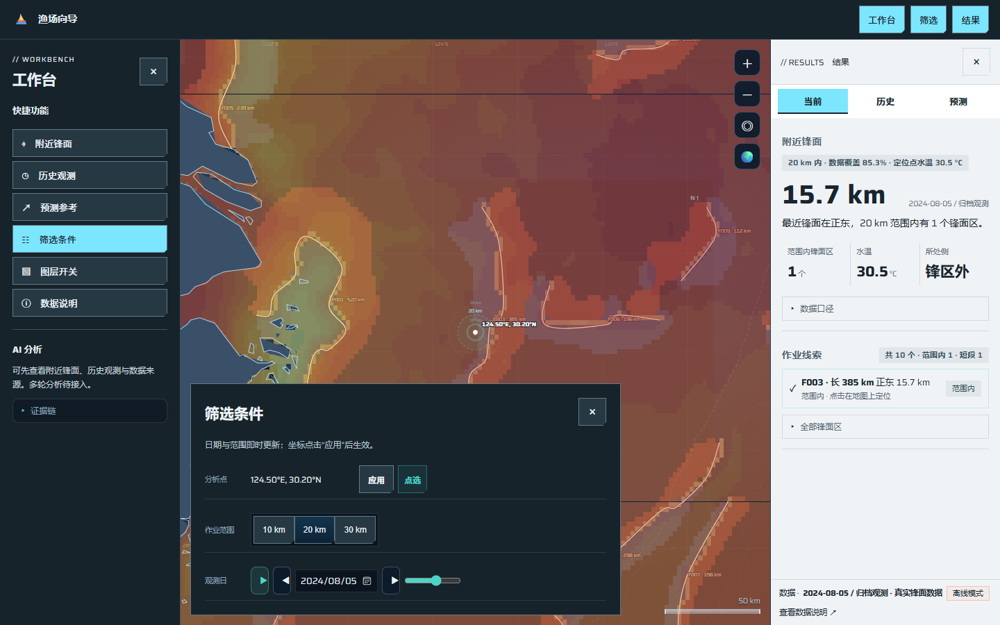
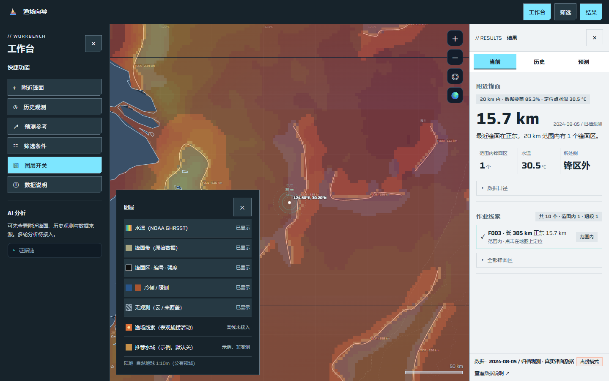
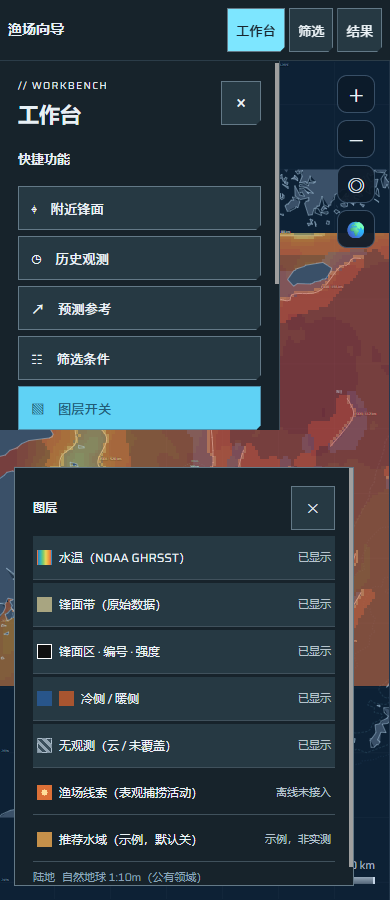

# 统一筛选、图层与条件恢复实施记录

日期：2026-10-25。规格：[UI #24](https://github.com/NingRuo-code/Ocean/issues/24)。实施票据：#26、#27、#31、#32。

设计变体：coldstore / ice；冷灰纸面、冰蓝操作色、紧凑切角与低动效。
主视觉：保留原海洋地图、投影、拖缩与科学图层渲染。
本批重点：独立筛选与图层浮层、应用条件恢复、按日历播放与缺日暂停。

## 交付状态

本批基于主分支 `77f323c6f7e4e632efcb8f61a6e034913c934319`，在 `codex/ui-filter-layers` 完成实现与本地验收。后续合并记录：2026-10-25 按用户要求通过 [PR #282](https://github.com/NingRuo-code/Ocean/pull/282) 合并主分支 `476b7e5d4fbb57d93c6ed76341b73ed00565bc20`，四项票据已实际关闭；下文保留原实现验收证据。#40 的 PR #281 为独立数据工作，不包含在本批，也不是本批前置。

| 票据 | 已实现内容 | 验收证据 |
|---|---|---|
| #26 统一筛选 | 日期、分析点、10/20/30 km 范围合并为独立浮层。日期/范围即时应用；坐标保留草稿，按应用或地图设置点才生效；非法坐标不改结果。点击地图收起浮层且继续查点/设置点，真实拖动、滚轮、缩放不收起。Escape 按上下文返回入口。 | 真实浏览器操作、原地图交互回归、四档布局 |
| #27 图层控制 | 左侧按钮打开实际图层控制，与筛选互斥；原位置仅保留只读图例。快捷任务显式应用默认搭配并反馈，普通刷新保留手动选择；按键支持 Enter/Space。展示未接入、缺资料、加载失败与覆盖未知，空活动缓存不显示就绪色块。 | 实际开关、键盘、刷新及受控空活动响应；小屏实际触摸操作 |
| #31 应用条件恢复 | 仅保存合法的已应用日期、分析点、范围和手动图层。等待启动可用性校验，尊重用户已开始的操作；保留原独立地图视角恢复。过期、损坏、禁用存储明确降级，损坏数据不永久阻断后续合法保存。 | 应用后重开、未应用草稿重开、非法值与存储故障的真实页面回归 |
| #32 缺日播放 | 逐个日历日推进；整日缺资料、未准备或请求失败暂停，展示日期和原因，用户主动继续下一可读日或停止。部分缺测说明限制；区间末尾停止，不自动跳回首日。手动改条件取消播放，旧请求不能重新启动。 | 内部缺日、409、网络重试、延迟返回、末端停止与手动改日回归 |

工作台仍是快捷功能与 AI 两个模块，AI 当前只展示既有说明与证据入口。桌面浮层避开工作台；小屏浮层打开时，上部工作台与下部编辑区独立滚动，触摸测试实际打开 AI 证据，并切换到筛选。地图保留可操作区域。

## 验证结果

| 检查 | 实际结果 |
|---|---|
| 完整工具测试 `node --test --test-concurrency=1 tools/tests/*.test.mjs` | 20 项通过，0 失败；其中本批浏览器回归 12 项 |
| 地图端到端 `node tools/e2e-check.mjs` | 128 项通过，无运行期 JS 异常 |
| 数据自洽 `node tools/data-check.mjs` | 922 项通过 |
| 后端既有回归 | 23 项通过；本批未修改后端 |
| 布局 `node tools/layout-check.mjs` | 1680 / 1440 / 1280 / 390 四档通过 |
| 代表性浮层截图与几何 | 1440 / 1280 指针操作、390 实际触摸操作，共六组；无横向溢出或面板越界 |
| 语法与补丁检查 | 修改的 JS 语法检查、`git diff --check` 通过 |

最初并发启动多组浏览器时，固定等待时间导致控件未就绪便被操作；已改为等待实际启动与偏好校验完成，再受控运行完整工具测试。此修正用于提高测试可靠性，不构成加载性能达标证据。

普通截图与地图回归使用仓库已有的归档展示资料。缺日、未准备、网络故障、空活动和延迟响应采用受控测试输入，分别验证软件行为；它们不能证明真实服务器覆盖、整月研究资格、零活动支持或生产可用性。

### Standards

独立 Standards 复核初次发现 0 项硬性规范问题，提出 1 项非阻断建议：图例判断不应依赖中文显示文字。已改为稳定的就绪枚举，再映射显示文字；复核确认解决，未发现新增硬性问题。

### Spec

独立 Spec 复核初次发现 2 项 P2：空活动缓存经普通刷新误变成“已显示”，以及小屏浮层遮挡工作台 AI 模块。均先以真实浏览器新增回归复现失败，再修复为通过；复核确认两项解决，未发现新引入的实质问题。

## 截图

桌面筛选与图层保留工作台和右侧结果：

小屏独立滚动区域（AI 位于上部工作台滚动区，触摸验证可访问）：

其余截图：[1280 筛选](screenshots/ocean-filters-1280.png)、[1280 图层](screenshots/ocean-layers-1280.png)、[390 筛选](screenshots/ocean-filters-390.png)。结构化记录见 [浮层布局证据](ocean-ui-filter-layer-layout-2026-10-25.json)。

## 边界与后续

- 本批不改变原科学配色、分档或精度，#33/#34 的同源色标与配色验收仍待实施。
- 不增加 A/B/C 重分析、归档准备、在线模型调用；恢复与播放不会触发这些任务。AI 多轮分析、真实活动研究资格、统计与预测仍按各自规格推进。
- 未做生产发布或服务器同步，线上不能据此宣称已经更新。P1 容量与加载优化仍需真实基线、资源实测及候选算法实验。
- 本批软件完成后继续以主线依赖安排当前结果整理、活动入口与色标等首批界面工作；真实资料审计与后续研究工具继续使用各自验收关口。
