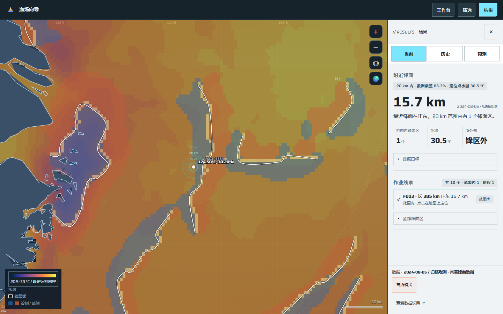
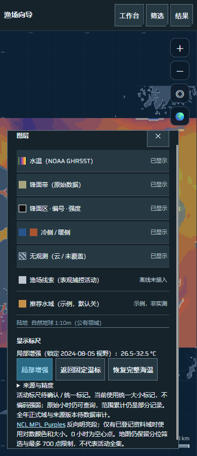

# 科学色标、局部增强与同源查询实施记录

日期：2026-10-25。规格：[UI #24](https://github.com/NingRuo-code/Ocean/issues/24)；实施票据：[#33](https://github.com/NingRuo-code/Ocean/issues/33)、[#34](https://github.com/NingRuo-code/Ocean/issues/34)。

上一批 [PR #283](https://github.com/NingRuo-code/Ocean/pull/283) 已合并，主分支提交 `8a3def01ccd4c7eba0bd2576b57eb2b7d8b0b1d1`，#29/#30 已关闭。本批分支为 `codex/ui-scientific-colors`，不混入独立数据工作 PR #281。

设计变体沿用 coldstore / ice：冷灰纸面、冰蓝操作色、紧凑切角、低动效；保留地图框架、投影、几何、拖缩。科学色带按数据语义使用，操作界面保持既有风格。说明放入原图层浮层，不再新增常驻面板。

## 本批结果与完成边界

| 部分 | 交付 | 当前不足 |
|---|---|---|
| #33 海温 | thermal同源图例、限定固定域、手动局部增强/返回、越界/缺测、粗细片遮罩、编号精简与查询一致 | 全年正式域未冻结；现有半度导出和服务再分档的精度仍有限 |
| #34 活动 | 浅紫对数显示的软件合同、真实小时查询、零值空心、越界标记、无域降级、海温淡化/恢复 | **真实限定活动域未登记，部分完成并保持开放**；合成测试不是真实域证据 |
| 整体 | 实际浏览器与小屏触摸回归、来源可复现、独立双轴复核 | 未部署生产；P0/P1、A/B/C研究、正式预测、AI、全量聚合均按各自任务继续 |

## 海温如何显示与查询

保存了官方 [NCL cmocean_thermal 数值表](https://www.ncl.ucar.edu/Document/Graphics/ColorTables/Files/cmocean_thermal.rgb) 的256行颜色；图面和图例共用同一映射。固定模式同温同色，不按日拉伸。来源、哈希、上游许可说明及本地重建步骤见[色表说明](../../frontend/prototype/palettes/README.md)。

构建器扫描62份既有SST导出，实际编码档位范围为 **20.5–33°C**，资料日期为 **2024-07-01至2024-08-31**，产品为`noaacwBLENDEDCsstDaily v1.0`，分档为0.5°C。清单版本为`sst-export/3803cb0e1ed6`。它是这些导出档位的范围，不能称全年海温极值或研究资格。服务资料、日期或产品不匹配时显示“固定参照 / 适用性待确认”。

手动“局部增强”只取当前可见格面中实际编码的温度，固定该次日期/视野与域；平移、缩放或切日不会偷偷重新拉伸。可主动重新增强或返回固定温标。粗格被细片部分覆盖时，剩余可见部分仍参与局部域；完全遮住的部分不参与。单一温度场采用±0.25°C的显示范围，数据本身不变。

粗细SST片不再靠透明叠加混色：使用相同的细片优先顺序，细片的完整网格足迹遮住粗片，包含细片内部缺测位置。缺水温用纹理、不着温度色；低/高于显示域分别有不同边框。所有获选片共用透明度，活动叠加时可淡化海温，并手动恢复。

查询使用与当前图面相同的SST片，注明网格粒度；整球粗格不会只报未绘出的细片温度。右侧分析点事实仍保留其支持的细片读数。锋面与SST缺测分别表达：真实归档中(120.625,27.475)的锋面缺测不再隐藏有效29.5°C水温。缺SST时不从粗片补细片缺口。默认只为最近及选中主锋面保留编号，原锋面线全部保留。

## 活动如何显示，为什么仍未完成

采用 [NCL MPL_Purples 数值表](https://www.ncl.ucar.edu/Document/Graphics/ColorTables/Files/MPL_Purples.rgb)128行中的0–64行，反向使用较亮半段。只有登记域状态、日期、产品/版本、单位、粒度及证据标识与实际资料匹配时才启动颜色和大小标尺；图例同源并写明小时和log1p。正值用`log1p(hours) / log1p(固定上界)`显示，超过上界只截显示并加越界边框，真实小时不截断。0h为空心点，不进入非法对数、不冒充最小正值。

**提交清单中活动域为pending**。当前默认中性等大标记，不编码强弱，显示“活动标尺待确认”；点击/悬停可读实际小时。缺粒度、单位冲突、重复匹配歧义、无记录与未就绪各自说明。#29仍基于完整返回数组计算圈内部分累计，不从可见点反算，不称全圈总量。

受控合同验证明确使用“合成合同域（非实证）”：相同30h跨日保持相同颜色/大小，另一天3200h仍读3200h；零、空记录、失配版本和非法域分别核验。合成0–100h没有写入真实域，样稿0–1000h也未使用。真实限定域需要P0审计支持范围、来源/版本、许可用途、粒度、零/缺测后登记，并用实际跨日资料复核。

地图仍有旧分位筛选和最多700点限制，界面明确说明，不代表活动全集。未完成的近景全量、远景聚合、跨级守恒和加载/容量算法继续在U2/P1中实施。AIS表观捕捞活动不等于渔获、鱼群密度或作业成功概率。

## 色块与精度检查

检查了源`bin_c=0.5`、前端视野资料再次按半度编码、粗细片覆盖、不同透明度及LOD显示路径。本批修复遮盖与混色，保持原网格与半度真实档位；没有平滑插值、填缺测或伪造更细观测。色带内的颜色插值仅是RGB显示，不增加数据精度。

原地图检查从整页抓取第一个°C数值，会把固定参照域当当日观测极值，已改为核对定位点读数是否属于当日实际导出档位；缺锋面检查也改为分层SST状态，不再要求独立有效SST消失。其余地图回归保留。

## 实际验证

| 检查 | 最终结果 |
|---|---|
| 配色浏览器回归 | 13项通过：固定/局部/返回、跨日、越界、缺测遮罩、编号、真实h、零/未知、版本、触屏、局部粗格、球面、真实独立SST |
| 完整工具测试 | `node --test --test-concurrency=1 tools/tests/*.test.mjs`：49通过，0失败 |
| 原地图交互 | `node tools/e2e-check.mjs`：129通过，0失败，无运行期异常 |
| 数据自洽 | `node tools/data-check.mjs`：922通过 |
| 四档布局 | 1680 / 1440 / 1280 / 390通过 |
| 实际截图操作 | 1440 / 1280指针、390触摸，共6组，图层浮层无越界/横向溢出 |
| 可复现 | 本地重复重建逐字相同；独立临时目录中LF/CRLF的62份输入构建结果逐字相同 |
| 静态检查 | 修改的JS语法和`git diff --check`通过 |
| 后端 | 未改后端，未重跑后端套件 |

SST来源哈希明确采用`source_hash_encoding: utf8-lf`，避免Windows/Linux换行使版本漂移；官方数值色表保存原LF字节。完整清单与色表可无网络重建。归档截图是既有可分发展示资料；活动合同及故障输入是合成测试，分别记证，均不能替代真实月资料、统计、预测或生产验收。

完整回归也复现了触屏地图拖动后浏览器不产生关闭按钮兼容click的问题：按钮已收到touch pointerup，但面板未关闭。幂等关闭操作增加控件内touch pointerup路径，保留原鼠标/键盘click；相同真实触摸回归通过，不靠重试或延时掩盖。

## Standards

独立复核发现1项来源身份可复现缺陷：按工作树字节hash使CRLF/LF产生不同版本。已明确UTF-8/LF契约并添加跨换行重建回归；复核核对62份来源及版本均匹配。最终硬性问题0；没有需要扩展本批范围的判断性结构建议。

## Spec

独立复核发现3项读数一致性问题：球面不同源、局部域漏可见粗格、锋面缺测隐藏SST，均已修复并各有浏览器反例；复核独立运行3项，3/3通过。最终软件阻断问题0；#34真实限定活动域仍未完成，必须保持开放。

轴内汇总：Standards 1项已解决、未解决0；Spec 3项已解决、软件未解决0，另保留真实活动域验收缺口。

## 代表视图

其余视图与尺寸见[六组布局记录](ocean-ui-scientific-color-layout-2026-10-25.json)。本批未同步生产，也未把旧PNG导出、统计报告或其他独立消费路径宣称为统一升级；它们按各自规格后续接入同源证据与显示合同。
