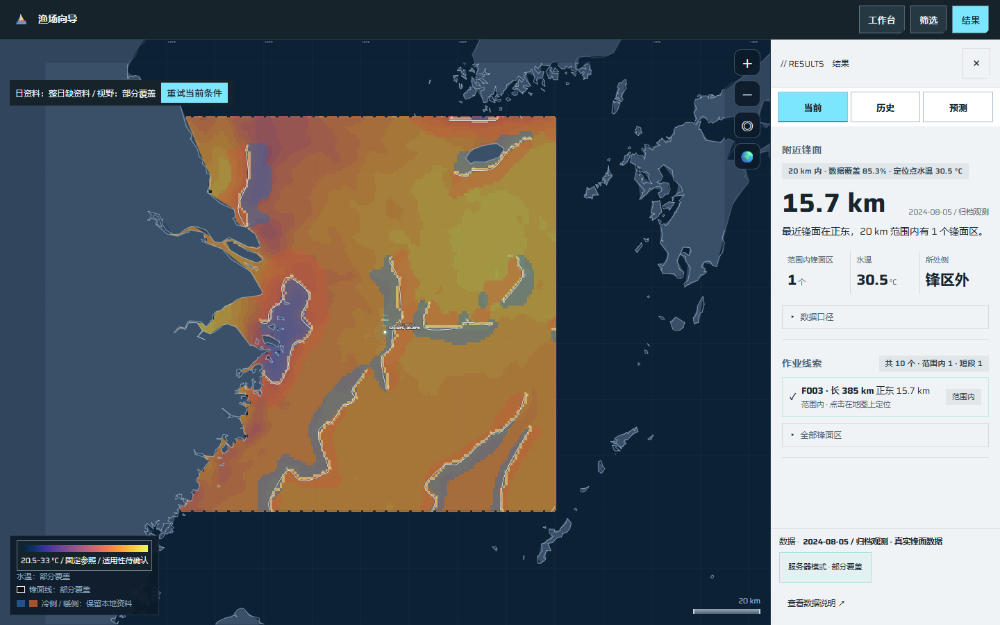
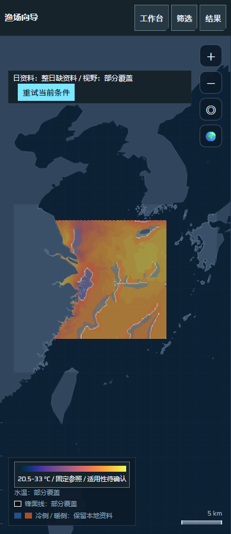

# 前端视窗覆盖与回退交付（#8）

基线为`0a05cca6d7c89382bc5c3d22d2137d783621f01f`，业务固定版本`de8452ec43a37e5be1e02f9c6866a33881e7385a`。复用#6/#7及原地图组件，只完善原页面的数据消费和提示，不重建界面、投影或统计逻辑。

## 当前行为

- 平面按当前视野及原吸附余量请求`/api/viewport`，不再另行预热全球。球面请求可见半球的经纬包围框，含极点时经度仍为全球；这不是逐像素可见裁切，也不是新分块/金字塔算法。
- 核回显日期、bbox、step、覆盖和明确单位；保留meta、来源、coverage和caveats。部分覆盖可直接显示并缓存，不能冒充完整ready；范围外空覆盖、未就绪、无权和失败分别提示。
- 缓存结果与实际绘图片和请求身份绑定，主片保留或窗口淘汰后不会留下“可用但无数据片”的命中。显式重试重新请求当前窗口；离线切换清除服务器数据。
- 历史后1–3日响应用独立方标和图例，保留半径/小时与重叠限制；先核单位、指标及球面可见性。它不写入当日活动格网，不参与当日活动汇总、鼠标格点命中或强弱色标。
- SST保留API两位显示精度，22.17°C不会再次量化成22°C。图例优先采用当前已确认覆盖；日资料或视窗失败而已有本地资料时，显示“保留本地资料”。

## 原浏览器与资料证据

[执行记录](ocean-viewport-display-execution-2026-10-27.json)来自实际原FastAPI本地HTTP服务和原页面。raw/cache为隔离空目录，未下载原档或连接生产；日原档接口404是这套隔离配置的缺输入证据，不推断现服故障。

| 宽度 | 请求bbox | 实际覆盖bbox | 页面结果 |
|---|---|---|---|
| 1440 | 110,20,135,40 | 120,27,128,34 | 部分覆盖，无横向溢出 |
| 390 | 110,10,135,50 | 120,27,128,34 | 部分覆盖，无横向溢出 |

两种宽度均保留三条历史响应记录，日活动资料未就绪，不把两者混为同日活动。小屏结果面板默认收起，模式按钮随面板隐藏；地图上的视窗状态仍可读。

截图与执行记录固定代码版本和SHA256。默认视野随屏幕纵横比变化，所以请求bbox不同，不是资料范围扩大。

## 验证

真实浏览器测试沿原API读取、球面切换、重复窗口、范围外和离线操作。故障反例在同一原页面明确注入：403、错日、单位/指标冲突、22.17°C、可保留主片的受控日响应。它们不冒充原档、真实研究或生产证据。

复核先发现球面背面点、缓存淘汰及单位冲突；截图再发现图例来源矛盾。每项均先有失败断言，再修复并通过。定向浏览器5项通过；Standards/Spec最终均无遗留。

最终固定业务版完整工具/浏览器130项、原e2e129项、1680/1440/1280/390布局检查、data922项均通过；JS语法、差异和本批文档链接检查通过。完整工具包含无Git独立安装原应用。后端业务源码未改，不重复上批完整后端245项验收；本批单独验证原服务浏览器消费及独立发布包兼容。检查过程中补了截图发现的图例问题，因此最终完整套件在最后固定版本上重新运行。

## 尚未完成

#1父阶段仍含其他关口。#46真实性能基线、论文候选收益、3/1/2秒目标、服务器容量和P0原档研究资格均未由本批证明；#47/#228按用户换服安排暂缓旧机实测。全球原档、分块/金字塔、缓存源指纹治理、正式A/B/PRED和生产部署仍按原工作包推进。

显示响应窗口不是同日捕捞、去重活动总量或渔获预测。单个经纬包围框仍可包含球面背面位置，绘制时会排除；后续更精细的可见范围分片应与P1正确性/成本一起比较。
