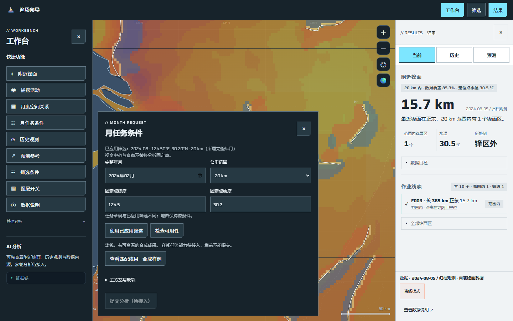
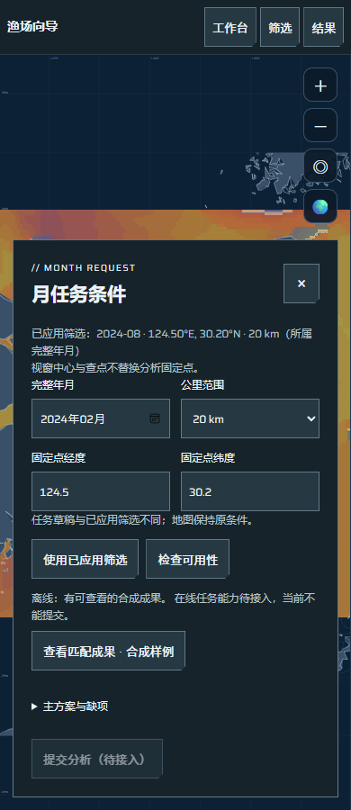

# W02：完整月条件草稿与轻量能力检查

日期：2026-10-26。关联[任务#97](https://github.com/NingRuo-code/Ocean/issues/97)、[规格#95](https://github.com/NingRuo-code/Ocean/issues/95)、W工作包#21。承接已合并W01/PR#290，基线main `038c2e3417ad8f60546ab16c04230249a8c4062c`；实现`dd4b134`，焦点/工具隔离`88704dd`，失败清理`4a5ba75`。合并状态以GitHub为准，未部署生产。

## 已完成的能力

原快捷模块新增“月任务条件”，以独立可收起浮层编辑完整年月、固定点、10/20/30km；沿用筛选浮层样式，仍保留左侧快捷/AI两个模块、原筛选和图层、右侧三个标签及地图。首开用已应用日的所属完整年月、已应用分析点及半径，未应用坐标输入、地图查点和视窗中心不替换任务固定点。

草稿与地图条件分别保存。编辑草稿不改日视图、地图或已读成果；改地图筛选也不自动改草稿，只有“使用已应用筛选”才同步待提交内容。原结果始终保留自身身份及条件，草稿不同时提示待更新；只有明确选择“查看匹配成果”才从原W01读取目录/结果并更新摘要/证据。未实现任务受理，因而没有冒充已受理状态或改写受理快照的入口。

新增既有A路由的轻量GET `/api/query/monthly-analysis/capability`。查询字段为完整年月、经纬度、公里范围及固定`monthly-main`草稿方案标签；这个标签只是唯一草稿选项，不是已完成科学主方案冻结。响应绑定规范化条件、请求身份、核实时间、能力检查身份，复用原公开冻结成果及逐源权限投影，仅列精确匹配条件的结果引用。

当前真实P0整月资格未交接，实际输入/方法/参数/资格版本均未知，真实在线任务能力未接入，`can_submit=false`，执行权限未核实。界面如实显示这些缺项；已有合成成果可读与真实新任务可提交分别表达。原A01合成受控执行和离线脚本成功不使本入口可执行，未新增另一套审计/资格或计算引擎。

字段缺项/超界定位到输入框；离线、401/403、登记源503、旧服务404、坏合同和模式改变有分别说明。服务失败不自动拿离线合成成果当成功；其他已就绪图层/原结果保留。修改条件使旧预检失效，旧响应不能覆盖新条件，读回条件/版本不符拒绝。检查/打开/编辑均不提交任务、不扫描原档、不下载源资料或调用AI。

共享有界公开读取助手供W01/W02两个实际消费者复用；浏览器服务夹具也复用同一个实际FastAPI启动器，没有测试专用业务服务。

## 实际证据

| 操作 | 独立已知事实与实际结果 |
|---|---|
| 首开 | 已应用2024-08-05、124.5/30.2、20km → 草稿完整2024-08；未应用126/32不进入草稿 |
| 将草稿改为2024-02并检查 | 实际GET回显相同条件，找到一份公开CC0合成引用；真实资格未交接、四类版本null、不能提交 |
| 明确查看甲 | 原月结果H40、原ID保留；查看之前检查不自动加载该结果 |
| 草稿改为125.5/30.2 | 甲ID和40h仍保留，并提示任务条件已改变，待更新 |
| 明确查看乙 | 乙原ID与0h显示；全局仍为2024-08-05、124.5/30.2、20km；无POST或受理 |
| 故障/快速修改 | 403、503、坏条件回显不成为离线成功；旧3月响应不能覆盖新2月检查 |

实际服务/Edge的原请求、能力回包、原成果保留及显式新选择见[脱敏执行证据](ocean-workbench-month-draft-execution-2026-10-26.json)。这是已知合成聚合的界面软件证据，不是真实P0/A研究成果或正式任务中心证据。

截图为同一合法离线合成登记。小屏可先收起工作台、单独编辑草稿，按Esc回到可见顶部按钮；父工作台仍打开时回到原快捷按钮。字段、按钮不靠第三个常驻模块放置。

## 验证

| 检查 | 实际结果 |
|---|---|
| 新能力API | 5项通过：规范回显/身份、精确条件匹配、非法字段/变体拒绝、登记缺失503、私有源不泄露 |
| 月度浏览器定点 | 草稿6项与原阅读7项串行13项通过；新增隐藏父面板焦点反例先红后绿 |
| 完整后端 | 158项通过 |
| 完整工具 | 首次与最终均85项通过，0失败；末次包含隐藏父面板焦点回归 |
| 原界面e2e | 隔离后129项通过且退出0，产品断言保持 |
| 布局/数据 | 四宽布局、922项数据检查通过；1440/390新截图人工查看 |
| 静态与包 | ruff、JS语法、离线生成核对、diff及敏感边界检查；wheel包含新接口模块和原冻结夹具，字节一致，未新增依赖 |

原e2e工具固定9337与上一轮未退出浏览器重复连接（实际核实IPv4/IPv6分别属于不同轮），读到旧日期/视窗，造成两项初始视图断言失败；更换目录仍误连。现改为每轮唯一临时目录及动态端口，连接自身DevToolsActivePort，正常与异常均经统一清理，不再忽略失败退出码。原产品地图及断言未修改。

工具实际启动失败返回1并清理目录；实际最小页面初始化ReferenceError返回1，关闭本轮浏览器/目录；Windows短暂文件占用用有界重试，最终专属目录数为0。正常129项全过并退出0。两种故障夹具仅验证工具生命周期，不是业务替身或研究证据。早期仅在成功末尾清理、立即退出触发Windows关闭异常的尝试亦保留日志指纹；以最终清理实现和实际退出结果为准。

## Standards

主体初审未发现硬规范违规。追加工具审查提出1项P2：启动/CDP异常仍可能绕过清理，延续旧浏览器残留。已改统一try/finally、启动错误捕获、移除中途强退、限定本轮端口/目录并有界处理短锁，实际失败/正常路径分别验证。`4a5ba75`定点复核通过，最终0项未解决；无值得扩大本批范围的判断性重构项。

## Spec

初审与两次追加定点检查均通过，未发现可操作规格缺陷或范围扩张。真实资格/版本/在线受理未交接均如实保留；共享读取助手与验收工具修复有实际消费者和失败证据。实施自查发现的隐藏父工作台焦点问题另以真实浏览器先红后绿修复。

两轴分开记证，审查者按资源隔离要求只读复核代码/合同，没有另启并发浏览器；实际浏览器结果来自本批串行验收。

## 接续与不足

- W03/#98仍需A/#71正式真实整月成果，W04/#99仍需A/#70版本复用合同与最小本人持久受理，不能由本批恒false状态放行执行。
- 真实P0覆盖/粒度/几何/零值/资格、正式A/B/C、统计区间与预测继续按原任务推进。公开合成登记只证明可读及软件隔离，不证明实际可用年月/海域。
- 主方案/实际版本缺项不是要求使用者凭空填写；须由A/P0正式交接后接入服务复核。当前变体关闭，无虚构执行权限、排队或成功状态。
- 未启用生产、下载原档、增加付费调用或更改数据公开范围；父级#95/#21保持开放。

使用说明：[月草稿与轻量核对](../data/workbench-month-draft.md)。
