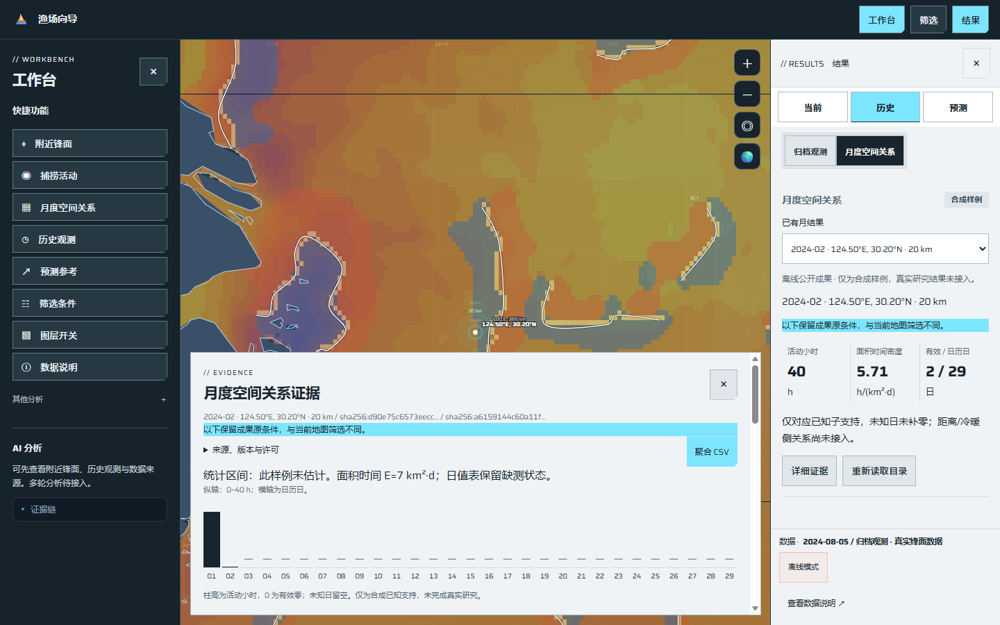
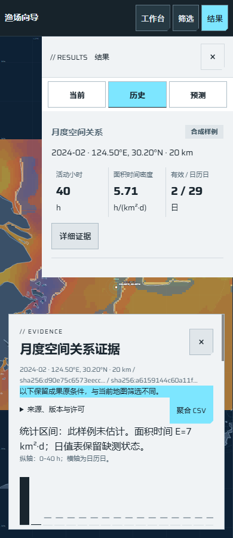

# W01：已有月成果进入工作台阅读

日期：2026-10-26。关联[任务#96](https://github.com/NingRuo-code/Ocean/issues/96)、[规格#95](https://github.com/NingRuo-code/Ocean/issues/95)、W工作包#21。基线main `01a4aee86c4de67fddc96ca832420699c7c7da29`；实现`d7e6c3b`，审查修复`fca0f38`。本记录描述已验收软件，合并状态以GitHub为准，未部署生产。

## 已完成的能力

从原左侧快捷模块打开“月度空间关系”，在原右侧历史标签中查看已保存月成果。原归档观测保留独立子视图，当前/历史/预测主标签、左侧紧凑AI、独立筛选/图层和地图框架均保留。B事件及C多区域分别说明待正式成果接入。

右侧只显示活动小时、面积时间密度、有效/日历日、原年月/固定点/公里范围及短说明；默认不展开底部。底部沿用现有证据面板，按需看逐日原值柱图/表、未估计区间、可展开的身份/来源/许可和聚合CSV。小屏看证据时收起次要选择和页脚，保留关键摘要，收起后恢复。地图拖缩、选点可用；读取旧成果不修改当前筛选。

在既有A路由增加两个只读GET：公开月结果目录与按原结果ID取公开投影。服务读取现有冻结合成聚合，先核逐源公开声明，再白名单投影；核原导入SHA、完整日历、版本/单位及原H/E一致性，不执行分析或修补源值。保留原结果身份，投影另有身份。离线文件通过同一适配生成，API/离线直接核一致。

服务失败/拒绝不会自动切换离线包；权限未知不公开，私有结果服务端拒绝。浏览器拒绝后清除旧值及下载，快速选择有请求代次隔离。新快照发布时关闭等待期间重开的旧证据，避免身份标题和内容混用。详情及切标签不提交任务、归档准备、原档下载或模型调用。

## 证据与真实边界

| 既有合成结果 | 独立已知事实 | 实际显示 |
|---|---|---|
| 甲：2024-02、124.5/30.2、20km | H40/E7/D2，日历29；第二日0、第三日未知 | 40h、5.71 h/(km²·d)、2/29日；29行，27未知日不绘值 |
| 乙：2024-02、125.5/30.2、20km | H0/E4/D1，日历29 | 有效零明确为0，未知不补零 |
| 全部未准备反例 | 无可核对支持 | 小例API保持H/E未知，不当零 |

隔离环境运行实际FastAPI应用及原静态前端，真实Edge操作只产生目录/详情GET；摘要、表、图及CSV身份一致，未发生POST。代码指纹、请求投影、CSV指纹及独立预期见[脱敏执行证据](ocean-workbench-month-reading-execution-2026-10-26.json)。正常实际服务与受控403、坏合同、迟到响应测试分别记录；截图为已许可离线同源聚合。

两份来源均为自建CC0合成，只有极少数已知支持日。没有新增真实整月A研究，没有距离带/冷暖侧统计或置信区间，不声称证明锋面与实际渔业活动关系。原单元、私人路径、细网格不进入新公开投影。固定本地公开登记文件由维护者管理，不是任意用户上传/公开授权平台。

## 验证

| 检查 | 结果 |
|---|---|
| 后端月结果读取 | 13项通过：GET身份、私有/未知许可、篡改/单位/假零/指标矛盾、缺失源、全未知及离线/API一致 |
| 月度真实浏览器 | 最终7项通过：实际服务、手动阅读、原条件、零/未知、CSV、键盘/Esc、触摸/缩放、403清除、坏合同、迟到及审查交错反例 |
| 完整后端 | 153项通过 |
| 完整工具 | 最终79项通过，0失败；首次78项通过，审查新增交错反例后复跑 |
| 既有界面e2e | 129项通过，无运行期JS异常 |
| 布局 | 1680/1440/1280/390四宽通过；新阅读1440/390截图人工查看 |
| 数据、静态及包 | 数据922项；ruff、Node语法、离线生成核对、diff检查通过；wheel包含新模块/原冻结夹具且字节一致，未新增依赖 |

在已确认接缝先记录入口不存在及身份交错失败，再实现/修复。完整套件和受控故障不替代真实研究资料及生产运行证据。

末次复跑曾在与独立浏览器取证同时运行时，出现1次旧小屏触控按钮命中失败（78/79）；保留失败记录，原断言未放宽。该用例单独复测通过，停止其他浏览器后完整79项通过。尚未验证并发浏览器触控稳定性，不将该项宣称为容量或并发验收。

## Standards

初审无阻断性硬规范问题；提出1项P3：导出器未统一捕获投影内部AttributeError/ArithmeticError。已补通用失败边界，定点复核`fca0f38`通过。最终0项未解决，无值得扩大本批范围的判断性重构项。

## Spec

初审提出1项P2：切换读取时重开旧详情，新内容返回后底部身份仍旧。真实浏览器回归先复现失败，再修复发布时关闭旧证据；明确再打开后身份、来源、表格与CSV属于新成果。审查者独立重放同路径通过，最终0项未解决；未发现范围扩张。

两轴分别记录，最初发现与最终验证均保留。

## 接续与不足

- 下一项W02/#97：继承已应用年月/点/半径生成任务草稿，区分未应用坐标、地图条件、草稿和已读结果；没有提交前不计算，能力/资格未知如实显示。
- W03/#98仍等待A/#71真实成果交接；W04/#99的本人权限、持久受理/幂等及任务执行尚未实现，不把公开只读服务算成最小任务中心。
- P0资格、真实GIS/活动资料、正式A/B/C统计、预测、完整AI、报告与生产各有独立任务。W01合成阅读不解除其资料阻塞，也不关闭#95/#21。
- 源和公开合同必须按后续真实交接扩展；当前读取故意仅接受已登记合成合同，不自动推广到真实来源或未知许可。

使用及接口说明：[月成果阅读说明](../data/workbench-month-reading.md)。
