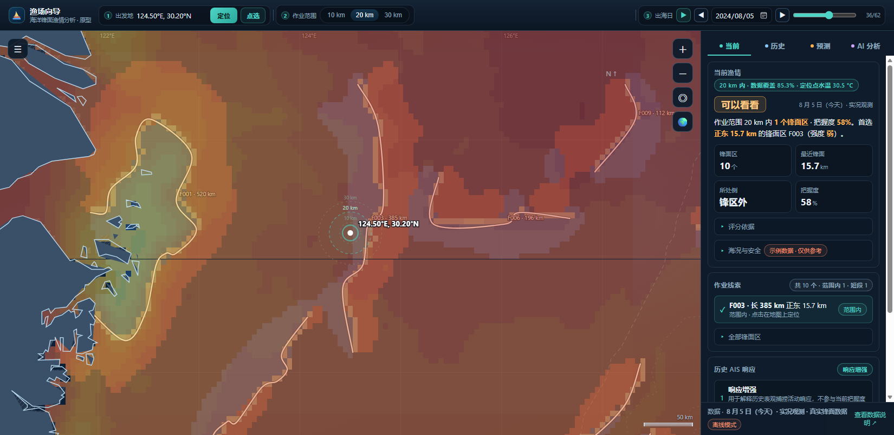
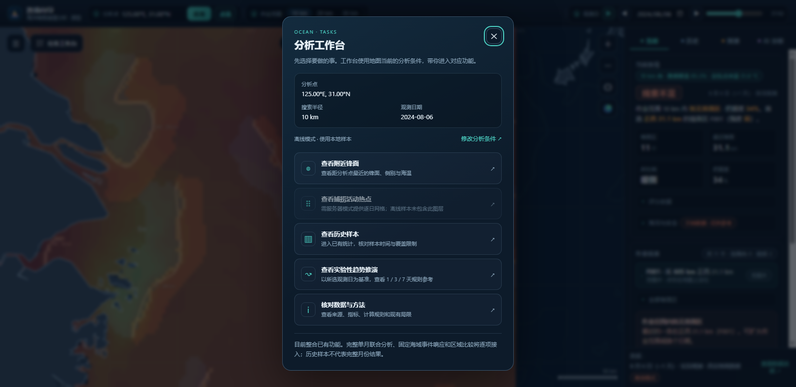

# U1 地图操作与任务工作台首版

Issue：[#15](https://github.com/NingRuo-code/Ocean/issues/15)，属于执行总纲 #13。

状态：2026-10-28按U1首版边界重新验收。已采用后续合入的非模态两模块工作台、原筛选和精简结果，本批补齐已应用条件摘要、地图操作说明及活动名称统一；[当前实施与证据](../../reports/ocean-u1-delivery-implementation-2026-10-28.md)。最终合并/关闭以GitHub为准，未部署生产。完整Q47/U2、真实活动支持、正式A/B/C及后续工作台执行仍分别验收。

以下为2026-10-23及以前的历史记录；旧未勾选项、PR和本地工具可用性仅描述当时状态，不作为当前进度。

## 历史批次：U1.1 非模态工作台（2026-10-23）

规格依据：Q47 正式界面实施规格，主规划分支 `docs/specs/ocean-frontend-redesign-draft-2026-10-23.md`。用户已确认整套理解，不再等待重复批准。

- 桌面使用原主区 flex 布局把工作台停靠左侧，地图适应剩余宽度；原生 dialog 使用非模态 show，无遮罩和焦点锁。
- 入口按钮可打开或收起。面板内 Esc 收起并回到入口；焦点已到地图时，Esc 沿用地图操作，不抢回面板。
- 展开期间真实指针拖动、滚轮缩放、地图点选仍可用；点选同步唯一条件。坐标输入与原半径/日期路径未另建副本。
- 小屏面板可收起且不越界；本项只证明侧边面板布局，不等于手机完整流程已验收。

本次实际检查：data-check 923/923；e2e-check 145/145（含新增实际拖动、滚轮、点选、焦点及非模态检查）；layout-check 30 项无失败（含 1280、960、390 宽侧边面板）；JS 语法检查与 diff 空白检查通过。新增检查针对工作台共存；旧测试里的四页签/评分断言是现存未迁移界面的回归，不能证明它们符合最终 Q47 规格。

截图：[首个侧边面板改动](../../reports/screenshots/workbench-side-panel.png)，来自本地离线样本，仅用于交互与布局检查，不是配色、科学关系或性能对比。

后续分解：U1.2 两模块与入口；U1.3 统一筛选/图层浮层；U1.4 右侧三入口与事实摘要、底部详情；U2 科学色标/时间/显示密度；P1 性能专项。后三项不能由本次面板改动标记完成。

远端边界：本轮未更新 Issue/PR、未合并、未部署。当前未检测到 gh CLI，按协作流程先保留本地票据与实际检查；远端同步没有完成，不把本地变更计为已发布。

下文为旧首版和需求变更历史，旧模态检查不作为当前非模态完成依据。

## 2026-10-23 交互要求变更（Q34/Q35）

用户明确否定居中且不能操作地图的工作台，要求按钮呼出/收起的非模态侧边面板。这是当前首版必须完成的修改，不能推迟到完整 AI。

- [x] 居中模态弹窗改为可呼出/收起的侧边面板，无阻断地图的全屏遮罩和焦点锁定。
- [x] 展开工作台时可拖图、缩放和选点；工作台位置、范围和时间同步共享条件。
- [x] 呼出/收起不重置分析条件；关闭与 Esc 采用适合非模态交互的焦点规则，不打断已经移到地图的操作。
- [ ] 右侧摘要压缩且可隐藏；详细分析按需呼出，底部分析区默认收起。新分析能力待对应计算完成后接入，不提前宣称已实现。
- [ ] 按新要求更新行为/布局检查、截图和 PR 描述，重新验证。下方旧弹窗检查保留为历史证据，不算新交互验收通过。

本轮只记录规划变更，未修改应用、未更新远端 Issue/PR、未重新运行界面检查；旧 PR 不应按当前界面最终方案直接合并。

## 问题与本次行为

原界面功能分散，新用户需要先理解页签和图层。此次保留地图观测作为首页，增加“任务工作台”按钮，通过弹层展示当前分析点、搜索半径和观测日期，引导进入已有附近锋面、活动热点、历史样本、趋势推演和数据说明。

工作台复用已有全局条件与功能，不另建计算副本。修改条件会关闭工作台并将焦点移到原坐标输入；选择任务关闭弹层并进入对应功能。原有历史和 AI 证据面板保留，完整单月联合分析、固定海域事件研究与区域比较待对应任务完成后接入。

热点入口在离线时说明逐日网格不可用并禁用；服务器模式下复用现有图层取数路径。服务器可访问不等于某天网格一定有效，实际覆盖继续由基础数据任务 #14 核实。

顶栏改用“分析点”“观测日”，应用坐标与回到分析点分别说明操作含义。活动图层称“捕捞活动热点”；现有预测卡片标“实验性趋势推演”，保留原规则数值并说明独立验证缺口。

## 验收结果

- [x] 地图仍为默认首页，工作台默认关闭。
- [x] 按钮可打开和关闭；Esc 可关闭并恢复入口焦点；原地图 Esc 逻辑不抢占弹层。
- [x] 修改条件回到唯一坐标输入，不创建第二套位置/日期/半径控件。
- [x] 换点、范围和日期后，工作台显示最新条件；任务跳转保留条件。
- [x] 离线活动入口不可用；模拟服务器验证任务调用所选日期的原有取数路径，没有生成虚假网格。
- [x] 原有数据与行为回归通过，弹层在 1280×800 内可见，在 960×640 内可滚动且无横向裁切。
- [x] 现有趋势明确标实验性，分析算法与分数保持原计算。
- [ ] 用户审核合并。
- [ ] 线上部署与验证：独立安排，不计入本地完成。

## 实际检查

基线：阶段分支 `9ecbf3e`。

| 检查 | 修改前 | 修改后 |
| --- | --- | --- |
| `node tools/data-check.mjs` | 923/923 | 923/923 |
| `node tools/e2e-check.mjs` | 128/128 | 140/140 |
| `node tools/layout-check.mjs` | 两种宽度无失败 | 两种原有宽度及新增弹层检查无失败 |
| `node --check frontend/prototype/prototype-fishing.js` | 未单独记录 | 通过 |
| `git diff --check` | 无改动 | 通过 |

本轮同时将 e2e/layout 检查的退出状态改为反映实际断言结果；失败不再以进程成功退出掩盖。一次回归中旧顶栏标签断言失败，更新为本轮明确的研究用词后重跑通过。

后端代码未修改，没有运行 pytest；没有以模拟服务器测试代替真实服务器或真实 AIS 覆盖验证。

## 截图证据

修改前地图：

新增任务工作台：

两图来自不同位置/日期的离线操作场景，用于证明入口与弹层布局，不作为海洋数据变化或性能对比。

## 残余事项与边界

- #16 继续完成 NCL 配色、时间入口重组、半径档位与更完整的加载状态；本次没有宣称这些已完成。
- #21 在 A/B/C 通过后逐项接入新分析；本次只提供已有功能的任务入口。
- 工作台尚无自然语言调用或深入结果问答，不以 AI 标题暗示已接模型。
- 保留离线功能与原有聚合数据，不提交原始 AIS、细网格或运维材料。
- 本次未声明任何性能加速倍率，统一性能基线属于 #17。
